# Ralix Real Estate CRM — Production-Grade Enterprise Architecture Blueprint

> **Document Version**: 5.1.0-HARDENED
> **Document Status**: Architecture Hardening Draft — **Proposed** (supersedes 4.0.0-ENTERPRISE; not yet formally approved)
> **Last Updated**: 2026-09-29
> **Scope**: Multi-Tenant Real Estate CRM, Inventory Lifecycle, Financial Integrity & Scoped Authorization Platform
> **Audience**: Backend, Frontend, Database, Security, DevOps, QA engineers; solution architects; technical leadership

## Architecture Revision Summary (4.0.0 → 5.0.0)

This revision preserves the domain coverage of 4.0.0 and hardens it. Substantive changes:

| # | Change | Reason |
| :-- | :--- | :--- |
| 1 | **Lead state decomposed** into five independent dimensions (lifecycle, operational status, temperature, SLA state, disposition). `LeadUrgency` is removed from the architecture. | 4.0.0 encoded lifecycle, operations, temperature and SLA in two overloaded enums, making state unreportable and self-contradictory. |
| 2 | **Lead no longer owns downstream domain state.** `SiteVisit`, `Booking`, `PropertyUnit`, `Payment` are authoritative for their own processes. | 4.0.0 implied `Lead.BOOKED` / `Lead.SITE_VISIT_DONE` were authoritative, competing with the inventory and booking state machines. |
| 3 | **Tenancy invariant made explicit**, with a closed list of entities carrying `organizationId` directly vs. inheriting it deterministically. | 4.0.0 claimed "every business table includes `organizationId`" while the reference schema relied on parent inheritance in several places. |
| 4 | **Authentication & session architecture added** (§6), resolving the JWT-vs-revocable-session contradiction, plus authorization cache invalidation via `authorizationVersion`. | 4.0.0 implied long-lived JWT claims and revocable enterprise sessions simultaneously, with no revocation path. |
| 5 | **Multi-organization membership model chosen** (`OrganizationMembership`) — marked **Proposed**. | 4.0.0 referenced "Org switch" while modelling a single `User.organizationId`. |
| 6 | **Concurrency architecture added**: inventory locking invariant, optimistic concurrency (`version`) on mutable aggregates. | 4.0.0 had an inventory state machine but no statement of how two simultaneous holds are prevented. |
| 7 | **Transactional Outbox + domain events added** (§22–23). | 4.0.0 wrote to BullMQ with no protection against "DB committed, enqueue failed". |
| 8 | **Webhook idempotency hardened** to `(provider, providerEventId)` with an explicit processing state machine and DLQ. | 4.0.0 used a single global `eventId @unique`, which collides across providers. |
| 9 | **Financial immutability, cost-sheet versioning and pricing-rule versioning added** (§15, §17). | 4.0.0 treated cost sheets and payments as mutable CRUD, making historical bookings unexplainable after a price change. |
| 10 | **PII precedence rule defined** (organization policy ∧ capability), plus logging/export protection. | 4.0.0 defined masking but not the interaction between org policy and capability. |
| 11 | **Canonical terminology fixed**: `organizationId` everywhere; `req.tenantId` is retired. | 4.0.0 used both terms interchangeably. |
| 12 | **Added**: failure/recovery matrix, DR, expand-contract migration, error contract, rate limiting, search, caching, object storage, testing strategy, ADRs, invariants, readiness checklist. | Required for the document to be implementable without re-deciding fundamentals. |

## Revision Summary (5.0.0 → 5.1.0) — consistency repair

A five-area consistency audit of 5.0.0 found 18 defects (4 blocking). All are resolved in this revision; no finding was answered with a note acknowledging the problem.

| Area | Fix |
| :-- | :--- |
| **Decision A** — lead cancellation | Added `LeadLifecycleStage.CANCELLED` (terminal, post-conversion, reachable only from `WON`). `WON → LOST` is explicitly illegal — `LOST` means never converted, `CANCELLED` means converted then cancelled. The lead never decides this: it reacts to `Booking.status = CANCELLED` via the `BookingCancelled` event (§16.2). Conversion reporting now separates gross from net conversion (§33.3) |
| **Decision B** — payment reversal | Removed `PaymentStatus.REVERSED`. New lifecycle `PENDING → PROCESSING → SUCCEEDED → REFUND_PENDING → REFUNDED` (§17.3). A refund is a **new compensating `Payment` row** linked by `reversalOfPaymentId`; the settled original is never mutated (§17.4) |
| Tenancy classification | `User` reclassified **Class G (global identity)** — it must never carry `organizationId`. Four-class model (Root / A / B / G); every entity classified exactly once; `OrganizationSetting`, `PricingRuleVersion`, `CommissionRule`, `AttributionHistory` added to Class A; `Organization` classified as Root; every Class B entity now declares its full parent path (§5.2–5.4) |
| Missing state machines | Added `InventoryHold` (§14.5) and `Payment` (§17.3) lifecycles. Hold is now `CONSUMED` at booking **start**, not confirmation — removing the contradiction where a legitimate long-running booking had its hold expired underneath it |
| SLA cycle | Added `BREACHED/RESOLVED/DUE_SOON → WITHIN_SLA` on new assignment (§11.6). SLA is measured **per assignment**, so a failover backup owner gets their own window while the original breach stays in history |
| Site visit | `RESCHEDULED` gained `CANCELLED`, `NO_SHOW` and self-transition paths (§12) |
| Capabilities | Added `FOLLOWUP_CREATE/MANAGE`, `SITE_VISIT_SCHEDULE/COMPLETE/CANCEL`, `COST_SHEET_APPROVE`, `ATTRIBUTION_MANAGE`, `COMMISSION_APPROVE`, `PAYMENT_RECONCILE` — every capability referenced in prose now exists in the matrix (§7.7) |
| Transaction boundaries | Added `Release Unit`, `Create Booking`, `Cancel Booking`, `Refund Payment`, `Confirm Duplicate`; `Assign Lead` now resets the SLA window (§35.1) |
| Schema ↔ prose | Restored `WhatsAppTemplate` (the dangling `templateId` target) with provider-mirrored approval state; `OutboxEvent.eventType` is now the closed `DomainEventType` registry rather than a free-form string (§47) |
| Failure matrix | Added **provider-charged-but-commit-failed** (the money-taken-no-record case), we-recorded-but-never-charged, duplicate booking/payment submission, permission revoked mid-session, and membership/session revocation (§43). Intent-first ordering added to §17.6 so a charge can never exist without a local row to reconcile against |

## Plotted Real Estate & Land Development Extension (5.1.0-HARDENED Extension)

This extension introduces native architecture support for **plotted real estate and land development projects** alongside constructed vertical developments (apartments, villas, commercial units) without conflating domain models or duplicating downstream business infrastructure:

| Area | Architectural Addition | Rationale |
| :-- | :--- | :--- |
| **Inventory Abstraction & ADR-012** | Clean separation between vertical constructed units (`PropertyUnit`) and land plot assets (`Plot`), preserving specialized attributes without overloading. | Prevents apartment attributes (`floorNumber`, `carpetAreaSqFt`, `BHK`) from corrupting land records, while avoiding untyped JSON property bags (§13, §45). |
| **Hierarchy & Classification** | Added `ProjectType` (`RESIDENTIAL_APARTMENT`, `RESIDENTIAL_VILLA`, `ROW_HOUSE`, `COMMERCIAL`, `PLOTTED_DEVELOPMENT`, `MIXED_DEVELOPMENT`) and structural entities: `PlotDevelopmentPhase` and `PlotLayoutBlock`. | Enables flexible township hierarchies (`Project → Phase → Layout/Sector/Block → Plot`) with optional intermediate levels (§13.B). |
| **Measurement & Geometry** | Decimal-based multi-unit measurement model (`AreaUnit`: `SQ_FT`, `SQ_M`, `SQ_YARD`, `ACRE`, `HECTARE`, `GUNTHA`) with stored canonical values and separate dimensions (frontage, depth, road width). Optional GIS/polygon boundary references. | Eliminates floating-point rounding errors and invalid frontage × depth approximations on irregular land parcels (§13.B.3–4). |
| **Regulatory vs Commercial Separation** | Separated commercial inventory availability (`UnitAvailability`) from legal readiness (`PlotRegulatoryStatus`: `DRAFT`, `UNDER_REVIEW`, `APPROVED`, `MARKETABLE`, `BOOKABLE`, `REGISTRATION_ELIGIBLE`, `SUSPENDED`). | Prevents legally unapproved plots from reaching customer booking or agreement execution, while supporting early pipeline marketing (§13.B.6, §23). |
| **Concurrency & Single Active Hold** | Database-enforced mutual exclusion on `InventoryHold`: partial unique index on `unitId WHERE status = 'ACTIVE'` and `plotId WHERE status = 'ACTIVE'`, with a strict check constraint enforcing `unitId XOR plotId`. | Guarantees that at most one active hold can exist for any plot or unit at any instant (§14, §44 Invariant 21). |
| **Plot Pricing & Cost Sheets** | Plotted pricing engine supporting per-sq-ft, per-sq-yd, per-sq-m, and fixed pricing, with itemized base land value, development charges, infrastructure charges, and premiums (corner, facing, road width). `CostSheet` snapshots the exact commercial terms. | Land pricing structures differ fundamentally from floor-rise and carpet-area models, yet must remain immutable after issuance (§15.4). |
| **Plot Booking & Handover** | Booking aggregates associate with exactly one inventory asset (`unitId XOR plotId`). Post-booking lifecycle extends to agreement execution, registration, possession, and handover without construction-linked slabs. | Reflects land conveyance legal milestones while reusing the core financial ledger and payment milestone engine (§16.4). |
| **Controlled Bulk Import & Lineage** | Staged, transactional CSV/Excel bulk import pipeline with duplicate detection and validation audit. Controlled administrative subdivision/merge lineage model (`PlotSubdivisionLineage`) marked Proposed. | Land developers manage thousands of plots per phase; silent in-place changes to transacted plot boundaries are prohibited (§13.B.9–10). |

**Decisions deliberately left open** are marked `TBD` or `Status: Proposed` throughout and collected in §45. They are not invented here: token lifetimes, RPO/RTO, the multi-org rollout, jurisdiction-specific land registration rules, and GIS integration providers require business sign-off.

---

## Table of Contents

**Foundations** — [1. Executive Summary](#1-executive-summary) · [2. Architecture Principles](#2-architecture-principles) · [3. System Context](#3-system-context) · [4. Layered Architecture](#4-layered-architecture)

**Security & Tenancy** — [5. Multi-Tenancy](#5-multi-tenancy) · [6. Identity & Authentication](#6-identity--authentication) · [7. Authorization & Data Governance](#7-authorization--data-governance)

**Domain** — [8. Domain Ownership](#8-domain-ownership--source-of-truth) · [9. Customer](#9-customer-architecture) · [10. Lead](#10-lead-architecture) · [11. Lead Assignment & SLA](#11-lead-assignment--sla-architecture) · [12. Site Visit](#12-site-visit-architecture) · [13. Real Estate Inventory & Plotted Development](#13-real-estate-inventory-architecture) · [14. Inventory Concurrency](#14-inventory-concurrency--locking) · [15. Pricing & Cost Sheet](#15-pricing--cost-sheet-architecture) · [16. Booking](#16-booking-architecture) · [17. Payments](#17-payments--financial-integrity) · [18. Channel Partner](#18-channel-partner-architecture) · [19. Communication](#19-communication-architecture)

**Distributed Systems** — [20. External Integrations](#20-external-integration-architecture) · [21. Webhooks](#21-webhook-architecture) · [22. Domain Events](#22-domain-event-architecture) · [23. Transactional Outbox](#23-transactional-outbox-architecture) · [24. BullMQ / Redis](#24-bullmq--redis-architecture) · [25. Idempotency, Retry & DLQ](#25-idempotency-retry--dead-letter-architecture) · [26. Workflow Automation](#26-workflow-automation-architecture)

**Platform** — [27. API](#27-api-architecture) · [28. Search](#28-search-architecture) · [29. Caching](#29-caching-architecture) · [30. Object Storage](#30-object-storage-architecture) · [31. PII & Security](#31-pii--security-architecture) · [32. Audit](#32-audit-architecture) · [33. Reporting](#33-reporting-architecture) · [34. Database](#34-database-architecture) · [35. Transaction Boundaries](#35-transaction-boundaries) · [36. Concurrency](#36-concurrency-architecture)

**Operations** — [37. Observability](#37-observability) · [38. Testing](#38-testing-architecture) · [39. Deployment](#39-deployment-architecture) · [40. Backup & DR](#40-backup--disaster-recovery) · [41. Migration](#41-migration-architecture) · [42. Performance & Scaling](#42-performance--scaling) · [43. Failure & Recovery Matrix](#43-failure--recovery-matrix)

**Governance** — [44. Non-Negotiable Invariants](#44-non-negotiable-system-invariants) · [45. Architecture Decision Records](#45-architecture-decision-records) · [46. Readiness Checklist](#46-architecture-readiness-checklist) · [47. Prisma Reference Schema](#47-prisma-reference-schema)

---

# 1. Executive Summary

Ralix is a multi-tenant enterprise Real Estate CRM managing the end-to-end journey — from **Meta Ads lead generation** through qualification, site visits, inventory holding, cost-sheet negotiation and booking, to **construction-linked or land-registration payment collection, possession/handover and brokerage payout**.

The system natively supports two first-class asset classes:
1. **Constructed Inventory**: Apartments, villas, row houses, and commercial units organized under towers and floors with construction-linked payment milestones (CLP).
2. **Plotted Real Estate & Land Developments**: Residential plots, NA plots, commercial/industrial plots, farm layouts, and phase-wise gated plotted townships organized under phases, layout sectors, and blocks with conveyance/registration milestones.

The system serves multiple independent real-estate organizations from one deployment. Its defining constraints are therefore not CRM features but **isolation, concurrency and financial integrity**: no tenant may observe another tenant's data; no two agents may sell the same apartment or land plot; no price change may retroactively rewrite a signed booking.

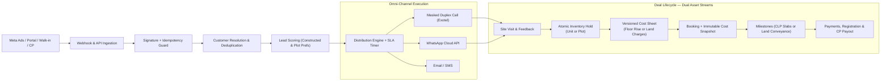

### 1.1 What this document is

A **target architecture specification**. It describes required behaviour, constraints and design decisions — not implementation progress. Where a decision has not been made, it is marked `TBD` or `Proposed` rather than asserted.

### 1.2 The three hardest problems

1. **Tenant isolation under a shared schema.** Every query path, every background job, every report and every signed URL must carry organization scope. Addressed in §5, §7, §60-equivalent data-access rules in §34.
2. **Inventory concurrency.** A unit is a single physical asset; two concurrent holds are a business catastrophe, not a race-condition curiosity. Addressed in §14.
3. **Consistency across a database and three external providers.** Meta, WhatsApp and telephony all retry, duplicate and time out. Addressed in §21, §23, §25.

---

# 2. Architecture Principles

These principles are binding. Where a design choice elsewhere in this document appears to conflict with one, the principle wins and the design is a defect.

| # | Principle | Concrete meaning in Ralix |
| :-- | :--- | :--- |
| 1 | **Tenant Isolation First** | Organization scope is applied at the data-access layer, not remembered by developers. A query that cannot prove its organization scope must not compile or must fail closed. |
| 2 | **Domain Ownership** | Each business fact has exactly one owning domain (§8). Unit availability belongs to `PropertyUnit`, never to `Lead`. |
| 3 | **Single Source of Truth** | Derived/denormalized fields (e.g. `Lead.nextFollowUpAt`) are conveniences for querying. They are never read to make a business decision the authoritative domain can answer. |
| 4 | **Capability-Based Authorization** | Permission is a named capability (`LEAD_ASSIGN`), never a hardcoded role comparison (`if role === 'MANAGER'`). |
| 5 | **Scope-Based Data Access** | *What* a user may do (capability) and *which records* they may do it to (scope) are evaluated independently and both must pass. |
| 6 | **Explicit State Machines** | Every lifecycle (lead, unit, booking, visit, payment, webhook, job) declares its legal transitions. Transitions not listed are rejected by a domain service with a typed error. |
| 7 | **Transactional Integrity** | A state change and its history, audit and outbox records commit atomically or not at all. Partial writes are never acceptable. |
| 8 | **Concurrency Safety** | Contended aggregates use database-level guarantees (row locks, unique partial indexes) — not read-then-write application checks. |
| 9 | **Idempotent External Integrations** | Every inbound webhook and every outbound side effect is safe to deliver twice. Providers *will* deliver twice. |
| 10 | **Asynchronous Side Effects** | External calls happen after commit, via the outbox and queues. No provider timeout may roll back or block a domain transaction. |
| 11 | **Auditability** | Every sensitive mutation produces an immutable audit record containing actor, tenant, before/after and correlation identifiers. |
| 12 | **PII Protection** | Customer contact data is masked by default and unmasked only where organization policy *and* capability both permit. PII never enters logs. |
| 13 | **Immutable Financial History** | Payments, cost snapshots and milestone history are append-only. Corrections are new compensating records, never in-place edits. |
| 14 | **Failure Recovery** | Every failure path terminates somewhere a human can find it: DLQ, reconciliation report or alert. Silent discard is forbidden. |
| 15 | **Observability** | A single correlation ID follows a request across HTTP, PostgreSQL, Redis, queues and providers. |
| 16 | **Backward-Compatible Evolution** | Schema change follows expand → backfill → switch → contract (§41). No deploy requires simultaneous incompatible versions. |
| 17 | **Least Privilege** | Roles grant the minimum capability and narrowest scope that permits the job. Defaults are restrictive. |
| 18 | **Defense in Depth** | Tenant and authorization rules are enforced at middleware, service, repository and database-constraint layers. Any single layer failing must not produce a breach. |

---

# 3. System Context

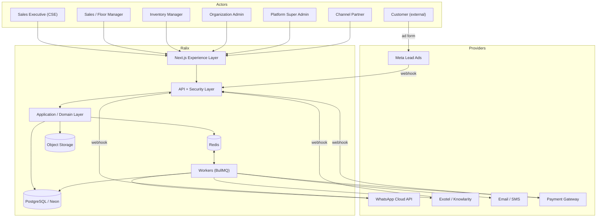

**Trust boundaries.** Everything inside `Ralix` is trusted only after the security layer has established organization and capability. Provider webhooks are untrusted until signature verification succeeds. The Experience layer is fully untrusted — it is a rendering client, never an authorization authority.

---

# 4. Layered Architecture

```text
┌─────────────────────────────────────────────┐
│                 EXPERIENCE                  │
│   Next.js / Admin / CSE / Manager / Reports │
└──────────────────────┬──────────────────────┘
                       ↓
┌─────────────────────────────────────────────┐
│                    API                      │
│   Versioning / Validation / Rate Limiting   │
└──────────────────────┬──────────────────────┘
                       ↓
┌─────────────────────────────────────────────┐
│                  SECURITY                   │
│  Auth / Tenant / Capability / Scope / PII   │
└──────────────────────┬──────────────────────┘
                       ↓
┌─────────────────────────────────────────────┐
│              APPLICATION LAYER              │
│  Commands / Queries / Workflows / Policies  │
└──────────────────────┬──────────────────────┘
                       ↓
┌─────────────────────────────────────────────┐
│                   DOMAIN                    │
│  Lead / Customer / Inventory / Booking      │
│  Payment / Site Visit / CP / Communication  │
└──────────────────────┬──────────────────────┘
                       ↓
┌─────────────────────────────────────────────┐
│               INFRASTRUCTURE                │
│  PostgreSQL / Prisma / Redis / BullMQ       │
│  Object Storage / External Providers        │
└──────────────────────┬──────────────────────┘
                       ↓
┌─────────────────────────────────────────────┐
│               OBSERVABILITY                 │
│  Logs / Metrics / Traces / Audit / Alerts   │
└─────────────────────────────────────────────┘
```

### 4.1 Layer responsibilities & boundaries

| Layer | Owns | Must not |
| :--- | :--- | :--- |
| **Experience** | Rendering, optimistic UI, client-side UX gating | Enforce authorization; treat client-side checks as security |
| **API** | Routing, versioning, transport validation (Zod), pagination, rate limiting, request IDs, error contract | Contain business rules or Prisma queries |
| **Security** | Session verification, organization resolution, capability check, scope-filter synthesis, PII masking policy resolution | Be bypassable by any route; be re-implemented ad hoc per controller |
| **Application** | Commands & queries, orchestration, transaction boundaries, precondition checks, audit + outbox emission | Know about HTTP (`req`, `res`, status codes) |
| **Domain** | Entities, state machines, transition rules, invariants, pricing/scoring calculation | Call providers directly; depend on Express, Next.js or BullMQ |
| **Infrastructure** | Prisma repositories, Redis, queues, storage clients, provider adapters | Expose provider-specific shapes upward; permit un-scoped queries |
| **Observability** | Structured logs, metrics, traces, alerting | Record raw PII |

### 4.2 Binding boundary rules

> **Controllers must not contain domain business logic.** A controller validates transport input, resolves the authenticated context, invokes one command or query, and maps the result or typed error to the HTTP contract in §27.4.

> **Domain services must not depend directly on HTTP concepts.** They accept an explicit `ActorContext { organizationId, userId, capabilities, scope, correlationId }` value object, never a request object. This keeps them callable from workers, schedulers and tests.

> **External providers must be isolated behind integration adapters.** Provider payload shapes, retry semantics and error codes stop at the adapter boundary (§20). The domain sees normalized commands and normalized failures.

> **Database access must not bypass tenant and authorization rules.** All reads and writes go through repositories that require an organization-scoped context (§34.1). Raw `prisma.*` access from controllers or workers is prohibited.

---

# 5. Multi-Tenancy

The tenant root is `Organization`. The deployment is shared-schema, shared-database, with isolation enforced in software and by constraint — see ADR-001 for why row-level isolation was chosen over database-per-tenant.

```text
Organization (Tenant Root)
 ├── OrganizationSetting (SLA thresholds, masking policy, tax defaults, provider refs)
 ├── Roles & RolePermissions
 ├── Users / OrganizationMemberships
 ├── Teams (TeamMember, TeamProject)
 ├── ChannelPartners
 ├── Projects → Towers → PropertyUnits
 ├── Customers → Leads → (SiteVisits, Calls, Messages, FollowUps)
 ├── Campaigns / LeadSources
 ├── CostSheets → Bookings → PaymentMilestones → Payments
 ├── WebhookEvents / OutboxEvents
 └── AuditLogs
```

### 5.1 The tenancy invariant

> **Every tenant-owned entity MUST either carry an explicit `organizationId` column, or be explicitly classified as a child entity whose tenant ownership is deterministically inherited through exactly one non-null parent foreign key.**

Ambiguity here is the single most common source of cross-tenant leaks, so **every** entity in the system is classified below into exactly one of four classes. An entity not appearing in exactly one class is a specification defect.

| Class | Meaning |
| :--- | :--- |
| **Root** | The tenant boundary itself |
| **Class A** | Tenant-owned; carries an explicit `organizationId` column |
| **Class B** | Tenant-owned; inherits tenancy deterministically through exactly one non-null parent |
| **Class G** | **Not tenant-owned** — global/platform scope, deliberately outside the tenancy model |

### 5.2 Root and Class G (not tenant-owned)

| Entity | Class | Rationale |
| :--- | :--- | :--- |
| `Organization` | **Root** | It *is* the tenant boundary; it cannot reference itself. All isolation is defined relative to this row |
| `User` | **Class G** | A **global identity** (§6.1). A person may hold memberships in several organizations, so the identity itself has no single owning tenant |
| `Permission` | **Class G** | Global capability catalogue; capability keys are system-defined and identical for every tenant |

> **`User` must never be given an `organizationId`.** Doing so to satisfy a tenancy table would silently re-impose the single-organization model that ADR-011 removes. The tenant boundary for a person is `OrganizationMembership`, not `User`.

```text
User (global identity — Class G)
 ├── Identity          id, email, passwordHash, name, avatar, MFA settings
 └── OrganizationMembership[]   (Class A — the tenancy & authorization boundary)
       ├── organizationId
       ├── roleId
       ├── status
       └── membership metadata (jobTitle, isAvailable, authorizationVersion)
```

> The **active organization is derived from the authorized membership bound to the session** (§5.8, §6.1) — never from the `User` row, and never from client input. A `User` with no `ACTIVE` membership has no tenant context and therefore no data access at all.

### 5.3 Class A — explicit `organizationId` (required)

Any entity that can be **the root of a query, filter, report, export or background job** carries `organizationId` directly, even where it is derivable. The redundancy is deliberate defense in depth (Principle 18) and removes the need for a join to enforce isolation.

```text
Identity & access   OrganizationMembership · Session · Role (dual-mode: tenant role)
Structure           Team · Project · Tower · PropertyUnit
Plotted Land        PlotDevelopmentPhase · PlotLayoutBlock · Plot · PlotDocument ·
                    PlotPricingRule · PlotImportBatch · PlotSubdivisionLineage
Inventory Holds     InventoryHold
Configuration       OrganizationSetting
Customer & lead     Customer · Lead · LeadAssignment · LeadStageHistory ·
                    LeadStatusHistory · LeadTemperatureHistory · LeadScoreHistory ·
                    LeadDispositionHistory · DuplicateCandidate
Marketing           Campaign · LeadSource
Partner             ChannelPartner · LeadAttribution · AttributionHistory ·
                    CommissionRule · CommissionPayout
Activity            SiteVisit · FollowUp · Note · Task
Communication       CallAttempt · CallRecord · Conversation ·
                    WhatsAppTemplate · WhatsAppMessage
Commercial          PricingRuleSet · PricingRuleVersion · CostSheet ·
                    Booking · BookingStatusHistory · PaymentMilestone · Payment
Platform            ActivityTimeline · AuditLog · WebhookEvent · OutboxEvent ·
                    Notification
```

Five classification notes worth stating explicitly:

- `Role` is a **dual-mode authorization entity** (§7.8) with two legitimate tenancy modes:
  - **Tenant role**: explicit organization ownership (`organizationId != null`, `isSystem = false`), used for normal organization-level authorization.
  - **Platform system role**: global/platform-owned (`organizationId = null`, `isSystem = true`, `scope = GLOBAL`), used strictly for platform-level operations.
  Every tenant-level `Role` carries an explicit `organizationId`. `organizationId = NULL` is allowed only for platform system roles (`isSystem = true`, `scope = GLOBAL`), which reside outside standard tenant isolation (§7.8). A single `Role` model represents both modes.
- `Tower`, `PropertyUnit`, `PlotDevelopmentPhase`, `PlotLayoutBlock`, and `Plot` are Class A despite being reachable via `Project`. Inventory is the most concurrency-sensitive and most frequently queried data in the system; requiring multi-level joins to prove tenancy on every hold, search, or status check is both a performance bottleneck and a security hazard.
- `PlotDocument` is Class A because regulatory compliance, title records, and sanction plans must be directly queryable and verified per tenant without traversing parent layouts.
- `OrganizationSetting` is Class A even though it is 1:1 with `Organization` — it is read directly by workers resolving SLA, masking and attribution policy, so it must prove its own tenancy without a join.
- `PricingRuleVersion`, `PlotPricingRule`, `CommissionRule` and `AttributionHistory` are Class A because each is queried directly for historical explainability (which rule version produced this figure, how did this attribution change) without traversing its parent.

### 5.4 Class B — deterministic inherited tenancy (no `organizationId`)

Pure join tables never queried as a root, always reached through exactly one Class A parent. Each declares its complete deterministic path to the tenant root:

| Entity | Deterministic parent path | Rationale |
| :--- | :--- | :--- |
| `RolePermission` | `RolePermission → Role (→ Organization if tenant role)` | Join table; read only while resolving a role's capabilities (platform system roles have no tenant parent) |
| `TeamMember` | `TeamMember → Team → Organization` | Join table; the referenced `OrganizationMembership` must resolve to the same organization (§5.6) |
| `TeamProject` | `TeamProject → Team → Organization` | Join table; `Project` must resolve to the same organization (§5.6) |
| `UserProject` | `UserProject → OrganizationMembership → Organization` | Join table; note the parent is the **membership**, not the global `User`; `Project` must resolve to the same organization |

> A Class B entity may **never** be exposed by an endpoint, report or job that treats it as a query root. If a use case requires that, the entity is reclassified to Class A and gains an explicit column — it is not granted an exception.

### 5.5 Denormalization consistency rule

Where `organizationId` is denormalized onto a child (Class A entities with a tenant-owned parent), it **must** equal the parent's. This is enforced three ways:

1. The repository layer derives it from the parent on write; callers cannot supply it.
2. A composite foreign key (`parentId`, `organizationId`) referencing the parent's `(id, organizationId)` unique key makes divergence unrepresentable in PostgreSQL.
3. `organizationId` is immutable after insert (§5.7).

### 5.6 Cross-tenant reference prohibition

> Any foreign key between two tenant-owned entities must reference a row in the **same** organization. This is validated in the application on write (target validation, §7.5) and structurally guaranteed by composite foreign keys where mandatory.

This closes attacks of the form "assign my lead to a user id belonging to another tenant", which schema-level FKs alone do **not** prevent.

#### Tenancy Reference Enforcement Matrix

Every tenant-owned relationship in the platform is governed by an explicit enforcement tier:
- **Tier A — Database-enforced**: Structurally guaranteed by composite foreign keys (`(parentId, organizationId) REFERENCES Parent(id, organizationId)` declared in raw SQL, §47.1).
- **Tier B — Application-enforced**: Server-side transactional Target Validation (§7.5) where database composite FKs are intentionally not practical or would break legitimate architecture patterns (e.g. Class B entities lacking `organizationId`, or dual-mode entities with `organizationId = NULL`).
- **Tier C — Both (Defense in Depth)**: Both database composite FK constraints and application transactional target validations are active simultaneously.

| Relationship | Path | Tier | Enforcement Mechanism & Architectural Rationale |
| :--- | :--- | :---: | :--- |
| `Lead → Customer` | `Lead.customerId → Customer.id` | **Both (C)** | DB composite FK `(customerId, organizationId) REFERENCES Customer(id, organizationId)` (§47.1) + Target Validation (§7.5). Core boundary. |
| `Booking → Lead` | `Booking.leadId → Lead.id` | **Both (C)** | DB composite FK `(leadId, organizationId) REFERENCES Lead(id, organizationId)` (§47.1) + Target Validation (§7.5). |
| `Booking → Customer` | `Booking.customerId → Customer.id` | **Both (C)** | DB composite FK `(customerId, organizationId) REFERENCES Customer(id, organizationId)` (§47.1) + Target Validation (§7.5). Debtor identity. |
| `Booking → PropertyUnit` | `Booking.unitId → PropertyUnit.id` | **Both (C)** | DB composite FK `(unitId, organizationId) REFERENCES PropertyUnit(id, organizationId)` (§47.1) + Target Validation (§7.5). Inventory asset boundary. |
| `Payment → Booking` | `Payment.bookingId → Booking.id` | **Both (C)** | DB composite FK `(bookingId, organizationId) REFERENCES Booking(id, organizationId)` (§47.1) + Target Validation (§7.5). Financial inflow boundary. |
| `InventoryHold → PropertyUnit` | `InventoryHold.unitId → PropertyUnit.id` | **Both (C)** | DB composite FK `(unitId, organizationId) REFERENCES PropertyUnit(id, organizationId)` (§47.1) + Target Validation (§7.5, §14). Hold serialization. |
| `Session → OrganizationMembership` | `Session.membershipId → OrganizationMembership.id` | **Both (C)** | DB composite FK `(membershipId, userId, organizationId) REFERENCES OrganizationMembership(id, userId, organizationId)` (§47.1) + Session Verification (§6.2). Prevents cross-tenant/cross-user session hijacking. |
| `Lead → Project` | `Lead.projectId → Project.id` | **Both (C)** | DB composite FK `(projectId, organizationId) REFERENCES Project(id, organizationId)` (§47.1) + Target Validation (§7.5). Project is nullable; FK enforces match on non-null values. |
| `Lead → OrganizationMembership` | `Lead.assignedToId → OrganizationMembership.id` | **Both (C)** | DB composite FK `(assignedToId, organizationId) REFERENCES OrganizationMembership(id, organizationId)` (§47.1) + Target Validation (§7.5). Nullable field. |
| `OrganizationMembership → Role` | `OrganizationMembership.roleId → Role.id` | **Application (B)** | Target Validation (§7.5). **Intentionally application-enforced**: `Role` is a dual-mode entity (§5.3, §7.8) where platform system roles have `organizationId = NULL`. A database composite FK would reject global platform roles. Application verifies that tenant roles match `membership.organizationId`, while platform system roles require break-glass authorization. |
| `Lead → Team` | `Lead.teamId → Team.id` | **Application (B)** | Target Validation (§7.5). Validated server-side in transaction: team must belong to same organization, be active, and hold `TeamProject` assignment to the lead's project. |
| `TeamMember → OrganizationMembership` | `TeamMember.membershipId → OrganizationMembership.id` | **Application (B)** | Target Validation (§7.5). **Intentionally application-enforced**: `TeamMember` is a Class B entity without an `organizationId` column (§5.4). DB composite FK on `(membershipId, organizationId)` is structurally impossible without denormalizing `organizationId` onto the join table. Application verifies `Team.organizationId == OrganizationMembership.organizationId` on assignment. |
| `TeamProject → Project` | `TeamProject.projectId → Project.id` | **Application (B)** | Target Validation (§7.5). **Intentionally application-enforced**: `TeamProject` is a Class B entity without an `organizationId` column (§5.4). Application verifies `Team.organizationId == Project.organizationId` before insert. |
| `UserProject → Project` | `UserProject.projectId → Project.id` | **Application (B)** | Target Validation (§7.5). **Intentionally application-enforced**: `UserProject` is a Class B entity without an `organizationId` column (§5.4). Application verifies `OrganizationMembership.organizationId == Project.organizationId`. |
| `CostSheet → Booking / Lead / Project` | `CostSheet` links | **Both (C) / Application (B)** | Composite FK on `(unitId, organizationId)` and `(leadId, organizationId)` via raw SQL (§47.1); application validates mutual consistency of project, unit, and lead in transaction (§15.3, §16.1). |
| `SiteVisit → Lead / Customer / Project` | `SiteVisit` links | **Both (C) / Application (B)** | Composite FK on `(customerId, organizationId)` and `(projectId, organizationId)` (§47.1); application validates that visit lead, customer, and project match mutually in transaction (§12.1). |
| `FollowUp → Lead / User / Team` | `FollowUp` links | **Both (C) / Application (B)** | Composite FK on `(leadId, organizationId)` (§47.1); application validates target user/team membership belongs to same organization and is active (§10.6). |

### 5.7 Tenancy immutability

> `organizationId` is assigned at creation and is immutable. No API accepts it as an updatable field. Transferring a record between organizations is not supported; it would invalidate every historical audit, attribution and financial record referencing it.

### 5.8 Request-scoped tenancy

**Canonical term: `organizationId`.** The identifier `req.tenantId` used in 4.0.0 is retired; no synonym is permitted anywhere in code, logs or documentation.

```text
Request → Session verification → req.auth = {
    userId, organizationId, membershipId, roleId,
    capabilities: Set<string>, scope: ScopeType,
    sessionId, authorizationVersion, correlationId
}
```

`req.auth.organizationId` is derived **exclusively** from the server-side session record. It is never read from the request body, query string, path or a client-supplied header.

> **Any endpoint that accepts `organizationId` as request input is a defect**, regardless of whether it is additionally validated. Accepting it invites confused-deputy bugs the moment a validation branch is missed.

> **Session Consistency Invariant**: A session represents the authorized combination of a user identity and an active organization membership. The architecture guarantees:
> 1. `Session.userId == OrganizationMembership.userId`
> 2. `Session.organizationId == OrganizationMembership.organizationId`
> 3. `Session.membershipId` references an `ACTIVE` membership owned by that user in that organization.
>
> This invariant is enforced at **both** layers:
> - **Database-enforced**: `OrganizationMembership` declares `@@unique([id, userId, organizationId])`, and `Session` references it via composite foreign key `FOREIGN KEY ("membershipId", "userId", "organizationId") REFERENCES "OrganizationMembership" ("id", "userId", "organizationId") ON DELETE CASCADE` declared in raw SQL (§47.1). An invalid combination (such as User A + Membership B + Organization C) is structurally unrepresentable and rejected at the database level.
> - **Application-enforced**: Session creation derives `userId` and `organizationId` directly from the authenticated `OrganizationMembership` row (§6.2), never from client input.
>
> Storing denormalized `userId` and `organizationId` directly on `Session` is an intentional performance and defense-in-depth isolation decision: it satisfies queries and filters without traversing joins on hot authentication paths while structurally guaranteeing consistency via the composite FK.

### 5.9 Tenancy in non-HTTP contexts

Workers, schedulers and webhook processors have no session. They construct a `SystemActorContext` that still carries an explicit `organizationId` resolved from the job payload or the `WebhookEvent` row, plus a synthetic actor identity (`system:sla-worker`) for audit. The same repository contracts apply; there is no privileged un-scoped path.

---

# 6. Identity & Authentication

> **Status: Proposed.** Lifetimes and lockout thresholds below are marked `TBD` and require security/business sign-off before implementation.

### 6.1 Identity model

4.0.0 modelled `User.organizationId + roleId` (one organization per user) while simultaneously describing an "Org switch" capability. This revision resolves the contradiction by adopting **Option B — separated identity and membership**:

```text
User (global identity)
 ├── id, email (globally unique), passwordHash, name, avatar, mfa settings
 └── OrganizationMembership[]
       ├── organizationId
       ├── roleId            (role is organization-scoped)
       ├── jobTitle          (descriptive, not authorization)
       ├── status            INVITED | ACTIVE | SUSPENDED | REMOVED
       ├── isAvailable       (lead-distribution eligibility)
       └── authorizationVersion
```

**Consequences.**
- A session is bound to **one** membership at a time. "Switching organization" issues a new session for a different membership; it never widens an existing session.
- `organizationId` on tenant data continues to reference `Organization` directly — the membership model changes *who can log in where*, not how records are owned.
- Role, capabilities, scope, availability and job title are **per-membership**, because a user may be a Manager in one organization and a CSE in another.

> **Migration note.** The current single-organization shape is a strict subset: it is the case where every user has exactly one `ACTIVE` membership. Adoption therefore follows expand-contract (§41) with no behavioural change for single-org tenants. Until adopted, the invariant "one user, one membership" holds. See **ADR-010 (Proposed)**.

### 6.2 Authentication flow

```text
User Identity
    ↓  credential submission (rate limited, §50-equivalent §27.6)
Credential Verification        ← password hash comparison, constant-time
    ↓
MFA Challenge (where enabled)
    ↓
Membership Selection           ← if the identity has >1 ACTIVE membership
    ↓
Session Creation               ← server-side Session row + device metadata
    ↓
Access Token (short-lived)     ← carries sessionId + authorizationVersion
    ↓
Refresh Token (rotating)       ← single-use, family-tracked
    ↓
Authorization (§7)
```

### 6.3 Credential & session policy

| Concern | Decision |
| :--- | :--- |
| Password hashing | Argon2id (memory-hard), per-password salt. Parameters tuned to a target verification cost of ~100 ms on production hardware; **exact parameters TBD** |
| Password policy | Minimum length enforced, breached-password rejection via a k-anonymity check; no composition rules or forced rotation |
| Access token | Short-lived bearer token. **Lifetime TBD** — must be short enough that §6.6 revocation latency is acceptable |
| Refresh token | Rotating and single-use. Reuse of a consumed refresh token invalidates the entire token family and raises a security alert (theft detection) |
| Session record | Server-side row: `sessionId`, `userId`, `membershipId`, `organizationId`, `authorizationVersion`, `createdAt`, `lastSeenAt`, `expiresAt`, `revokedAt`, `ipAddress`, `userAgent`, `deviceLabel` |
| Idle & absolute expiry | Both enforced. **Values TBD** |
| Concurrent sessions | Permitted and individually listed/revocable by the user and by Organization Admins for their members |
| Logout | Revokes the current session row and its refresh-token family immediately |
| Global logout | Revokes all sessions for a membership; also triggered automatically on password change, MFA change and role change |
| Password reset | Single-use, expiring, side-effect-free token delivered out of band; consuming it revokes all existing sessions |
| Account lockout | Progressive delay plus temporary lock after repeated failures, keyed on `(identity, source IP)` to limit lockout-as-DoS. **Thresholds TBD** |
| Brute-force protection | Rate limiting at IP, identity and organization level (§27.6); failures are audited and alertable |
| Compromised session | Admin/user-initiated revocation; automatic revocation on refresh-token reuse detection; all revocations audited |

### 6.4 Why both a token and a server-side session

4.0.0 implied stateless JWT authentication *and* enterprise revocation, which are incompatible without a server-side check. The resolution:

> The access token is a **short-lived cache** of an authoritative server-side session. Every request validates `sessionId` against the session store (Redis, PostgreSQL-backed). A revoked session fails immediately regardless of token expiry.

This keeps the hot path fast while preserving instant revocation. The session store is Redis-fronted with PostgreSQL as the durable record; a Redis miss falls back to PostgreSQL rather than failing open.

### 6.5 Authentication failure semantics

Authentication failures return `AUTHENTICATION_REQUIRED` and must not distinguish "unknown identity" from "wrong password" in the response body, response timing or status code.

### 6.6 Authorization cache invalidation

A revoked permission must take effect without waiting for token expiry and without making tokens permanent-lived.

```text
OrganizationMembership.authorizationVersion : Int
```

- The version is embedded in the access token and stored on the session row.
- Any change to the membership's role, the role's permissions, the role's scope, or the membership's status **increments** `authorizationVersion` for every affected membership, inside the same transaction as the change.
- On every request, the security layer compares the token's version with the current authoritative version. A mismatch forces a silent re-issue against current permissions, or rejects the request with `AUTHENTICATION_REQUIRED` if the membership is no longer `ACTIVE`.

> **Invariant.** Permission revocation takes effect no later than the next request. Stale authorization is never permitted for the remaining lifetime of an already-issued token.

Changing a **Role's** permissions fans out to all memberships holding that role; this is performed transactionally with the role edit and emits a `RolePermissionsChanged` domain event (§22).

---

# 7. Authorization & Data Governance

### 7.1 The extended authorization pipeline

4.0.0's five layers are preserved and extended with the three stages that were missing — target validation, business preconditions, and a mandatory audit step:

```text
Authentication          Who is the user? (valid, unrevoked session)
        ↓
Tenant (Organization)   Which organization is this session bound to?
        ↓
Capability              May their role perform this action at all?
        ↓
Data Scope              Which set of records may they operate on?
        ↓
Record Ownership        Is this specific record inside that set?
        ↓
Target Validation       Are all referenced targets valid and same-tenant?
        ↓
Business Preconditions  Does the domain state permit this transition?
        ↓
Mutation                Inside a transaction
        ↓
Audit                   Immutable record, same transaction
        ↓
Domain Event            Outbox, same transaction
```

The access decision is:

$$\text{Access} = \text{Auth} \land \text{Tenant} \land \text{Capability} \land \text{Scope} \land \text{Ownership} \land \text{TargetValid} \land \text{Preconditions}$$

Every conjunct is independently evaluated. **No conjunct may be inferred from another** — in particular, read access never implies write access, and broad scope never substitutes for a missing capability.

### 7.2 Job title vs. role vs. capability vs. scope

Business job titles are not authorization primitives.

```text
┌─────────────────┐     ┌─────────────────┐     ┌─────────────────┐
│ MEMBERSHIP      │     │ ROLE            │     │ PERMISSIONS     │
├─────────────────┤     ├─────────────────┤     ├─────────────────┤
│ User: Amit      │     │ Name: CSE       │     │ LEAD_VIEW       │
│ jobTitle:       │────▶│ slug: cse       │────▶│ LEAD_UPDATE     │
│  "Telecaller"   │     │ scope: SELF     │     │ FOLLOWUP_CREATE │
└─────────────────┘     └─────────────────┘     └─────────────────┘

┌─────────────────┐     ┌─────────────────┐     ┌─────────────────┐
│ MEMBERSHIP      │     │ ROLE            │     │ PERMISSIONS     │
├─────────────────┤     ├─────────────────┤     ├─────────────────┤
│ User: Rajesh    │     │ Name: Manager   │     │ LEAD_VIEW       │
│ jobTitle:       │────▶│ slug: manager   │────▶│ LEAD_ASSIGN     │
│  "Team Leader"  │     │ scope: TEAM     │     │ REPORT_VIEW     │
└─────────────────┘     └─────────────────┘     └─────────────────┘
```

* `jobTitle` — descriptive only ("Senior Telecaller", "Director of Growth"). Rendered in UI and signatures. **Never consulted for an access decision.**
* `roleId` — role bundling capabilities and a default scope (organization-scoped for tenant roles, or platform-scoped for system roles).
* `capability` — a named permission key checked by middleware.
* `scope` — the record-visibility boundary (`SELF`, `TEAM`, `PROJECT`, `ORGANIZATION`, `GLOBAL`).

### 7.3 The two-question rule

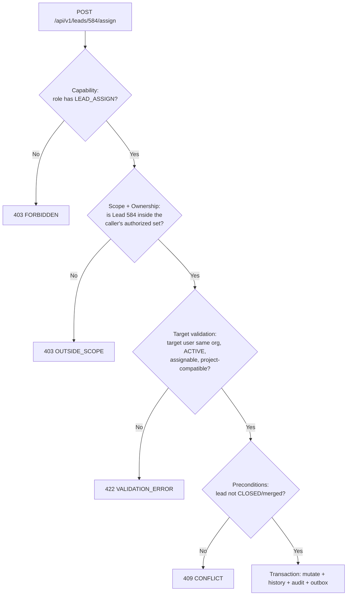

Note that `OUTSIDE_SCOPE` and `RESOURCE_NOT_FOUND` must be **indistinguishable to the caller** for records in other organizations (§7.9).

### 7.4 Scope resolution

| Scope | Authorized record set (for Lead) |
| :--- | :--- |
| `SELF` | `assignedToId = user.id` |
| `TEAM` | `teamId ∈ {teams where the user is an ACTIVE TeamMember}` |
| `PROJECT` | `projectId ∈ {projects reachable via UserProject} ∪ {projects reachable via TeamProject for the user's active teams}` |
| `ORGANIZATION` | `organizationId = session.organizationId` |
| `GLOBAL` | unrestricted by organization — platform Super Admin only (§7.8) |

**Union rule.** When a user reaches records through multiple paths:

> Effective accessible records are the **union** of all explicitly authorized scope paths, unless a permission-specific policy states otherwise.

So a `PROJECT`-scoped user on two teams covering three projects plus one direct `UserProject` assignment sees the union of all four projects. Precedence is *additive for records*, never for capabilities:

> **Scope precedence never grants capability.** A broader scope enlarges the record set for capabilities already held; it never adds a capability. A user with `ORGANIZATION` scope but without `LEAD_ASSIGN` still cannot assign any lead in the organization.

Inactive membership paths (`TeamMember.isActive = false`, `leftAt` set, membership `SUSPENDED`) are excluded from the union immediately.

### 7.5 Target validation

Scope answers "may I touch this record". Target validation answers "are the things I am pointing it at legitimate". Required whenever a mutation accepts a reference id:

| Mutation | Targets requiring validation |
| :--- | :--- |
| Assign lead | assignee membership exists, same organization, `ACTIVE`, assignable, project-compatible; team same organization, active, has `TeamProject` access to the lead's project |
| Change lead project | project same organization and active |
| Attach campaign / source / CP | same organization and active |
| Hold / book unit | unit same organization; unit belongs to the stated project/tower |
| Create booking | lead, customer, unit and cost sheet all same organization and mutually consistent |
| Record payment | milestone belongs to the booking; booking same organization |

> Every relationship target is validated **server-side, in the same transaction as the mutation**. Client-supplied identifiers are treated as hostile.

### 7.6 Filter synthesis

Controllers never hand-write scope logic. The security layer synthesizes a Prisma `where` fragment that the repository composes with **`AND`**:

```text
final_where = organizationFilter
          AND scopeFilter          (from capability + scope resolution)
          AND userSuppliedFilters  (validated, allow-listed)
```

> **Composition is always `AND`.** A user-supplied filter can only ever narrow the result set. It can never widen it, and `OR` between the scope filter and user filters is prohibited — that pattern is the classic scope-escape bug.

User-supplied filter keys are allow-listed per resource; unknown keys are rejected with `VALIDATION_ERROR` rather than ignored (silently ignoring a filter produces results the caller did not ask for).

### 7.7 Enterprise permission matrix

| Permission Key | Resource | Action | CSE | Sales Manager | Inventory Manager | Org Admin | Super Admin |
| :--- | :--- | :--- | :---: | :---: | :---: | :---: | :---: |
| `LEAD_VIEW` | Lead | View | **SELF** | **TEAM** | **PROJECT** | **ORGANIZATION** | **GLOBAL** |
| `LEAD_CREATE` | Lead | Create | Yes | Yes | No | Yes | Yes |
| `LEAD_UPDATE` | Lead | Update stage/status/notes | **SELF** | **TEAM** | No | Yes | Yes |
| `LEAD_ASSIGN` | Lead | Assign / Reassign | No | **TEAM** | No | Yes | Yes |
| `LEAD_TRANSFER` | Lead | Transfer across teams | No | No | No | Yes | Yes |
| `LEAD_DELETE` | Lead | Soft delete | No | No | No | Yes | Yes |
| `LEAD_EXPORT` | Lead | CSV / Excel export | No | No | No | **Dual-Auth** | Yes |
| `LEAD_MERGE` | Lead | Confirm duplicate merge | No | **TEAM** | No | Yes | Yes |
| `CUSTOMER_VIEW_UNMASKED` | Customer | View raw phone/email | No | Configurable | No | Yes | Yes |
| `FOLLOWUP_CREATE` | FollowUp | Schedule follow-up / callback | **SELF** | **TEAM** | No | Yes | Yes |
| `FOLLOWUP_MANAGE` | FollowUp | Reschedule / cancel another user's follow-up | No | **TEAM** | No | Yes | Yes |
| `SITE_VISIT_SCHEDULE` | SiteVisit | Schedule / reschedule a visit | **SELF** | **TEAM** | **PROJECT** | Yes | Yes |
| `SITE_VISIT_COMPLETE` | SiteVisit | Record outcome (completed / no-show) | **SELF** | **TEAM** | **PROJECT** | Yes | Yes |
| `SITE_VISIT_CANCEL` | SiteVisit | Cancel a scheduled visit | **SELF** | **TEAM** | No | Yes | Yes |
| `INVENTORY_HOLD` | Unit | Place expiring hold | Yes | Yes | Yes | Yes | Yes |
| `INVENTORY_BLOCK` | Unit | Permanent block | No | No | Yes | Yes | Yes |
| `PLOT_VIEW` | Plot | View layout & plots | **SELF** | **TEAM** | **PROJECT** | **ORGANIZATION** | **GLOBAL** |
| `PLOT_CREATE` | Plot | Add plot definition | No | No | **PROJECT** | Yes | Yes |
| `PLOT_UPDATE` | Plot | Update dimensions / characteristics | No | No | **PROJECT** | Yes | Yes |
| `PLOT_HOLD` | Plot | Place expiring hold on plot | Yes | Yes | Yes | Yes | Yes |
| `PLOT_BLOCK` | Plot | Permanent / management block | No | No | Yes | Yes | Yes |
| `PLOT_RELEASE` | Plot | Release plot hold or block | Yes (own) | Yes | Yes | Yes | Yes |
| `PLOT_BOOK` | Plot | Create plot token booking | Yes | Yes | No | Yes | Yes |
| `PLOT_REGISTRATION_UPDATE` | Plot | Update conveyance / registration status | No | No | No | Yes | Yes |
| `PLOT_DOCUMENT_MANAGE` | PlotDocument | Upload / manage title, 7/12, NA docs | No | No | **PROJECT** | Yes | Yes |
| `PLOT_IMPORT` | Plot | Bulk CSV/Excel inventory import | No | No | No | **Dual-Auth** | Yes |
| `PLOT_LAYOUT_MANAGE` | Layout | Configure sectors, roads & GIS map | No | No | **PROJECT** | Yes | Yes |
| `COST_SHEET_GENERATE` | CostSheet | Generate quote | Yes | Yes | Yes | Yes | Yes |
| `COST_SHEET_DISCOUNT` | CostSheet | Apply discount above cap | No | Up to 2% | Up to 5% | Yes | Yes |
| `BOOKING_CREATE` | Booking | Issue token booking | Yes | Yes | No | Yes | Yes |
| `BOOKING_CANCEL` | Booking | Cancel & release unit | No | Configurable | Yes | Yes | Yes |
| `PAYMENT_CREATE` | Payment | Log cheque / transfer | No | Yes | No | Yes | Yes |
| `PAYMENT_REFUND` | Payment | Process refund (§17.4) | No | No | No | **ORG_ADMIN** | Yes |
| `PAYMENT_RECONCILE` | Payment | Resolve reconciliation discrepancies (§17.6) | No | No | No | **ORG_ADMIN** | Yes |
| `COST_SHEET_APPROVE` | CostSheet | Approve a sheet exceeding the discount cap | No | No | Up to 5% | Yes | Yes |
| `ATTRIBUTION_MANAGE` | LeadAttribution | Transfer / extend / revoke CP attribution | No | No | No | Yes | Yes |
| `COMMISSION_APPROVE` | CommissionPayout | Approve partner payout (§18.2) | No | No | No | Yes | Yes |
| `USER_MANAGE` | User | Invite / disable members | No | No | No | Yes | Yes |
| `ROLE_MANAGE` | Role | Edit roles & permissions | No | No | No | Yes | Yes |
| `REPORT_FINANCIAL` | Report | Revenue & margin | No | No | No | Yes | Yes |
| `AUDIT_VIEW` | AuditLog | Read audit trail | No | No | No | Yes | Yes |

"Configurable" denotes an organization-level policy toggle in `OrganizationSetting`; the capability is only effective when the policy also permits it (§31.4).

### 7.8 GLOBAL scope containment

`GLOBAL` is a platform-operations scope, not a business role. It is restricted to platform system roles (`Role.organizationId = null`, `isSystem = true`, `scope = GLOBAL`).

- `GLOBAL` scope is platform-only.
- `organizationId = NULL` is allowed only for platform system roles; `isSystem = true` is required for `organizationId = NULL` roles.
- `GLOBAL` mutation requires explicit break-glass authorization.
- All `GLOBAL` access is audited with elevated severity and is alertable.
- `GLOBAL` grants cross-organization **read** for support purposes. Cross-organization **mutation** additionally requires explicit break-glass authorization and produces a high-severity audit entry. **Break-glass workflow: TBD.**

#### System Role Uniqueness & Integrity Constraints

In PostgreSQL, standard SQL treats `NULL != NULL`, meaning an ordinary `@@unique([organizationId, slug])` would permit duplicate `NULL` organizationIds with identical slugs. To guarantee global uniqueness and structural containment of platform system roles, the database enforces four structural rules via raw SQL (§47.1):
1. **Global System-Role Slug Uniqueness**: `CREATE UNIQUE INDEX role_system_slug_unique ON "Role" (slug) WHERE "organizationId" IS NULL;` guarantees that every platform system role has a globally unique slug across the entire system.
2. **System Role Tenancy Check**: `CHECK ("organizationId" IS NOT NULL OR ("isSystem" = TRUE AND "scope" = 'GLOBAL'))` guarantees that `organizationId = NULL` is structurally impossible for normal tenant roles and requires system status with GLOBAL scope.
3. **GLOBAL Scope Containment Check**: `CHECK ("scope" != 'GLOBAL' OR ("organizationId" IS NULL AND "isSystem" = TRUE))` prevents normal tenant roles from ever acquiring `GLOBAL` scope.
4. **Tenant Role Privilege Isolation**: `CHECK ("isSystem" = FALSE OR "organizationId" IS NULL)` guarantees that tenant-owned roles can never be marked as system roles. Platform roles cannot become tenant roles, and tenant roles cannot become global platform roles.

### 7.9 Failure semantics & IDOR

> A record in another organization must produce the **same** response as a record that does not exist: `404 RESOURCE_NOT_FOUND`, with identical timing characteristics.

Returning `403` for a cross-tenant record confirms its existence and is an information leak. Within the caller's own organization, a record outside their scope returns `403 OUTSIDE_SCOPE`, since its existence is not a cross-tenant secret.

---

# 8. Domain Ownership & Source of Truth

### 8.1 Ownership matrix

| Domain | Authoritative Source |
| :--- | :--- |
| Lead lifecycle | `Lead.lifecycleStage` |
| Lead operational status | `Lead.status` |
| Lead engagement/temperature | `Lead.temperature` |
| Lead SLA condition | `Lead.slaState` |
| Lead outcome reason | `Lead.disposition` |
| Lead ownership (current) | `Lead.assignedToId` / `Lead.teamId` |
| Lead ownership (history) | `LeadAssignment` |
| Customer identity | `Customer` |
| Duplicate relationships | `DuplicateCandidate` |
| Site visit | `SiteVisit.status` |
| Unit availability | `PropertyUnit.availability` |
| Plot availability | `Plot.availability` |
| Plot physical characteristics | `Plot` |
| Plot geometry & coordinates | `Plot.geometryRef` / `PlotLayoutBlock` |
| Plot regulatory readiness | `Plot.regulatoryStatus` |
| Plot regulatory documentation | `PlotDocument` |
| Unit hold | `InventoryHold(unitId)` (+ transactional unit transition) |
| Plot hold | `InventoryHold(plotId)` (+ transactional plot transition) |
| Cost calculation | `CostSheet` + Pricing Engine |
| Unit pricing rules | `PricingRuleSet` / `PricingRuleVersion` |
| Plot pricing rules | `PlotPricingRule` |
| Booking | `Booking.status` (linked to `PropertyUnit` XOR `Plot`) |
| Plot conveyance / registration | `Booking.registrationStatus` / `Plot.registrationStatus` |
| Payment | `Payment` |
| Payment schedule | `PaymentMilestone` |
| Calls (technical) | `CallAttempt` |
| Calls (business outcome) | `CallRecord.disposition` |
| WhatsApp | `Conversation` / `WhatsAppMessage` |
| CP attribution | `LeadAttribution` |
| Commission | `CommissionRule` / `CommissionPayout` |
| Authorization | `Role` + `Permission` + `OrganizationMembership.scope` |
| Business activity feed | `ActivityTimeline` |
| Security/compliance record | `AuditLog` |
| External webhook idempotency | `WebhookEvent` |
| Asynchronous event delivery | `OutboxEvent` |

### 8.2 The ownership rule

> **A domain must never infer authoritative state from another domain's convenience fields when the authoritative domain already exists.**

Worked examples of the rule in force:

| Question | Correct source | Forbidden source |
| :--- | :--- | :--- |
| Is unit A-1204 sellable? | `PropertyUnit.availability` + active `InventoryHold` | `Lead.lifecycleStage = BOOKING` |
| Is plot B-42 bookable? | `Plot.availability = AVAILABLE` ∧ `Plot.classification = SALEABLE_PLOT` ∧ `Plot.regulatoryStatus ∈ {BOOKABLE, REGISTRATION_ELIGIBLE}` | `Lead.lifecycleStage = BOOKING` |
| Did this customer visit the site? | `SiteVisit.status = COMPLETED` | `Lead.lifecycleStage = SITE_VISIT` |
| Has the deal closed? | `Booking.status` | `Lead.lifecycleStage = WON` |
| How much has been collected? | `SUM(Payment)` for the booking | `Booking.tokenAmountPaid` alone |
| Who owns this lead right now? | `Lead.assignedToId` | most recent `ActivityTimeline` entry |

### 8.3 Derived fields

Derived fields are permitted for query performance and dashboards, must be clearly labelled as derived, and are always recomputable from their authoritative source:

| Derived field | Derived from | Permitted use |
| :--- | :--- | :--- |
| `Lead.nextFollowUpAt` | earliest pending `FollowUp.scheduledAt` | list sorting, dashboards |
| `Lead.lastContactedAt` | latest qualifying `CallRecord` / outbound message | SLA display, list sorting |
| `Lead.hasCompletedSiteVisit` | existence of `SiteVisit.status = COMPLETED` | Kanban badges, filters |
| `Lead.score` | scoring service output | prioritization, routing |
| `Booking.totalAgreementValue` | `CostSheet` snapshot | display, reporting |

> A derived field is never the basis of a state transition, an authorization decision, or a financial calculation.

---

# 9. Customer Architecture

### 9.1 Customer is not Lead

```text
Customer  (a person — durable identity)
   ├── Lead #1 → Project A   (opportunity)
   ├── Lead #2 → Project B   (opportunity)
   └── Lead #3 → Project C   (opportunity)
```

> `Customer ≠ Lead`. A Customer is a person the organization knows. A Lead is one commercial opportunity involving that person. One Customer may hold many Leads over time, and — where business rules permit — many Bookings.

Identity attributes (name, phone, email, city) live on `Customer` and are **not** duplicated onto `Lead`. Lead-specific commercial attributes (budget, preferred configuration, project interest) live on `Lead` and are **not** promoted to `Customer`, because they differ per opportunity.

### 9.2 Identity structure

```text
Customer
 ├── organizationId
 ├── name
 ├── phone              (raw, as captured — preserved verbatim)
 ├── normalizedPhone    (canonical E.164 — matching key)
 ├── email              (raw)
 ├── normalizedEmail    (trimmed + lowercased — searchable attribute & deduplication signal)
 ├── externalIdentities (provider identities, e.g. Meta lead form contact refs)
 └── identityHistory    (append-only record of identity attribute changes)
```

### 9.3 Normalization rules

Normalization exists solely to produce **deterministic matching keys**. It never replaces the captured value.

| Rule | Requirement |
| :--- | :--- |
| Determinism | The same input always produces the same output; normalization is a pure function with no I/O |
| Preservation | Raw `phone`/`email` are stored unchanged; normalization is additive |
| Phone canonical form | E.164 with explicit country code |
| Default region | A bare national-format number is interpreted using the **organization's configured default region**, not a global constant. Organizations operating in multiple countries must capture an explicit country code |
| Ambiguity | A number that cannot be confidently normalized is stored raw, flagged, and excluded from automatic matching rather than guessed |
| Email canonical form | Trim + lowercase. Provider-specific tricks (dot-stripping, `+tag` removal) are **not** applied — they produce false merges across genuinely distinct mailboxes |
| Phone casing | Never apply case or character transformations to phone numbers beyond digit/`+` extraction |

> **Region-default correctness matters.** Interpreting every 10-digit number as one fixed country silently corrupts identity for any tenant operating elsewhere. The default region is organization configuration, and `TBD` is the correct answer for a tenant that has not set one — such numbers are flagged for review, not guessed.

### 9.4 Organization-scoped matching & identity key distinction

> Matching keys are **only ever compared within one organization.** `(organizationId, normalizedPhone)` is unique; the same phone number existing in two organizations describes two unrelated Customer records and must never be joined, merged or surfaced across the boundary.

#### Phone vs. Email Identity Semantics

The architecture explicitly distinguishes between primary unique matching keys and secondary searchable identity attributes:

| Attribute | Database Constraint | Architectural Role | Behavior on Ingestion |
| :--- | :--- | :--- | :--- |
| `normalizedPhone` | `@@unique([organizationId, normalizedPhone])` | **Authoritative unique matching key** | Primary deduplication key. Identical normalized phone within the organization resolves to the existing `Customer` (§9.5). |
| `normalizedEmail` | `@@index([organizationId, normalizedEmail])` | **Searchable attribute & deduplication signal** | Indexed for performant search. Does **not** enforce database uniqueness and does not trigger auto-merge on ingestion. |

**Rationale for non-unique email in database**:
1. **Shared Email Addresses**: In real estate transactions, family members, co-buyers, and spouses frequently provide the same email address while maintaining distinct individual mobile numbers and purchasing distinct units.
2. **Missing / Omitted Emails**: A significant proportion of inbound leads (telephony walk-ins, IVR calls, paper walk-in registers) have a phone number but no email. Requiring unique email would either block legitimate leads or require synthetic placeholders that corrupt identity.
3. **Deduplication vs. Silent Merging**: When an inbound lead presents an email matching an existing customer but with a *different* phone number, the system does **not** silently overwrite or auto-merge records. Instead, it creates a `DuplicateCandidate` (`matchType = NORMALIZED_EMAIL`, §10.8) for explicit human review under `LEAD_MERGE` authorization.

### 9.5 Customer resolution during ingestion

```text
Inbound contact (webhook / API / import)
        ↓
Normalize phone + email
        ↓
Lookup (organizationId, normalizedPhone)
        ↓
 ┌──────────────┴──────────────┐
 Found                      Not found
 ↓                             ↓
Reuse Customer            Create Customer
 ↓                             ↓
 └──────────────┬──────────────┘
                ↓
Create NEW Lead (always — a repeat enquiry is a new opportunity)
                ↓
Evaluate duplicate signals (§10.8) → DuplicateCandidate where warranted
```

> A returning customer produces a **new Lead**, never a silent overwrite of the previous one. Prior opportunity history is never destroyed by re-contact.

---

# 10. Lead Architecture

This section replaces 4.0.0's `LeadStatus` + `LeadUrgency` design entirely. Those two enums conflated six unrelated concepts, which made every pipeline report ambiguous and forced contradictory writes (a lead could not be both "hot" and "SLA breached").

### 10.1 Five independent dimensions

A Lead's state is a **tuple**, not a single value. Each dimension answers a different question and is independently settable, queryable and reportable.

| Dimension | Field | Answers |
| :--- | :--- | :--- |
| Lifecycle | `lifecycleStage` | Where is this opportunity in the commercial journey? |
| Operational status | `status` | What is its current working condition? |
| Temperature | `temperature` | How engaged/intent-loaded is the buyer? |
| SLA state | `slaState` | Are we compliant with our response commitment? |
| Disposition | `disposition` | Why is it in its current outcome? |

```text
LeadLifecycleStage : NEW · CONTACTED · QUALIFIED · SITE_VISIT · NEGOTIATION · BOOKING · WON ·
                     CANCELLED · LOST
LeadStatus         : ACTIVE · ON_HOLD · CALLBACK_PENDING · NO_RESPONSE · INVALID · DUPLICATE · CLOSED
LeadTemperature    : COLD · WARM · HOT
LeadSLAState       : WITHIN_SLA · DUE_SOON · BREACHED · RESOLVED
LeadDisposition    : INTERESTED · NOT_INTERESTED · NO_RESPONSE · WRONG_NUMBER · INVALID_LEAD ·
                     DUPLICATE · BUDGET_ISSUE · LOCATION_ISSUE · PRODUCT_MISMATCH · COMPETITOR ·
                     FUTURE_REQUIREMENT · RENTAL_REQUIREMENT · INVESTMENT_REQUIREMENT ·
                     PURCHASED · LOST_TO_COMPETITOR · OTHER
```

### 10.2 Independence is a hard rule

All of the following are **valid simultaneous states**, and the system must represent each without contradiction:

```text
lifecycle=NEW        status=ACTIVE            temperature=HOT   sla=BREACHED    disposition=—
lifecycle=QUALIFIED  status=CALLBACK_PENDING  temperature=HOT   sla=WITHIN_SLA  disposition=INTERESTED
lifecycle=SITE_VISIT status=ACTIVE            temperature=WARM  sla=RESOLVED    disposition=INTERESTED
lifecycle=NEGOTIATION status=ON_HOLD          temperature=COLD  sla=WITHIN_SLA  disposition=BUDGET_ISSUE
lifecycle=LOST       status=CLOSED            temperature=COLD  sla=RESOLVED    disposition=LOST_TO_COMPETITOR
```

> **A hot lead that breached SLA is still hot.** SLA breach is an internal compliance failure, not a statement about buyer intent. No automation may set `temperature = COLD` because of an SLA breach, and no SLA transition may write `temperature`, `lifecycleStage`, `status` or `disposition`.

Cross-dimension writes are permitted only where an **explicitly documented business rule** requires them. The complete permitted set is:

| Trigger | Permitted cross-dimension write | Rationale |
| :--- | :--- | :--- |
| Transition to `LOST`, `WON` or `CANCELLED` | `status → CLOSED` | Operational work stops when the opportunity ends |
| Call disposition `CALLBACK_REQUESTED` | `status → CALLBACK_PENDING` | The call outcome *is* an operational statement |
| Call disposition `NO_ANSWER`/`BUSY` | `status → NO_RESPONSE` | Same |
| Confirmed duplicate merge | `status → DUPLICATE` | Operational closure of the losing record |
| First qualifying contact (§11.7) | `slaState → RESOLVED` where breached | SLA is measured against that action |

Anything not in this table is a defect.

### 10.3 Lifecycle state machine

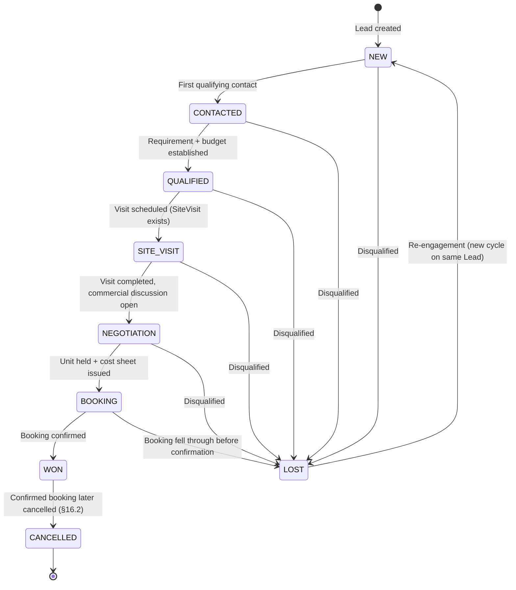

**Transition rules.**

| Rule | Requirement |
| :--- | :--- |
| Forward progression | One stage at a time along the defined path. Skipping stages is rejected |
| Loss | Reachable from **any** pre-conversion stage. Loss is never restricted to a linear terminal position |
| `WON` | Reachable only from `BOOKING`, and only when an authoritative confirmed `Booking` exists (§16). Its only exit is `CANCELLED` |
| `CANCELLED` | **Terminal** post-conversion outcome — it has no outgoing transition. Reachable **only** from `WON`, and only as a consequence of an authoritative `Booking.status = CANCELLED` (§16.2) |
| Re-engagement after cancellation | A cancelled opportunity is **not** reopened. A later purchase by the same person is a **new `Lead`** against the same `Customer` (§9.1), preserving the cancelled deal's history intact for conversion and clawback reporting. Only `LOST` supports in-place re-engagement, because no conversion ever occurred there |
| Re-engagement & cycle partitioning | `LOST → NEW` reopens the opportunity, partitioned by a cycle counter (`Lead.lifecycleCycle += 1`, §10.7, §33.3). The transition is recorded in `LeadStageHistory` with the new `cycle` number, `reason`, and re-engagement metadata. **`RE_ENGAGED` is not a lifecycle stage** — it is an event. Prior loss remains historically intact under its original cycle; subsequent activity belongs to the new cycle |
| Backward moves | Not permitted except the explicit `LOST → NEW` path. Correcting a mistaken advance is an administrative action requiring elevated capability, and is audited as a correction. **Exact correction capability: TBD** |
| Authority | Transitions occur **only** through the lifecycle domain service. Controllers, workers and scripts never write `lifecycleStage` directly |
| Rejection | An illegal transition returns a typed domain error (`CONFLICT` / `INVALID_TRANSITION`), never a silent no-op |

**`LOST` vs. `CANCELLED` — these are not synonyms and must never be merged:**

| Outcome | Meaning | Reached from |
| :--- | :--- | :--- |
| `LOST` | The opportunity **failed to convert**. No booking was ever confirmed | Any pre-conversion stage (`NEW`…`BOOKING`) |
| `CANCELLED` | The opportunity **converted and was subsequently cancelled**. A booking existed and was confirmed | `WON` only |

> Collapsing these would corrupt every conversion metric: a cancelled deal would be indistinguishable from one that never closed, making conversion rate, revenue attribution and commission clawback unreportable. `WON → LOST` is therefore **not** a legal transition.

> **The Lead never decides that a cancellation occurred.** `Booking.status = CANCELLED` is authoritative (§8.1). The lead transition is performed by the application workflow reacting to the `BookingCancelled` domain event (§16.2), through the ordinary lifecycle service — exactly as `SiteVisitCompleted` drives the visit-stage transition (§12.2). A lead in `WON` whose booking is cancelled is not corrected manually.

### 10.4 Stage-gate preconditions

Some transitions require corroborating state in the owning domain. The backend is the sole enforcement point; frontend restrictions are UX affordances only.

| Transition | Required precondition | Owning domain |
| :--- | :--- | :--- |
| `QUALIFIED → SITE_VISIT` | A `SiteVisit` exists in `SCHEDULED`/`CONFIRMED` | `SiteVisit` |
| `SITE_VISIT → NEGOTIATION` | A `SiteVisit` has reached `COMPLETED` | `SiteVisit` |
| `NEGOTIATION → BOOKING` | An active `InventoryHold` and an issued `CostSheet` exist | `InventoryHold`, `CostSheet` |
| `BOOKING → WON` | A `Booking` in `CONFIRMED` exists | `Booking` |
| `WON → CANCELLED` | The lead's confirmed `Booking` has reached `CANCELLED` | `Booking` |

> Preconditions are **queried from the authoritative domain at transition time**. They are never inferred from a Lead-local flag, and never trusted from the client.

Exact enforcement strictness per organization (hard block vs. warn-and-allow with elevated capability) is **TBD** — it is a business policy, and this document deliberately does not invent it.

### 10.5 Operational status semantics

| Status | Meaning |
| :--- | :--- |
| `ACTIVE` | Normal working state |
| `ON_HOLD` | Deliberately paused (customer travelling, awaiting documents) |
| `CALLBACK_PENDING` | Customer requested a callback; a `FollowUp` is the source of truth for when |
| `NO_RESPONSE` | Contact attempted without success |
| `INVALID` | Not a real prospect (junk data, wrong number) |
| `DUPLICATE` | Confirmed duplicate of another Lead; retained, not deleted |
| `CLOSED` | No further operational work — set when lifecycle reaches `WON`, `LOST`, or `CANCELLED` |

> `status` never encodes lifecycle information. Values like `QUALIFIED`, `NEGOTIATION` or `BOOKED` must not appear here.

### 10.6 Follow-ups

`FollowUp` is authoritative for scheduled callbacks. `Lead.nextFollowUpAt` is a derived convenience for list sorting and dashboards (§8.3) and is recomputed whenever the lead's pending follow-ups change.

> Callback scheduling is never encoded as a lifecycle stage.

### 10.7 Lead history

Every meaningful dimension change is historically traceable:

| Model | Records |
| :--- | :--- |
| `LeadStageHistory` | lifecycle transitions |
| `LeadStatusHistory` | operational status changes |
| `LeadTemperatureHistory` | warming/cooling movement |
| `LeadScoreHistory` | score movement with attribution |
| `LeadDispositionHistory` | outcome-reason changes |
| `LeadAssignment` | ownership changes (§11) |

Each history row carries a common shape:

```text
organizationId · leadId · oldValue · newValue · actorId · reason · source · metadata · createdAt
```

`source` distinguishes `MANUAL`, `AUTOMATION`, `SCORING_ENGINE`, `SLA_WORKER`, `IMPORT`, `WEBHOOK` — which makes "who actually changes our lead states" an answerable question.

**Relationship to the other two trails** (see §32 for the full distinction):

| Store | Purpose | Shape |
| :--- | :--- | :--- |
| Dimension history tables | Structured analytics & reporting source | Typed columns, queryable, aggregatable |
| `ActivityTimeline` | Human-readable business feed in the UI | Narrative title/detail |
| `AuditLog` | Immutable security & compliance record | Actor, request, before/after snapshot |

> These are complementary, not redundant. A dimension change writes to its history table and the audit log within the transaction; the activity feed entry is for human consumption. No component reads the activity feed to determine state.

### 10.8 Duplicate detection

Duplicate handling must preserve history. A duplicate is a **relationship between two Leads**, not a deletion.

```text
DuplicateCandidate
 ├── organizationId
 ├── leadId            (the newer / candidate record)
 ├── matchedLeadId     (the existing record)
 ├── matchType         NORMALIZED_PHONE | NORMALIZED_EMAIL | NAME_SIMILARITY |
 │                     EXTERNAL_LEAD_ID | COMPOSITE
 ├── confidence        0.0 – 1.0
 ├── status            PENDING | CONFIRMED | DISMISSED
 ├── reviewedById / reviewedAt
 └── metadata          (signal breakdown for explainability)
```

**Detection signals.** Phone-only matching is explicitly **not** a sufficient enterprise strategy — families share numbers and portals recycle them.

| Signal | Weight characteristics |
| :--- | :--- |
| `normalizedPhone` exact | Strong, but not conclusive alone |
| `normalizedEmail` exact | Strong |
| Name similarity | Weak alone; meaningful in combination |
| Same campaign/source within a short window | Supporting signal (re-submission of the same form) |
| Recent activity proximity | Supporting signal |
| Provider `externalLeadId` | Conclusive — same provider record |

Exact thresholds and the auto-confirm cutoff are **TBD** (business calibration). The architecture requires only that `confidence` and the signal breakdown be stored so decisions are explainable.

**Lifecycle.**

```text
candidate detected → PENDING
        ↓ review (capability LEAD_MERGE)
   CONFIRMED  or  DISMISSED
        ↓ (CONFIRMED)
losing Lead.status → DUPLICATE (retained, never deleted)
surviving Lead retains its own history; merge is recorded in both leads' history
        ↓
AuditLog entry + DuplicateResolved domain event
```

> **Never silently delete a Lead, Customer or their history because a duplicate was detected.** Merge is an explicit, audited, reversible-by-record decision. Cross-organization merging is impossible by construction (§9.4).

### 10.9 Source vs. campaign attribution

4.0.0 used `Campaign` as the sole origin identifier, which cannot express "Meta lead, unknown campaign" or distinguish two ads within a campaign. These are separate concepts:

```text
Source          = META | PORTAL | WEBSITE | WALK_IN | CHANNEL_PARTNER | REFERRAL | IMPORT
Provider        = FACEBOOK | INSTAGRAM | GOOGLE | HOUSING | MAGICBRICKS | ...
Campaign        = "Pune Luxury Apartments"          (Campaign entity)
Ad              = "2BHK Video Creative"
Form            = "Project Enquiry Form"
ExternalLeadId  = provider's own record identifier
```

> Source describes **how** the lead arrived. Campaign describes **which marketing spend** produced it. A lead always has a source; it may have no campaign. Attribution data is never encoded into lifecycle, status or disposition.

#### Provider Uniqueness & Ingestion Idempotency Boundary

For external integrations (Meta, Google, Housing, Magicbricks), the architecture guarantees idempotency at two concentric perimeters:
1. **Webhook Ingestion Perimeter (§21.1)**: `WebhookEvent @@unique([provider, providerEventId])` deduplicates inbound webhooks at the HTTP boundary. Repeated webhook deliveries for the same provider event are acknowledged with `200 OK` and dropped before invoking any domain pipeline.
2. **Canonical LeadSource Provider Binding**: To ensure two `LeadSource` rows cannot represent the same integrated provider within an organization, the database enforces:
   `CREATE UNIQUE INDEX lead_source_org_provider_unique ON "LeadSource" ("organizationId", "provider") WHERE "provider" IS NOT NULL;` (§47.1).
   Each external provider maps 1:1 to exactly one canonical `LeadSource` row per organization.
3. **Lead External Record Deduplication**: The schema defines `Lead @@unique([organizationId, sourceId, externalLeadId])`, backed in raw SQL by a partial unique index:
   `CREATE UNIQUE INDEX lead_external_id_unique ON "Lead" ("organizationId", "sourceId", "externalLeadId") WHERE "externalLeadId" IS NOT NULL;` (§47.1).
### 10.10 Lead scoring

```text
Lead.score          current value (0–100)
LeadScoreHistory    oldScore · newScore · reason · source · timestamp
```

Scoring is a **domain service**, not controller logic and not a database trigger. Inputs typically include budget fit, configuration match, source quality, engagement recency and response behaviour.

> `score`, `temperature`, `lifecycleStage`, `status` and `disposition` answer five different questions and must never be conflated. Score is the model's opinion; temperature is the observed engagement; lifecycle is the commercial position.

Score changes are recorded with attribution so a score can always be explained. Re-scoring is idempotent for the same inputs.

### 10.11 Opportunity requirements: Constructed property vs. Plotted land

A common architectural trap in real estate CRMs is attaching property preferences to the `Customer` record. In Ralix:
> **Preferences and requirements belong strictly to `Lead` (the commercial opportunity), NEVER to `Customer` (the legal identity).**

A single customer identity may seek a 3 BHK luxury apartment in one project while concurrently evaluating a 2,400 sq. yard commercial plot or a 5-acre farm parcel in a plotted township. Conflating opportunity requirements onto `Customer` creates state clobbering across multi-project customer journeys.

`Lead` captures typed, first-class requirements tailored to the project's development type:

```text
Constructed Requirements (Apartments / Villas / Commercial Units):
 ├── preferredConfiguration     e.g. "2 BHK", "3 BHK Luxury", "Penthouse"
 ├── preferredFloorRange        minFloor · maxFloor
 ├── preferredCarpetAreaSqFt    minArea · maxArea
 └── parkingRequired            Int

Plotted Land Requirements (Plotted Developments / Townships):
 ├── preferredPlotArea          Decimal  (stored canonical value)
 ├── minimumPlotArea            Decimal  (lower bound filter)
 ├── maximumPlotArea            Decimal  (upper bound filter)
 ├── preferredAreaUnit          SQ_FT | SQ_M | SQ_YARD | ACRE | HECTARE | GUNTHA
 ├── preferredFacing            NORTH | EAST | NORTH_EAST | WEST | SOUTH | ANY
 ├── cornerPreference           BOOLEAN  (requires corner plot)
 ├── roadWidthPreference        Decimal  (minimum road width in feet/meters)
 ├── preferredPlotType          RESIDENTIAL | COMMERCIAL | INDUSTRIAL | AGRICULTURAL_FARM | NA_RESIDENTIAL | MIXED_USE
 ├── preferredLandUse           RESIDENTIAL | COMMERCIAL | INDUSTRIAL | AGRICULTURAL | RECREATIONAL
 ├── budgetMin · budgetMax      Decimal  (currency amount)
 ├── locationPreference         String?  (sector, road, phase preference)
 └── investmentPurpose          SELF_USE | INVESTMENT | LONG_TERM_WEALTH | COMMERCIAL_VENTURE
```

Scoring engines evaluate plot leads against plot inventory attributes (e.g. frontage, depth, road width, corner status) rather than tower/floor variables.

---

# 11. Lead Assignment & SLA Architecture

### 11.1 Current ownership vs. history

```text
Lead
 ├── assignedToId     current owner  (nullable — unassigned is a real state)
 └── teamId           current team

LeadAssignment        append-only ownership history
 ├── organizationId · leadId
 ├── fromUserId → toUserId
 ├── fromTeamId → toTeamId
 ├── assignedById     (actor; null for system)
 ├── reason           MANUAL | AUTO_ROUND_ROBIN | SLA_FAILOVER | REDISTRIBUTION |
 │                    TEAM_TRANSFER | BACKUP | MANAGER_REASSIGN | UNASSIGNED
 ├── assignedAt
 └── releasedAt       (null = currently open assignment)
```

> Exactly one `LeadAssignment` row per lead may have `releasedAt = null`. Reassignment closes the open row and opens a new one **in the same transaction**, making the complete ownership chain reconstructable:
> `CSE A → CSE B → Backup CSE → Manager` is six rows, fully attributed, with no gaps.

### 11.2 Assignment types

| Type | Trigger | Actor |
| :--- | :--- | :--- |
| Automatic | Lead ingestion | Distribution engine |
| Manual | Manager action | User with `LEAD_ASSIGN` |
| SLA failover | SLA breach | SLA worker (system) |
| Redistribution | Bulk rebalancing | User with `LEAD_ASSIGN` |
| Team transfer | Cross-team move | User with `LEAD_TRANSFER` |
| Backup | Owner unavailable | Distribution engine |
| Unassignment | Owner deactivated/removed | System or admin |

### 11.3 Assignment target validation

Before any assignment commits (§7.5):

```text
Target user:  exists · same organization · membership ACTIVE · isAvailable (for auto-assignment)
              · holds lead-handling capability · has access to the Lead's project
              (via UserProject or TeamProject)
Target team:  exists · same organization · active · has TeamProject access to Lead.projectId
```

> Assignment must never place a lead with a user who cannot subsequently see it. An assignment that would be invisible to its own owner under scope rules is rejected as a validation error, not silently completed.

### 11.4 Distribution engine

```text
Lead created
    ↓
Eligibility filter   (organization · project access · ACTIVE · isAvailable · within daily cap)
    ↓
Selection strategy   (round-robin by open-lead count; strategy is configurable)
    ↓
Assignment transaction
    ↓
Outbox: LeadAssigned event
    ↓
Workers: notification · audio chime · WhatsApp welcome · SLA timer scheduling
```

Selection strategy, daily caps and working-hours handling are organization configuration. Additional strategies (weighted, skill-based, territory-based) are **Proposed** and out of scope for this revision.

### 11.5 SLA architecture

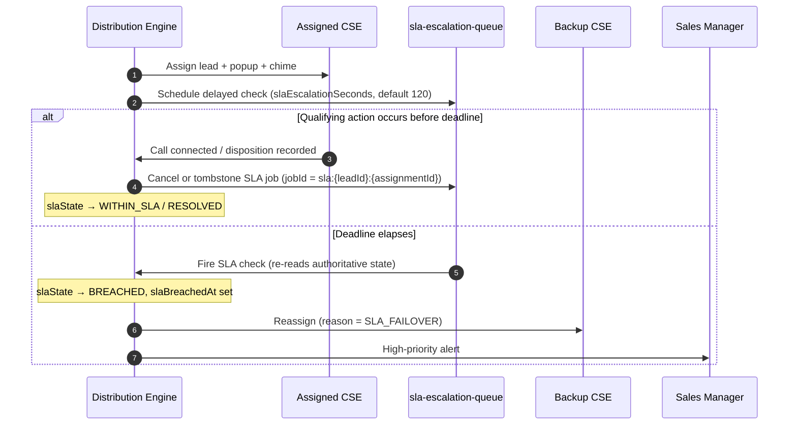

**SLA state transitions.**

```text
WITHIN_SLA → DUE_SOON   (approaching deadline; advisory, drives UI urgency)
WITHIN_SLA → BREACHED   (deadline elapsed without a qualifying action)
DUE_SOON   → BREACHED
DUE_SOON   → RESOLVED   (qualifying action before deadline)
WITHIN_SLA → RESOLVED   (qualifying action)
BREACHED   → RESOLVED   (late contact — breach remains recorded in history)

── new assignment opens a new SLA window (§11.6) ──
BREACHED   → WITHIN_SLA
RESOLVED   → WITHIN_SLA
DUE_SOON   → WITHIN_SLA
```

> `slaBreachedAt` is **never cleared** by a later resolution. The breach is a historical compliance fact; `RESOLVED` records that contact eventually happened, not that the breach did not occur.

### 11.6 SLA is measured per assignment, not per lead

A lead may be assigned several times — auto-assignment, SLA failover, manual reassignment — and **each new owner receives their own response commitment**. Without a path back to `WITHIN_SLA`, a lead that breached once would remain permanently `BREACHED`, the backup CSE's window would be unmeasurable, and the failover in §11.5 would produce an owner who can never be held to (or credited with) an SLA.

```text
Assignment #1 (CSE A)        Assignment #2 (Backup CSE, via failover)
WITHIN_SLA → BREACHED   ───▶  WITHIN_SLA → RESOLVED
     ↑                              ↑
  breach recorded in           new window opens at assignment;
  LeadAssignment + history     slaDueAt recomputed
```

| Rule | Requirement |
| :--- | :--- |
| Window opening | Opening a new `LeadAssignment` resets `slaState → WITHIN_SLA` and recomputes `slaDueAt` from the assignment timestamp, **in the same transaction as the assignment** (§35.1) |
| Historical preservation | `slaBreachedAt` and the breach's audit/history rows are **never** erased by the reset. The organization's breach count is computed from history, not from current state |
| Attribution | Each breach is attributed to the `LeadAssignment` open at the time, so a backup CSE is never charged with the previous owner's breach |
| No reset without reassignment | `slaState` never returns to `WITHIN_SLA` for the *same* assignment. A breach cannot be cleared by contacting late — that is what `RESOLVED` is for |
| Unassignment | Unassigning a lead leaves `slaState` as-is; there is no owner to hold a commitment, so no new window opens until reassignment |

> Reporting consequence: "how many leads are currently breached" reads `Lead.slaState`; "how many breaches occurred this month" reads the breach history. These are different questions and the reset only affects the first.

### 11.7 What satisfies the SLA

4.0.0 left this undefined, which makes the metric unfalsifiable. The default rule:

> **A qualifying action is one that demonstrably reached the customer or recorded a human judgement about them:** a `CallAttempt` reaching `CONNECTED`, or an owner-recorded `CallRecord.disposition`, or an outbound WhatsApp/SMS message confirmed `SENT` by the provider.
>
> **Explicitly non-qualifying:** opening the lead record, a call that only rang (`NO_ANSWER`, `BUSY`, `FAILED`), an automated welcome message dispatched by the system rather than the owner, or any purely internal action such as adding a note.

The rationale is that the SLA measures *customer response*, not agent activity — a ringing phone has not responded to anyone. The precise qualifying set is **Status: Proposed** and requires business sign-off, particularly on whether an agent-initiated-but-unanswered call should count.

### 11.8 SLA idempotency

The SLA worker will run more than once for the same logical deadline — retries, redeliveries and restarts guarantee it.

| Mechanism | Requirement |
| :--- | :--- |
| Deterministic job id | `sla:{leadId}:{assignmentId}` — enqueueing twice produces one job, not two |
| Assignment binding | The job carries the `assignmentId` it was scheduled for. On execution it re-reads the lead; if the open assignment differs, the job is **obsolete** and exits without effect |
| State guard | Transitioning to `BREACHED` is conditional on the current state not already being `BREACHED`, applied as a conditional update, not a read-then-write |
| Single-flight failover | Reassignment is performed inside the same transaction as the breach transition, so a concurrent duplicate observes the already-breached state and exits |
| Effect budget | One logical breach produces **exactly one** `BREACHED` transition, one `LeadAssignment` failover row, one manager alert and one activity entry |

> **Invariant.** Re-executing the SLA job any number of times for one deadline leaves the system in the same final state as executing it once.

---

# 12. Site Visit Architecture

`SiteVisit` is authoritative for site-visit state. The Lead's lifecycle stage indicates *where the opportunity is*; the visit entity records *what actually happened*.

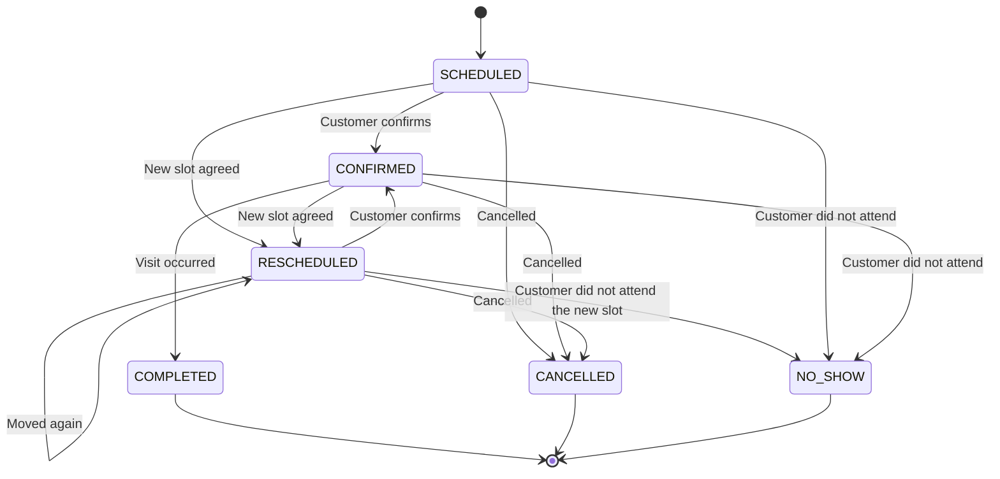

### 12.1 Separation from Lead

```text
Lead.lifecycleStage = SITE_VISIT        (opportunity position)
SiteVisit.status    = SCHEDULED         (operational reality)

…later…

Lead.lifecycleStage = SITE_VISIT
SiteVisit.status    = COMPLETED
        ↓ then, as a separate decision
Lead.lifecycleStage = NEGOTIATION
```

> `SITE_VISIT_SCHEDULED` and `SITE_VISIT_DONE` must **not** exist as Lead lifecycle stages. They describe visit state, which `SiteVisit.status` already owns authoritatively. Encoding them in the Lead creates two sources of truth that will diverge the first time a visit is rescheduled.

A Lead may have **many** SiteVisits (rescheduled, multiple projects, repeat visits). A single Lead lifecycle field cannot represent that; the entity can.

### 12.2 Visit completion and lead progression

Completing a visit emits `SiteVisitCompleted` (§22). A workflow may then **propose or perform** the `SITE_VISIT → NEGOTIATION` transition through the lifecycle service, subject to normal transition rules and authorization.

> The visit domain never writes `Lead.lifecycleStage` directly. It emits an event; the lead domain decides. This keeps the transition rules in one place and prevents contradictory state (e.g. a lead advanced past a visit that was later marked `NO_SHOW`).

`Lead.hasCompletedSiteVisit` is a derived reporting field (§8.3), recomputed from `SiteVisit`.

---

# 13. Real Estate Inventory Architecture

```text
Project (ProjectType)
   ↓
Development / Inventory Structure
   ├── Constructed: Tower → Floor
   └── Plotted:     Phase → Layout / Sector / Block
   ↓
Inventory Asset
   ├── PropertyUnit (Apartments, Villas, Row Houses, Commercial Units)
   └── Plot         (Residential, Commercial, Industrial, Farm, NA Plots)
```

The system separates the **development structure** from the **inventory asset** itself. While vertical construction groups units within towers and floors, horizontal land developments group plots within phases, sectors, and blocks.

Crucially, downstream commercial domains remain **100% unified and reusable**:

```text
Lead
 ↓
Customer
 ↓
Site Visit
 ↓
Inventory Hold (Unit OR Plot)
 ↓
Cost Sheet (Floor Rise OR Land Charges)
 ↓
Booking (One Inventory Asset)
 ↓
Payment Milestones (CLP Slabs OR Conveyance Milestones)
 ↓
Payments & Financial Ledger (Append-Only)
 ↓
Registration / Handover
```

The inventory domain determines whether the transacted asset is a constructed `PropertyUnit` or a land `Plot`.

### 13.1 Project development classification

Every project carries a canonical `ProjectType`:

```text
ProjectType : RESIDENTIAL_APARTMENT · RESIDENTIAL_VILLA · ROW_HOUSE ·
              COMMERCIAL · PLOTTED_DEVELOPMENT · MIXED_DEVELOPMENT
```

- **Constructed developments** (`RESIDENTIAL_APARTMENT`, `COMMERCIAL`, `ROW_HOUSE`, `RESIDENTIAL_VILLA`) instantiate towers and floors leading to `PropertyUnit` assets.
- **Plotted developments** (`PLOTTED_DEVELOPMENT`) instantiate phases and layout blocks leading to `Plot` assets.
- **Mixed developments** (`MIXED_DEVELOPMENT`) may contain both constructed towers and plotted sectors within separate defined zones of the same overall project.

---

### 13.A Constructed Inventory (Vertical / Built Units)

```text
Organization → Project → Tower → PropertyUnit
```

All four carry `organizationId` explicitly (§5.3).

#### 13.A.1 Unit state machine

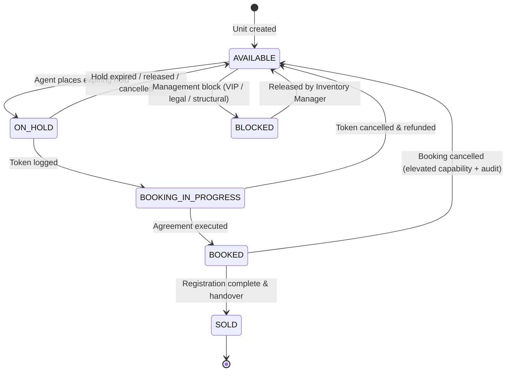

#### 13.A.2 Transition rules

| Transition | Capability | Business precondition | Notes |
| :--- | :--- | :--- | :--- |
| `AVAILABLE → ON_HOLD` | `INVENTORY_HOLD` | No active hold exists | Atomic (§14) |
| `ON_HOLD → AVAILABLE` | `INVENTORY_HOLD` (own hold) or `INVENTORY_BLOCK` | — | Also automatic on expiry |
| `AVAILABLE ↔ BLOCKED` | `INVENTORY_BLOCK` | — | Management action, audited |
| `ON_HOLD → BOOKING_IN_PROGRESS` | `BOOKING_CREATE` | Hold is `ACTIVE` **and held by the acting party**; cost sheet issued | Atomic with booking creation; **hold → `CONSUMED` here** (§14.5) |
| `BOOKING_IN_PROGRESS → BOOKED` | `BOOKING_CREATE` | Agreement executed, required payment `SUCCEEDED` | Atomic with booking confirmation; hold already `CONSUMED` |
| `BOOKED → SOLD` | `BOOKING_CREATE` / admin | Registration + handover complete | Terminal |
| `BOOKED → AVAILABLE` | `BOOKING_CANCEL` | Cancellation approved; refund path initiated | High-severity audit |
| `SOLD → *` | — | **Forbidden.** Terminal | Corrections are administrative, audited, and out of normal flow |

**Forbidden transitions** (never legal): `AVAILABLE → BOOKED` (skipping hold/token), `BLOCKED → BOOKED`, `SOLD → anything`, and any transition from a unit in another organization.

> Unit availability is authoritative in `PropertyUnit`. No Lead, Booking or report may assert a different availability, and no process may infer availability from `Lead.lifecycleStage`.

---

## 13.B Plotted Real Estate / Land Development Architecture

Plotted developments (land subdivisions, township plots, farm layouts, industrial zones) differ fundamentally from vertical construction. Land parcels have no floor levels, no carpet-area-to-super-area ratios, and no BHK room configurations. Instead, they operate with spatial dimensions, road frontages, zoning classifications, statutory land permissions, and phase-wise layout approvals.

Ralix models plotted real estate as a **first-class citizen**, rather than coercing land plots into apartment models with nullable columns.

### 13.B.1 Hierarchy: Phase, Layout, Sector and Block

Plotted developments organize land into flexible, configurable subdivisions without forcing artificial levels:

```text
Project
 └── PlotDevelopmentPhase (Phase 1, Phase 2 — statutory & launch phase)
      └── PlotLayoutBlock (Sector A, Block 3, Boulevard Road — optional subdivision)
           └── Plot (The discrete sellable or reserved asset)
```

The hierarchy permits any of the following canonical structures per project configuration:
1. `Project → Phase → Plot` (Direct phase allotment)
2. `Project → Phase → Sector / Block → Plot` (Township layout)
3. `Project → Layout → Road / Block → Plot` (Subdivision scheme)

`PlotDevelopmentPhase` represents statutory and marketing release tranches:
```text
PlotDevelopmentPhase
 ├── organizationId · projectId
 ├── name · code                  (e.g. "Phase 1 - Meadow Groves", "PH-01")
 ├── description · launchDate · status
 ├── totalPlots · developmentArea · areaUnit
 ├── layoutPlanReference          (object storage reference to approved master plan)
 └── approvalReference            (RERA / Town Planning / Sanction Order id)
```

`PlotLayoutBlock` represents spatial or physical clusters within a phase:
```text
PlotLayoutBlock
 ├── organizationId · projectId · phaseId
 ├── name · code · sector         (e.g. "Sector C", "Block 4")
 ├── roadName · roadWidth · roadWidthUnit
 └── description
```

### 13.B.2 First-class Plot inventory asset (`Plot`)

A `Plot` is a first-class inventory asset with the same concurrency, transaction, audit, and outbox guarantees as `PropertyUnit`. Its attributes are decomposed into distinct architectural facets:

```text
Plot (Inventory Asset)
 ├── Identity
 │    ├── id · organizationId · projectId
 │    ├── phaseId · blockId?
 │    ├── plotNumber              (unique within boundary, §13.B.10)
 │    └── surveyNumber?           (cadastral / revenue land survey identifier)
 │
 ├── Classification & Land Use
 │    ├── classification          SALEABLE_PLOT | ROAD | AMENITY | OPEN_SPACE | UTILITY | RESERVED | OTHER_NON_SALEABLE
 │    ├── plotType                RESIDENTIAL | COMMERCIAL | INDUSTRIAL | AGRICULTURAL_FARM | NA_RESIDENTIAL | NA_COMMERCIAL | MIXED_USE
 │    └── landUse                 RESIDENTIAL | COMMERCIAL | INDUSTRIAL | AGRICULTURAL | PUBLIC_SEMI_PUBLIC | OPEN_SPACE_RECREATIONAL
 │
 ├── Physical Characteristics
 │    ├── area                    Decimal(12, 4) (canonical stored measurement)
 │    ├── areaUnit                SQ_FT | SQ_M | SQ_YARD | ACRE | HECTARE | GUNTHA
 │    ├── dimensions              String? (e.g. "40 x 60 ft", "Irregular polygon")
 │    ├── frontage · depth        Decimal(10, 2)? (meters or feet per project unit)
 │    ├── facing                  NORTH | EAST | NORTH_EAST | WEST | SOUTH | SOUTH_EAST | SOUTH_WEST | NORTH_WEST
 │    ├── isCornerPlot            Boolean (triggers corner PLC calculation)
 │    └── roadWidth               Decimal(8, 2)? (width of abutting road)
 │
 ├── Commercial Characteristics
 │    ├── baseRate                Decimal(14, 2)
 │    ├── pricingUnit             PER_SQ_FT | PER_SQ_YARD | PER_SQ_M | FIXED_PRICE
 │    ├── developmentCharges      Decimal(14, 2) (internal roads, electrification, water)
 │    ├── infrastructureCharges   Decimal(14, 2) (clubhouse, perimeter, STP)
 │    └── plcAmount               Decimal(14, 2) (corner, park-facing, wide-road premium)
 │
 ├── Regulatory Readiness & Documentation
 │    ├── regulatoryStatus        DRAFT | UNDER_REVIEW | APPROVED | MARKETABLE | BOOKABLE | REGISTRATION_ELIGIBLE | SUSPENDED
 │    ├── reraRegistration?       String
 │    ├── naOrderRef?             String (Non-Agricultural conversion order reference)
 │    ├── layoutPlanRef?          String (Approved sanction layout sheet id)
 │    └── geometryRef?            String (GIS / boundary polygon reference)
 │
 └── Concurrency & Operational State
      ├── availability            AVAILABLE | ON_HOLD | BOOKING_IN_PROGRESS | BOOKED | SOLD | BLOCKED
      └── version                 Int (optimistic locking counter)
```

### 13.B.3 Area and measurement model

Land in real estate is measured across varying regional and legal conventions. Floating-point representations or assuming square feet universally leads to cumulative financial errors and legal disputes.

#### Canonical storage vs. Display conversion
1. **Canonical Storage**: All plot areas are stored in standard high-precision decimals (`Decimal(12, 4)`) alongside the explicitly declared `areaUnit`.
2. **Display Representation**: Transformed at the presentation layer based on the user's localized setting or the project's default unit.
3. **Exact Conversion Ratios**:
   - $1\text{ Sq. Yard} = 9\text{ Sq. Ft} = 0.83612736\text{ Sq. Meters}$
   - $1\text{ Acre} = 43,560\text{ Sq. Ft} = 4,840\text{ Sq. Yards} = 40.468564224\text{ Gunthas}$
   - $1\text{ Guntha} = 1,089\text{ Sq. Ft} = 121\text{ Sq. Yards} \approx 101.171\text{ Sq. Meters}$
   - $1\text{ Hectare} = 10,000\text{ Sq. Meters} \approx 2.47105\text{ Acres}$
4. **Rounding Policy**: Conversion for financial calculations occurs using decimal arithmetic. Rounding occurs **only at the final commercial transaction boundary** to 2 decimal places (paise/cents). Intermediate area conversions preserve at least 4 decimal places.
5. **Dimensional Independence**: Plot area is **never computed as frontage × depth** unless the plot is explicitly flagged as `GEOMETRY_RECTANGULAR`. Irregular plots, trapezoids, and cul-de-sac plots have independently surveyed and certified areas.

### 13.B.4 Plot geometry and GIS mapping

Plots may have non-rectangular physical perimeters and spatial locations on layout master plans:
- **Boundary representation**: Polygons are represented as structured GeoJSON arrays of coordinate pairs `[[x, y], ...]` stored in `geometryRef` or an auxiliary geometry record.
- **Decoupled GIS**: The CRM stores coordinate references and boundary vertex lists without coupling to a specific proprietary GIS or map vendor.
- **Layout Map Position**: X/Y coordinates and SVG path data for interactive UI master plans.
- **Privacy & Precision**: Coordinates are treated as project assets; tenant isolation filters strictly apply to map queries (§7.6).

### 13.B.5 Regulatory readiness vs. Commercial availability

A plot must never be sold or registered simply because an agent marked it "available". The architecture strictly separates **commercial availability** from **statutory / regulatory readiness**:

```text
Availability          → What can the sales team do commercially? (AVAILABLE, ON_HOLD, etc.)
Regulatory Readiness  → Is the land legally permitted for this stage? (DRAFT, APPROVED, etc.)
```

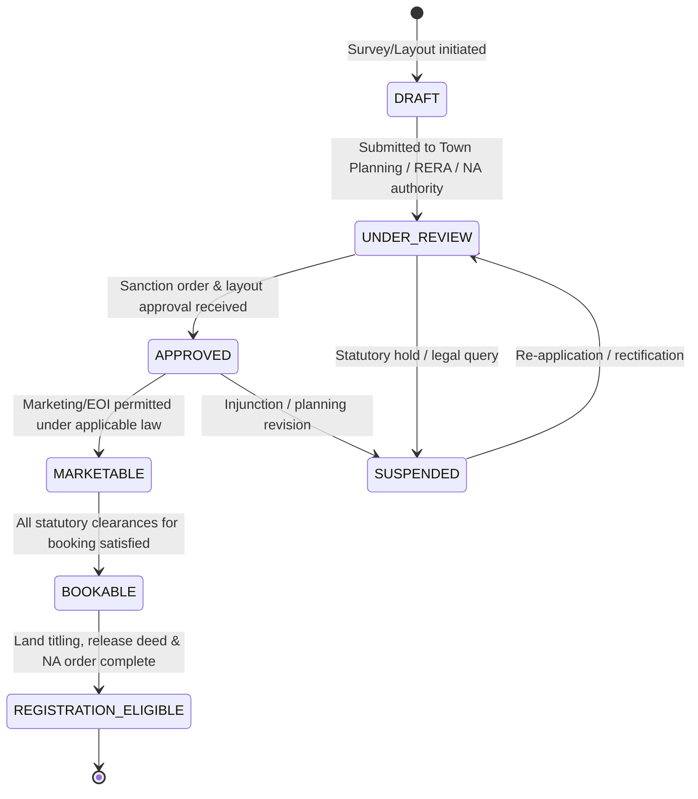

#### Readiness gates enforced by business preconditions:
- An agent may place a lead's interest on a plot in `MARKETABLE` status.
- A plot **cannot transition to `ON_HOLD` or `BOOKING_IN_PROGRESS`** unless `regulatoryStatus ∈ {BOOKABLE, REGISTRATION_ELIGIBLE}`.
- A booking **cannot transition to `REGISTERED`** unless `regulatoryStatus = REGISTRATION_ELIGIBLE`.

### 13.B.6 Plot documentation architecture

Legal compliance in plotted land requires statutory verification across revenue and planning departments. `PlotDocument` stores references to verified records using the private object storage architecture (§30):

```text
PlotDocument
 ├── organizationId · projectId
 ├── plotId? · phaseId?           (can attach to specific plot or entire phase)
 ├── documentType                 LAYOUT_PLAN | SANCTION_PLAN | TITLE_DEED |
 │                                LAND_RECORD_7_12 | PROPERTY_CARD | NA_ORDER |
 │                                RERA_CERTIFICATE | DEVELOPMENT_AGREEMENT |
 │                                SALE_DEED | ENCUMBRANCE_CERTIFICATE |
 │                                INFRASTRUCTURE_APPROVAL
 ├── documentRef                  (private object storage key)
 ├── documentName · status        PENDING | VERIFIED | REJECTED | EXPIRED
 ├── issuedDate · expiryDate?
 └── verifiedById? · verifiedAt?
```

Raw PDF/TIFF files are stored in object storage with access governed by short-lived signed URLs issued only after capability verification (`PLOT_DOCUMENT_MANAGE` or `PLOT_VIEW`).

### 13.B.7 Plot availability state machine

Plots follow the exact same inventory lifecycle semantics as constructed units, preserving total domain consistency:

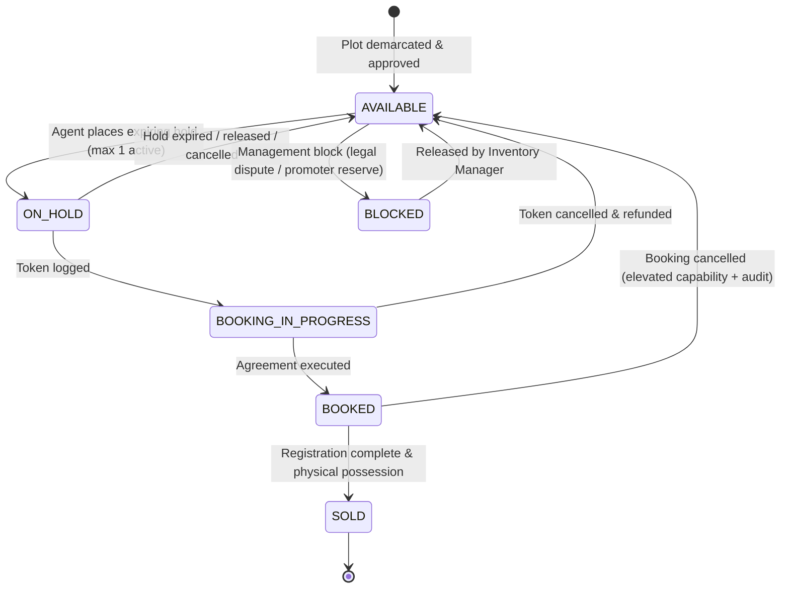

### 13.B.8 Allocation and reserved land (Non-saleable inventory)

Plotted townships allocate significant land to common infrastructure. These are classified under `Plot.classification`:
- `SALEABLE_PLOT`: Normal commercial parcel available for customer purchase.
- `ROAD`: Internal arterial/access roads.
- `AMENITY`: Clubhouse, commercial complex, sports arena.
- `OPEN_SPACE`: Parks, green buffers, gardens.
- `UTILITY`: Substation, sewage treatment plant (STP), water reservoir (OHSR).
- `RESERVED`: Future phase reserve or government authority allotment.

> **Precondition Invariant**: Only plots with `classification = SALEABLE_PLOT` may participate in `HoldPlot`, `StartPlotBooking`, or `CostSheetGenerate`. Attempts to hold or book non-saleable land are rejected with `422 VALIDATION_ERROR` (Invariant #23).

### 13.B.9 Plot number uniqueness boundary

Unlike apartment units where a unit number is unique within a tower (`towerId, unitNumber`), plotted layouts follow regional numbering rules:
- **Canonical Uniqueness**: In Ralix, a plot number is unique within its phase:
  $$\text{UNIQUE}(organizationId, projectId, phaseId, plotNumber)$$
- In layouts with independent block subdivisions where plot numbering restarts per block, uniqueness is enforced on:
  $$\text{UNIQUE}(organizationId, projectId, phaseId, blockId, plotNumber)$$

### 13.B.10 Plot transfer, merge, and subdivision (Lineage model)

During township development, promoters frequently subdivide large plots or merge adjacent plots.
> **Administrative Immutability Rule**: A plot cannot be modified, renumbered, merged, or subdivided in place if it has active holds, bookings, payments, or registered deeds.

When subdivision occurs prior to commercial commitment, it is executed via a controlled administrative lineage workflow (**Status: Proposed**):
```text
Parent Plot (e.g. Plot 100, 2000 sq. yd)
   ↓ Subdivision Event (audited, administrative capability)
Parent Plot.availability → ARCHIVED_SUBDIVIDED
   ├── Child Plot 100-A (1000 sq. yd, AVAILABLE)
   └── Child Plot 100-B (1000 sq. yd, AVAILABLE)
```
The historical record is maintained in `PlotSubdivisionLineage` linking `parentPlotId` to `childPlotId` so sales history and land provenance remain auditable.

### 13.B.11 Controlled bulk inventory import

Plotted layouts often release 500 to 5,000 plots simultaneously. Manual entry is error-prone. Ralix defines a controlled, multi-stage bulk import architecture:

```text
CSV / Excel Upload
      ↓
Stage 1: Transport & Schema Parsing (Zod validation on format, numbers, enums)
      ↓
Stage 2: Tenant & Relational Validation (verify project, phase, blocks exist in caller's org)
      ↓
Stage 3: Duplicate & Invariant Detection (check intra-file duplicates and existing DB plots)
      ↓
Stage 4: Dry-Run Preview Report (counts of VALID, INVALID, DUPLICATE rows)
      ↓
Stage 5: Dual-Auth Administrative Approval (capability PLOT_IMPORT)
      ↓
Stage 6: Transactional Batch Insertion (chunked 500 rows/tx with AuditLog & OutboxEvent)
```

`PlotImportBatch` tracks the lifecycle: `PENDING → VALIDATING → PREVIEW_READY → PROCESSING → COMPLETED | FAILED`. If any chunk violates database integrity, the batch fails safely without partial orphan plots.

### 13.B.12 Visual layout map representation

The frontend experience layer renders interactive visual layout maps from SVG geometry or coordinate grids:
- `AVAILABLE`: Displayed in standard theme neutral/available state.
- `ON_HOLD`: Amber / pending state.
- `BOOKING_IN_PROGRESS`: Blue / processing state.
- `BOOKED`: Distinct reserved indicator.
- `SOLD`: Inactive / unavailable indicator.
- `BLOCKED`: Muted / restricted indicator.

Color schemes and visual tokens are controlled by the presentation design system; domain APIs expose purely the authoritative availability state and geometry coordinates. Clicking a plot triggers the identical authorized inspection drawer used across tabular pipeline views.

---

# 14. Inventory Concurrency & Locking

This is the highest-risk concurrency surface in the system. 4.0.0 defined the state machine but not how simultaneous attempts are resolved.

### 14.1 The invariant

> **At any instant, an inventory asset (`PropertyUnit` or `Plot`) has at most one active hold or booking authority, as defined by the inventory state machine.** Two actors must never both succeed in holding or booking the same unit or plot.

### 14.2 Hold as a unified first-class entity

A hold is modelled as a single polymorphic abstraction rather than fragmented into `ApartmentHold` and `PlotHold`. Hold history, expiry, and ownership are completely unified and auditable across both asset categories:

```text
InventoryHold
 ├── organizationId
 ├── unitId?       (references PropertyUnit; mutually exclusive with plotId)
 ├── plotId?       (references Plot; mutually exclusive with unitId)
 ├── heldByUserId · leadId
 ├── status        ACTIVE | RELEASED | EXPIRED | CONSUMED
 ├── heldAt · expiresAt · releasedAt
 └── reason
```

### 14.3 Database-enforced exclusivity

Application-level "check then write" is insufficient — two transactions can both read `AVAILABLE` before either writes. The database structurally enforces exclusivity for both inventory types:

| Mechanism | Purpose |
| :--- | :--- |
| **Partial unique index** on `InventoryHold(unitId) WHERE status = 'ACTIVE' AND unitId IS NOT NULL` | Makes a second concurrent active hold on a constructed unit **unrepresentable**. The database rejects it with unique key violation |
| **Partial unique index** on `InventoryHold(plotId) WHERE status = 'ACTIVE' AND plotId IS NOT NULL` | Makes a second concurrent active hold on a land plot **unrepresentable**. Guarantees Invariant #21 |
| **Asset exclusivity CHECK constraint** `CHECK ((unitId IS NOT NULL AND plotId IS NULL) OR (unitId IS NULL AND plotId IS NOT NULL))` | Enforces that every hold references **exactly one** inventory asset — never both and never neither |
| **Row lock on the asset** (`SELECT … FOR UPDATE`) at the start of the hold/book transaction | Serializes contending transactions on the exact `PropertyUnit` or `Plot`, producing deterministic ordering |
| **Conditional state transition** (`UPDATE … WHERE availability = 'AVAILABLE'`) | The transition asserts its own precondition atomically; zero rows affected means "lost the race" |
| **Optimistic `version`** on `PropertyUnit` and `Plot` (§36) | Catches stale-read overwrites from long-lived UI sessions |

> Concurrency-sensitive invariants are enforced **by the database**, not solely by application checks (Principle 8).

### 14.4 Hold acquisition flow (Constructed Unit & Land Plot)

```text
BEGIN
  -- 1. Serialize contenders on the asset row
  IF asset_type = 'CONSTRUCTED' THEN
    SELECT unit FROM PropertyUnit WHERE id = :unitId AND organizationId = :orgId FOR UPDATE;
    assert unit.availability = AVAILABLE;
  ELSE
    SELECT plot FROM Plot WHERE id = :plotId AND organizationId = :orgId FOR UPDATE;
    assert plot.classification = SALEABLE_PLOT;
    assert plot.regulatoryStatus IN ('BOOKABLE', 'REGISTRATION_ELIGIBLE');
    assert plot.availability = AVAILABLE;
  END IF;

  -- 2. Assert no active hold (belt; partial unique index is braces)
  assert no ACTIVE hold for (unitId OR plotId);

  -- 3. Insert unified InventoryHold
  INSERT INTO InventoryHold (
    id, organizationId, unitId, plotId, heldByUserId, leadId,
    status = 'ACTIVE', expiresAt = now + org.holdMaxHours
  );

  -- 4. Transition asset availability atomically
  IF asset_type = 'CONSTRUCTED' THEN
    UPDATE PropertyUnit SET availability = 'ON_HOLD', version = version + 1 WHERE id = :unitId;
    INSERT INTO OutboxEvent (UnitHeld);
  ELSE
    UPDATE Plot SET availability = 'ON_HOLD', version = version + 1 WHERE id = :plotId;
    INSERT INTO OutboxEvent (PlotHeld);
  END IF;

  INSERT INTO AuditLog;
COMMIT;
```

**Conflict handling.** A losing contender receives `409 CONFLICT` with a machine-readable code identifying the conflict, plus the current unit state so the UI can refresh without a second round trip.

> **Retry policy.** Hold acquisition is **not** automatically retried on conflict. Silently retrying until success would hand the unit to whichever client polls hardest. The conflict surfaces to the user. Only transient infrastructure errors (deadlock, serialization failure, connection reset) are retried, with bounded attempts and jittered backoff.

### 14.5 Hold state machine

A hold has its own lifecycle, and leaving it implicit produced a real contradiction: a hold that expired *while its booking was legitimately in progress* would be `EXPIRED`, yet booking confirmation expects to consume it.

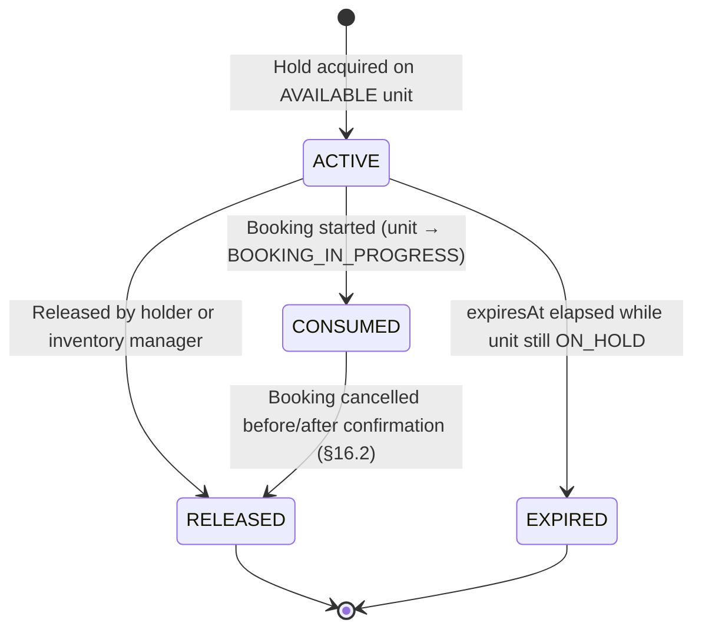

| Transition | When | Effect on unit |
| :--- | :--- | :--- |
| `ACTIVE → CONSUMED` | Booking starts. **The hold is consumed at `ON_HOLD → BOOKING_IN_PROGRESS`, not at confirmation** | `ON_HOLD → BOOKING_IN_PROGRESS` |
| `ACTIVE → EXPIRED` | `expiresAt` elapsed **and** the unit is still `ON_HOLD` for this hold | `ON_HOLD → AVAILABLE` |
| `ACTIVE → RELEASED` | Manual release | `ON_HOLD → AVAILABLE` |
| `CONSUMED → RELEASED` | Booking cancelled | `→ AVAILABLE` (§16.2) |

> **A `CONSUMED` hold never expires.** Consumption happens when the booking begins, so `expiresAt` stops applying the moment the unit leaves `ON_HOLD`. This is what removes the contradiction: a booking that takes longer than `unitHoldMaxHours` to complete no longer has its hold pulled out from under it, and `EXPIRED → CONSUMED` — a transition that should never exist — is unreachable. The §13.2 precondition "hold is active and held by the acting party" is therefore evaluated **once**, at `ON_HOLD → BOOKING_IN_PROGRESS`, not again at confirmation.

### 14.6 Hold expiry

```text
inventory-lock-queue (periodic, every 60s)
    ↓
Find holds where status = ACTIVE AND expiresAt < now
    ↓ per hold, transactionally:
SELECT unit FOR UPDATE
    ↓ conditional — only if the unit is STILL ON_HOLD for THIS hold:
InventoryHold.status → EXPIRED
PropertyUnit.availability → AVAILABLE
AuditLog + OutboxEvent (UnitHoldExpired)
    ↓ otherwise (unit progressed, or hold already CONSUMED/RELEASED):
no-op — the job exits without effect
```

Expiry is conditional on the unit still being `ON_HOLD` **for that specific hold**. A unit that has progressed to `BOOKING_IN_PROGRESS` has already moved its hold to `CONSUMED` (§14.5), so the sweep does not select it at all. Expiry is idempotent: re-running produces no additional effect.

> Expiry must never be implemented as "release every unit whose `expiresAt` has passed" without checking which hold owns the current state. That pattern releases units out from under active bookings.

### 14.7 Booking conflict

Unit transition and booking creation occur in **one transaction** (§35). If either fails, both roll back and the unit remains held. Provider calls (payment gateway, notifications) happen after commit via the outbox — never inside the lock window, since a provider timeout would hold a database row lock for the provider's timeout duration.

---

# 15. Pricing & Cost Sheet Architecture

### 15.1 Separation of concerns

```text
PricingRuleSet / PricingRuleVersion   →  how prices are computed (versioned rules)
Tax & Charge configuration            →  GST, stamp duty, registration (versioned)
CostSheet                             →  a computed, versioned commercial document
Booking.costSnapshot                  →  the immutable figures a deal was struck on
```

> Financial formulas live in a pricing domain service governed by versioned rules. They are never embedded in controllers, and never duplicated in the frontend for anything other than display preview.

### 15.2 Calculation model

$$\text{Agreement Value} = (\text{Carpet Area} \times \text{Base Rate}) + (\text{Floor} \times \text{Floor Rise}) + \text{PLC} + \text{Parking} + \text{Clubhouse}$$

$$\text{Total All-Inclusive} = \text{Agreement Value} + \text{GST} + \text{Stamp Duty} + \text{Registration} + \text{Maintenance Deposit}$$

A cost sheet records every component, not only the total:

```text
base price · floor rise · PLC · parking · amenities · discount
· taxable value · GST · stamp duty · registration · other charges · total
· pricingRuleVersionId · taxConfigVersionId
```

### 15.3 Versioning and immutability

```text
CostSheet
 ├── version               incrementing per (lead, unit) negotiation thread
 ├── status                DRAFT | ISSUED | APPROVED | SUPERSEDED | EXPIRED | CONSUMED
 ├── generatedAt · generatedById
 ├── approvedAt · approvedById      (required when discount exceeds the role cap)
 ├── pricingRuleVersionId           which rules produced these numbers
 └── lineItems                      full component breakdown
```

| Rule | Requirement |
| :--- | :--- |
| Issued sheets are immutable | Changing a price creates a **new version**; the prior version becomes `SUPERSEDED`. An issued sheet is never edited in place |
| Booking snapshot | Creating a booking copies the full commercial breakdown into the booking as a snapshot **and** references the exact `costSheetId` + `version` used |
| Explainability across time | Because the pricing rule version is recorded, a booking from last year remains fully explainable after this year's price revision |
| Discount authority | Discounts above the acting role's cap (§7.7) require approval; the approver is recorded on the sheet |
| PDF | Generated asynchronously, stored privately, served by signed URL (§30) |

> **A repriced project must never change the numbers on an existing booking.** This is the central reason pricing rules and cost sheets are versioned rather than mutable.

### 15.4 Plotted development pricing engine & CostSheet

Plotted land development pricing differs fundamentally from vertical construction: floor-rise, clubhouse premiums, and carpet area calculations do not apply to land parcels.

#### 15.4.1 Plotted pricing calculation model

$$\text{Base Land Amount} = \begin{cases} \text{Plot Area} \times \text{Base Rate Per Unit} & \text{if pricingUnit} \in \{\text{PER\_SQ\_FT, PER\_SQ\_YARD, PER\_SQ\_M}\} \\ \text{Fixed Plot Price} & \text{if pricingUnit} = \text{FIXED\_PRICE} \end{cases}$$

$$\text{Location Premiums} = \text{Corner Premium} + \text{Facing Premium} + \text{Road Width Premium} + \text{PLC}$$

$$\text{Agreement Value} = \text{Base Land Amount} + \text{Location Premiums} + \text{Development Charges} + \text{Infrastructure Charges} - \text{Discount}$$

$$\text{Total All-Inclusive} = \text{Agreement Value} + \text{Applicable Taxes} + \text{Stamp Duty} + \text{Registration} + \text{Legal \& Doc Charges} + \text{Maintenance Deposit}$$

The pricing engine calculates each line item as a discrete component:
1. **Base Land Value**: Area multiplied by rate per unit (or lump-sum fixed price).
2. **Infrastructure Charges**: External township development (electrification, perimeter wall, sewage lines, storm water drains).
3. **Development Charges**: Internal road paving, street lighting, water supply connection.
4. **Corner Plot Premium**: Calculated as a percentage of base land value or fixed per-unit surcharge when `Plot.isCornerPlot = true`.
5. **Facing Premium**: Favorable directional orientations (e.g. East or North-East facing).
6. **Road Width Premium**: Surcharge for plots abutting major boulevard roads (e.g. 60-foot or 80-foot roads).
7. **Preferential Location Charge (PLC)**: Proximity to clubhouse, green belt, or lake view.
8. **Statutory Taxes & Registration**: Stamp duty and registration charges calculated per regional revenue authority rates.

#### 15.4.2 Plot CostSheet representation

`CostSheet` natively models plot pricing using the same versioned, immutable document architecture (§15.3). It records:

```text
CostSheet (Plotted Land)
 ├── id · organizationId · leadId
 ├── plotId                   (references Plot; unitId = NULL)
 ├── plotArea · areaUnit      (e.g. 2,400 SQ_YARD)
 ├── pricingUnit              PER_SQ_YARD
 ├── ratePerUnit              Decimal(14, 2)
 ├── basePrice                (Base Land Amount)
 ├── developmentCharges       Decimal(14, 2)
 ├── infrastructureCharges    Decimal(14, 2)
 ├── plcAmount                (Total Location Premiums: corner, facing, road width)
 ├── discountApplied          Decimal(14, 2) (subject to discount authorization cap)
 ├── agreementValue           Decimal(14, 2)
 ├── stampDutyAmount          Decimal(14, 2)
 ├── registrationAmount       Decimal(14, 2)
 ├── otherCharges             (Legal, documentation, maintenance deposit)
 ├── totalAllInclusive        Decimal(14, 2)
 ├── pricingRuleVersionId     (references PlotPricingRule version)
 └── status                   DRAFT | ISSUED | APPROVED | SUPERSEDED | EXPIRED | CONSUMED
```

The immutable commercial snapshot rule applies identically: creating a plot booking copies the complete itemized breakdown into `Booking.costSnapshot`. Subsequent rate revisions in `PlotPricingRule` never alter existing quotes or confirmed plot bookings.

---

# 16. Booking Architecture

`Booking` is its own aggregate and the authoritative source for deal state.

```text
Booking
 ├── organizationId
 ├── customerId · leadId
 ├── unitId?                     (references PropertyUnit; mutually exclusive with plotId)
 ├── plotId?                     (references Plot; mutually exclusive with unitId)
 ├── channelPartnerId            (attribution at time of booking)
 ├── costSheetId + costSheetVersion
 ├── costSnapshot                immutable commercial figures
 ├── status                      DRAFT | CONFIRMED | CANCELLED | COMPLETED
 ├── registrationStatus?         AGREEMENT_PENDING | AGREEMENT_EXECUTED | REGISTRATION_PENDING | REGISTERED | POSSESSION_HANDOVER
 ├── bookingDate
 ├── statusHistory               BookingStatusHistory[]
 ├── milestones                  PaymentMilestone[]
 └── payments                    Payment[]
```

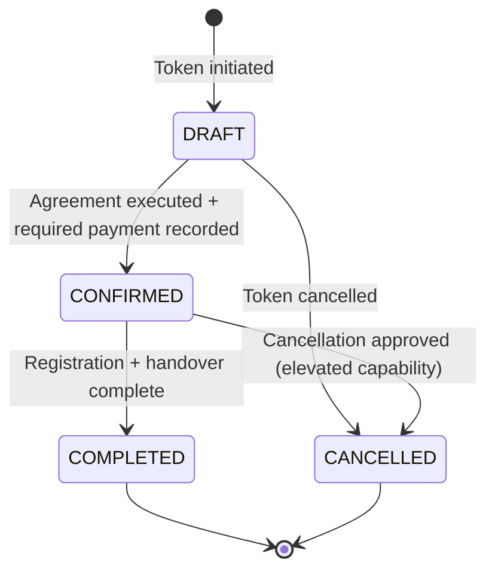

### 16.1 Booking invariants

1. **A booking's inventory asset never silently changes.** Changing the unit or plot means cancelling and creating a new booking — the physical asset is the subject of the agreement.
2. **Exactly one inventory asset per booking.** A booking must reference `unitId XOR plotId`. Simultaneous reference to both or neither is rejected at the database level by a strict CHECK constraint (Invariant #22).
3. **The commercial total is auditable forever** via the cost snapshot and its pricing rule version.
4. **Confirmation requires preconditions**: an executed agreement, the required token payment recorded, and the asset in `BOOKING_IN_PROGRESS`.
5. **Asset state and booking state change transactionally together** (§35). A confirmed booking on an `AVAILABLE` asset is a corruption, not a recoverable inconsistency.
6. **Cancellation is never a delete.** It is a status transition with a reason, an actor, an audit entry and a refund path.
7. **`Lead.lifecycleStage = WON` follows from `Booking.status = CONFIRMED`** — never the reverse. The lead reflects the booking; the booking never reflects the lead.

### 16.2 Cancellation and its downstream consequences

Cancellation of a **confirmed** booking is the single event that touches the most domains at once, so its propagation is specified explicitly rather than left to each domain to infer.

```text
Booking.status → CANCELLED          (authoritative decision; capability BOOKING_CANCEL)
        ↓ same transaction
BookingStatusHistory · AuditLog · InventoryHold → RELEASED (if any)
IF booking.unitId IS NOT NULL THEN
  PropertyUnit.availability → AVAILABLE           (BOOKED → AVAILABLE, §13.2)
ELSE
  Plot.availability → AVAILABLE                   (BOOKED → AVAILABLE, §13.B.7)
END IF
PaymentMilestone rows → VOIDED (UPCOMING, DUE, INVOICED, PAID_PARTIAL → VOIDED; no further demands generated)
        ↓ OutboxEvent: BookingCancelled
        ↓ ─────── async ───────
Workflow reacts:
  • Lead lifecycle WON → CANCELLED        (via lifecycle service, §10.3)
  • Lead.status → CLOSED
  • Refund path initiated where money was received (§17.4)
  • CP attribution / commission clawback evaluated (§18.2)
```

| Rule | Requirement |
| :--- | :--- |
| Authority | `Booking` decides. The Lead, the asset and the commission ledger all *react* |
| Atomicity | Booking status, asset release (unit or plot), hold release, milestone voiding (to `VOIDED`) and audit commit together (§35.1) |
| Asset Target Exclusivity | Plot cancellation releases the plot; unit cancellation releases the unit. Cross-domain asset corruption is structurally impossible |
| Lead consequence | Applied asynchronously via `BookingCancelled`, never written inside the booking transaction — this keeps lifecycle rules in the lifecycle service and avoids two domains writing `lifecycleStage` |
| Idempotency | The workflow is keyed on `(bookingId, BookingCancelled.eventId)`; a replayed event performs the lead transition once. A lead already in `CANCELLED` is a no-op, not an error |
| Financial | Cancellation **never** deletes payments. Money already received is returned through a compensating refund record (§17.4) |
| Irreversibility | A cancelled booking is not re-confirmed. Proceeding again requires a new booking against a newly held asset |

> Without this specification, `Lead = WON` and `Booking = CANCELLED` could coexist permanently — the exact contradiction Decision A removes.

### 16.3 Construction-Linked Plan (CLP) — Constructed Inventory

```text
Milestone Schedule (Constructed CLP):
 ├── Booking Token (10%)               → due on booking
 ├── Agreement Execution (10%)         → due within N days
 ├── Plinth Completion (15%)           → triggered by tower construction stage
 ├── Slabs 1–10 (5% each = 50%)        → triggered per slab progress
 ├── Flooring & Finishing (10%)        → triggered on plaster completion
 └── Notice of Possession (5%)         → due on handover
```

**Demand Notice Engine.** Advancing a tower's construction stage emits `ConstructionStageAdvanced`, which asynchronously compiles demand invoices for affected bookings and dispatches notices via email/WhatsApp.

> Demand generation is idempotent per `(milestoneId, stageEvent)`. Advancing a tower twice, or replaying the event, must not issue duplicate demands to buyers — an over-billed customer is a serious business incident.

### 16.4 Plotted development booking, milestones & conveyance lifecycle

Plotted land sales follow a legal conveyance and land-development progression rather than vertical construction stages. Forcing tower construction stages onto land plots is prohibited.

#### 16.4.1 Plotted milestone schedule models

Plotted developments configure milestones across four architectural models:
1. **Conveyance / Legal Milestones**:
   ```text
   Plotted Milestone Schedule:
    ├── Booking Token Advance (e.g. 10%)              → due on booking
    ├── Agreement to Sell Execution (e.g. 20%)        → due within 30 days
    ├── Layout Infrastructure Completion (e.g. 30%)   → roads, drains, power demarcation
    ├── Sub-Registrar Conveyance / Deed (e.g. 30%)    → due on deed execution & registration
    └── Physical Demarcation & Possession (e.g. 10%)  → on peg-marking & possession certificate
   ```
2. **Time-Linked / Fixed-Date Installments**: Configurable installment dates (e.g. 25% quarterly) independent of site progress.
3. **Statutory Sanction Triggers**: Milestones triggered by statutory releases (e.g. Final NA Order release, RERA completion certificate).
4. **Custom Milestones**: Configured per organization policy and customer commercial terms.

All payment milestones for plots integrate into the exact same immutable payment ledger, receipt generator, and demand notice engine specified in §17.

#### 16.4.2 Plotted conveyance state machine

For plotted developments, `Booking` tracks legal conveyance through `registrationStatus`:

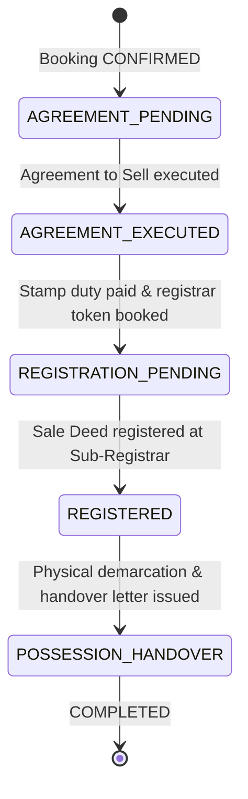

> **Statutory Precondition Gate**: Transition to `REGISTERED` requires that the plot's `regulatoryStatus = REGISTRATION_ELIGIBLE` and all prerequisite milestone payments have status `SUCCEEDED`. Registering an unapproved or encumbered plot violates Invariant #25.

---

# 17. Payments & Financial Integrity

### 17.1 Three distinct concepts

| Concept | Meaning |
| :--- | :--- |
| `PaymentMilestone` | What is **owed**, and when — the schedule |
| `Payment` | What was **received or returned** — an actual movement of money |
| Ledger event | The append-only financial record derived from payments (**Status: Proposed** — a formal double-entry ledger is not adopted in this revision) |

> These are never merged. A milestone is a plan; a payment is a fact. Updating a milestone's "paid amount" without a corresponding payment record destroys reconcilability.

### 17.2 Financial immutability

> **Payment records are append-only.** A payment is never edited or deleted. Corrections are new compensating records (refund, adjustment) that reference the original.

Milestone aggregate amounts (`amountPaid`, `status`) are **derived** from the payment records and recomputed, never independently authored.

### 17.3 Payment lifecycle

Principle 6 requires every lifecycle to declare its legal transitions, and money is the last place to leave them implicit.

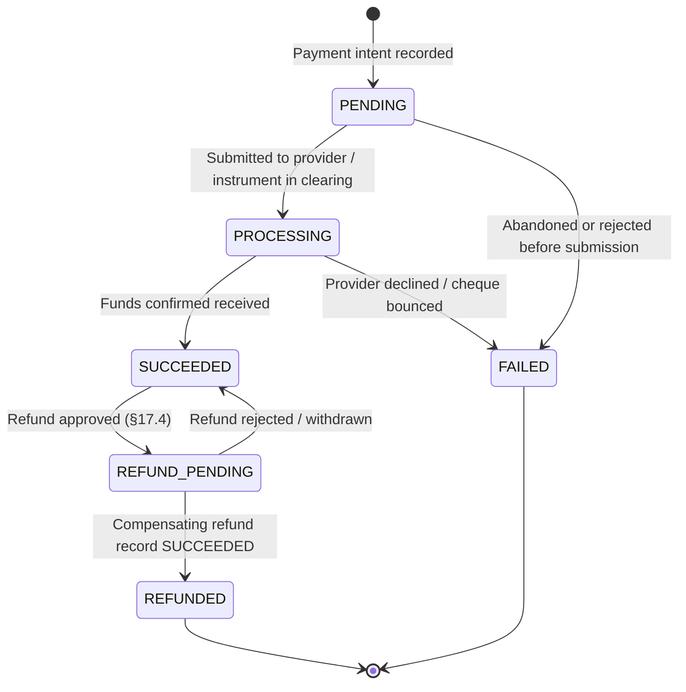

| State | Meaning |
| :--- | :--- |
| `PENDING` | Intent recorded; no movement of money confirmed |
| `PROCESSING` | Submitted to the provider, or an instrument (cheque, transfer) is clearing |
| `SUCCEEDED` | Funds confirmed received. **This is the terminal success state of the original record** |
| `FAILED` | No money moved. Terminal |
| `REFUND_PENDING` | A refund has been approved against this payment but is not yet settled |
| `REFUNDED` | Fully returned via one or more compensating records. Terminal |

> **A record in `PENDING` or `PROCESSING` has not yet asserted that money moved**, so advancing it is a completion of the original fact, not a rewrite of it. Once `SUCCEEDED`, the *amount, payer, instrument and timestamp are frozen forever* — the only permitted further change is the refund annotation, which exists to make the compensating record discoverable from the original.

### 17.4 Refunds and reversals — compensating records only

> **There is no `REVERSED` status and no `SUCCEEDED → REVERSED` transition.** Mutating a settled payment into a reversal would destroy the record that money was once received, leaving the ledger unable to explain either the inflow or the outflow.

A refund is a **new `Payment` row** in the opposite direction:

```text
Original Payment                        Compensating Payment
 ├── type   = MILESTONE                  ├── type   = REFUND
 ├── amount = 500,000  (positive)        ├── amount = 500,000  (positive)
 ├── status = SUCCEEDED → REFUND_PENDING ├── status = PENDING → SUCCEEDED
 └── id     = pay_A         ◀────────────┴── reversalOfPaymentId = pay_A
```

| Rule | Requirement |
| :--- | :--- |
| Direction | Expressed by `type` (`REFUND` / `ADJUSTMENT`), never by a negative `amount` — the `amount > 0` check constraint holds for every row |
| Linkage | `reversalOfPaymentId` points at the original, making the pair reconstructable from either side |
| Original record | Never edited beyond its own lifecycle transition to `REFUND_PENDING` → `REFUNDED`; amount and payer are immutable |
| Partial refunds | Multiple compensating records may reference one original. The original reaches `REFUNDED` only when the refunded total equals its amount; otherwise it remains `SUCCEEDED` with a derived partially-refunded indicator |
| Bound | Refunded total may never exceed the original amount, nor the booking's net received amount; enforced in-transaction |
| Authorization | Requires `PAYMENT_REFUND` (§7.7); the transaction boundary is defined in §35.1 |
| Aggregates | Milestone `amountPaid` is recomputed from `SUCCEEDED` inflows minus `SUCCEEDED` refunds — never decremented in place |

### 17.5 Required guarantees

| Guarantee | Mechanism |
| :--- | :--- |
| Amount validity | `amount > 0` enforced by database constraint; direction expressed by payment type, not a negative amount |
| Refund bound | Refund total for a booking may never exceed the net received amount; enforced in-transaction against the current aggregate |
| Duplicate prevention | Unique constraint on `(organizationId, provider, providerTransactionRef)` where a provider reference exists |
| API idempotency | `Idempotency-Key` required on payment creation (§25.3); a repeated key returns the original result rather than creating a second payment |
| Webhook idempotency | Gateway callbacks deduplicated via `WebhookEvent (provider, providerEventId)` (§21) |
| Reconciliation | Scheduled comparison of internal payments against provider settlement reports; discrepancies raise an alert and a reconciliation record — never an automatic silent correction |
| Audit | Every payment, refund and status change writes an `AuditLog` entry in-transaction |
| Retention | Financial records are never hard-deleted (§34.4) |

> **A double-charged customer and a lost payment are both unacceptable.** Idempotency protects against the first; the outbox and reconciliation protect against the second.

### 17.6 Partial completion — provider charged, we did not record

This is the most dangerous failure in the system: the customer's money has moved, but no record of it exists on our side. It cannot be prevented — the network can fail after the provider commits and before we do — so it is **detected and reconciled** rather than assumed away.

```text
1. Payment intent recorded FIRST, in our database:  status = PENDING
   (idempotencyKey + providerTransactionRef reserved before the provider is called)
        ↓ COMMIT
2. Provider charged
        ↓
   ┌────────────────────────┴────────────────────────┐
   Provider confirms                        We never learn the outcome
   ↓                                        (timeout / crash / lost webhook)
   status → SUCCEEDED                       status stays PENDING/PROCESSING
                                                      ↓
                                            Reconciliation (§17.5) compares
                                            provider settlement vs. our rows
                                                      ↓
                                            Discrepancy record + ALERT
                                                      ↓
                                            Human financial review resolves:
                                            confirm → SUCCEEDED, or refund
```

| Rule | Requirement |
| :--- | :--- |
| **Intent-first ordering** | The `PENDING` row is committed **before** the provider is called. A charge can then never exist without a local record to reconcile against — the row may be incomplete, but it is never absent |
| Never auto-resolve | A stale `PENDING`/`PROCESSING` row is **never** silently marked `SUCCEEDED` or `FAILED` by a timeout. Guessing either way is a financial error: one fabricates revenue, the other abandons the customer's money |
| Status query | Where the provider supports it, a reconciliation worker queries the authoritative transaction status by `idempotencyKey`/`providerTransactionRef` before escalating |
| Ageing alert | A payment in `PENDING`/`PROCESSING` beyond a defined threshold raises an alert (§37.4). **Threshold: TBD** |
| Terminal path | Every such row terminates in a human decision recorded with actor and reason — never in silent expiry |

> The inverse failure (we recorded, provider never charged) is caught by the same reconciliation pass and resolved by marking the row `FAILED` with the provider's authoritative evidence attached.

### 17.7 Payment milestone state model & transitions

`PaymentMilestone` represents the schedule of what is **owed** (§17.1). It undergoes its own business lifecycle tracked by `MilestoneStatus`:

| State | Meaning |
| :--- | :--- |
| `UPCOMING` | Scheduled in the future; construction/trigger stage not yet reached |
| `DUE` | Trigger condition met; payment due date active |
| `INVOICED` | Demand notice generated and dispatched to buyer |
| `PAID_PARTIAL` | One or more payments received; `amountPaid < amountDue` |
| `PAID_FULL` | Fully settled; `amountPaid >= amountDue` |
| `OVERDUE` | Past due date with outstanding balance |
| `VOIDED` | The milestone is no longer collectible because its associated booking was cancelled or the demand was formally invalidated |

**Milestone state semantics & cancellation transitions:**
- `VOIDED` is a **schedule/business state**, not a payment record. It indicates that the milestone obligation is no longer collectible and no further demands will be issued.
- **Transition on cancellation**: When a booking is cancelled (§16.2), milestones in uncompleted or open states transition to `VOIDED`:
  ```text
  UPCOMING / DUE / INVOICED / PAID_PARTIAL → VOIDED
  ```
- **Settled milestones**: A milestone in `PAID_FULL` does **not** transition to `VOIDED`. If money must be returned following booking cancellation, the milestone record is preserved and funds are returned through the immutable refund / compensating-payment architecture (`type = REFUND`, §17.4).
- **Financial integrity invariant**: Payment records remain strictly append-only. `amountPaid` remains derived from `Payment` records (`SUCCEEDED` inflows minus `SUCCEEDED` refunds). Cancellation and voiding do **not** mutably delete or reverse `Payment` records.

---

# 18. Channel Partner Architecture

4.0.0 expressed the 60-day non-poaching rule in prose only, which leaves the most commercially contested rule in the system unimplementable. It is modelled explicitly here.

```text
ChannelPartner
 ├── organizationId · firmName · contactPerson · phone · email · reraNumber
 ├── tier                 SILVER | GOLD | PLATINUM
 └── isActive

LeadAttribution                    current attribution
 ├── organizationId · leadId · customerId · channelPartnerId
 ├── status               ACTIVE | EXPIRED | TRANSFERRED | REVOKED
 ├── attributedAt · expiresAt
 └── source               CP_REGISTRATION | FIRST_TOUCH | MANUAL

AttributionHistory                 append-only changes with actor + reason
CommissionRule                     versioned: base rate, volume accelerator, tier modifiers
CommissionPayout                   computed, approved, paid
```

### 18.1 Attribution lifecycle

```text
created     CP registers a customer, or first-touch attribution on lead ingestion
validated   customer not already actively attributed to another CP (window check)
extended    qualifying activity may extend expiry, where organization policy permits
expired     attribution window elapsed without conversion → customer becomes open
transferred explicit, audited reassignment between partners
revoked     policy violation or fraud, audited
```

**The attribution window** (default 60 days, organization-configurable) is evaluated at attribution time against `(organizationId, customerId)`. A second CP registering an actively-attributed customer is rejected with a conflict — it never silently overwrites the first partner's claim. Transfer, extension and revocation all require `ATTRIBUTION_MANAGE` (§7.7).

> Attribution changes are commercially equivalent to moving money. Every create, extend, transfer, expire and revoke is audited with actor and reason, and the full chain is preserved in `AttributionHistory`.

### 18.2 Commission

Commission is computed from a **versioned** `CommissionRule` (base rate, e.g. 2.0%, plus volume accelerator, e.g. +0.5% at ≥3 deals, plus tier modifiers). In multi-asset environments, commission structures frequently differentiate between constructed inventory and plotted land: rules can be scoped per `Project`, `Phase`, `plotType` (`PlotType`), `productType` (`CONSTRUCTED` vs `PLOTTED`), booking value slabs, and partner tier. The rule version applied is recorded on the payout so historical payouts remain explainable after rate changes — the same versioning principle as pricing (§15.3).

Payout progresses `PENDING → APPROVED → PAID`, requires `COMMISSION_APPROVE` (§7.7), and is append-only once paid. A booking cancellation (§16.2) triggers clawback evaluation against any payout already generated; a `PAID` payout is never edited — clawback is recorded as a new negative-direction payout record, mirroring the compensating-record rule for payments (§17.4).

---

# 19. Communication Architecture

### 19.1 Telephony

Technical call progress and business outcome are **separate** concepts and must not share a field.

```text
CallAttempt              technical lifecycle, provider-driven
 └── status   INITIATED → RINGING → CONNECTED → COMPLETED
                                 ↘ FAILED | NO_ANSWER | BUSY | CANCELLED

CallRecord               business record of a connected/attempted conversation
 ├── callAttemptId · leadId · userId
 ├── durationSeconds · recordingRef
 └── disposition   CONNECTED | NO_ANSWER | BUSY | CALLBACK_REQUESTED | INTERESTED |
                   NOT_INTERESTED | WRONG_NUMBER | INVALID
```

> **`CallDisposition` describes one call. `LeadDisposition` describes the opportunity.** They are different enums on different entities with different lifetimes.

A lead accumulates call history without any call overwriting the lead's accumulated state:

```text
Call 1 → NO_ANSWER
Call 2 → CONNECTED
Call 3 → CALLBACK_REQUESTED
                ↓
Lead: lifecycle = CONTACTED · status = CALLBACK_PENDING · temperature = HOT
```

All three call records are retained. Only the narrowly-permitted cross-dimension write from §10.2 applies.

**Masked duplex calling.** The agent clicks "Call"; the provider bridges the agent's virtual extension to the customer through virtual numbers. CSEs never see raw customer numbers (§31), which eliminates phone-list exfiltration. Recordings are stored privately and served by signed URL (§30).

### 19.2 WhatsApp

```text
WhatsAppTemplate             provider-approved message template
 ├── providerTemplateId · name · language · category
 ├── status   DRAFT | PENDING_APPROVAL | APPROVED | REJECTED | PAUSED | DISABLED
 └── parameter definition (ordered, typed placeholders)

Conversation                 per (organization, customer) thread
 ├── status · lastInboundAt · lastOutboundAt · serviceWindowExpiresAt
 └── messages

WhatsAppMessage
 ├── conversationId · leadId · direction (INBOUND | OUTBOUND)
 ├── templateId · templateParameters  (outbound template sends)
 ├── providerMessageId                (idempotency + status correlation)
 ├── deliveryStatus  QUEUED | SENT | DELIVERED | READ | FAILED
 └── content / mediaRef
```

**Templates are provider-governed, not CRM-governed.** Meta approves each template out of band, so the CRM mirrors rather than owns approval state:

| Rule | Requirement |
| :--- | :--- |
| Send eligibility | Only an `APPROVED` template may be dispatched. A send referencing a `REJECTED`/`PAUSED`/`DISABLED` template fails validation before enqueueing |
| Approval state | Mirrored from the provider via webhook; the CRM never marks a template `APPROVED` on its own authority |
| Parameters | The ordered parameter definition is validated against supplied values at send time — a mismatch is a `VALIDATION_ERROR`, never a silently malformed customer message |
| Tenancy | Class A. Templates belong to one organization and are never shared across tenants, even when the provider account is shared |
| Service window | Outside the provider's customer-service window, only template messages may be sent; free-form sends are rejected at validation |

> Delivery status (`SENT`/`DELIVERED`/`READ`/`FAILED`) is a **transport fact** and is never conflated with business response or disposition. A `READ` message tells you nothing about buyer intent.

Inbound provider events are idempotent on `providerMessageId` (§21). Outbound sends are dispatched through the queue with rate limiting, and carry an idempotency key so a retry cannot double-send to a customer.

Capabilities: automated welcome template on lead creation, interactive quick replies (`[Schedule Site Visit]`, `[Download Brochure]`), and a two-way agent inbox with read receipts.

---

# 20. External Integration Architecture

```text
External Provider
      ↓
Integration Adapter        ← provider-specific: auth, payload shape, error mapping, retry semantics
      ↓
Application Service        ← normalized commands and normalized failures
      ↓
Domain
```

> **Provider-specific logic must not leak beyond its adapter.** No domain service, controller or worker may reference a provider's payload shape, error codes or authentication scheme. Swapping Exotel for Knowlarity must be an adapter change, not a cross-cutting refactor.

Applies uniformly to: Meta Lead Ads, WhatsApp Cloud API, Exotel/Knowlarity, email, SMS, payment gateway, object storage.

### 20.1 Adapter contract

Every adapter provides:

| Element | Requirement |
| :--- | :--- |
| Normalized request/response | Domain-shaped types; no provider DTOs escape |
| Normalized failure taxonomy | `TRANSIENT` (retry), `PERMANENT` (do not retry), `RATE_LIMITED` (retry after), `AUTH` (alert — credentials wrong/expired) |
| Timeout | A bounded timeout on every call; no unbounded provider wait |
| Circuit breaker | Repeated failures trip the breaker, failing fast into the retry/DLQ path rather than exhausting workers |
| Idempotency key propagation | Where the provider supports it, so provider-side retries deduplicate |
| Credential resolution | Via secret manager reference (§31.6), never plaintext configuration |
| Instrumentation | Latency, error rate and breaker state per provider |

### 20.2 Failure containment

> An external provider failure must never corrupt transactional domain state, roll back a committed business fact, or block a user request that does not strictly require the provider's response. Provider calls occur **after** commit, in workers, via the outbox (§23).

---

# 21. Webhook Architecture

### 21.1 Provider-scoped idempotency

4.0.0 used a single globally-unique `eventId`, which collides the moment two providers issue the same identifier format. Replaced by:

```text
WebhookEvent
 ├── organizationId          (resolved during verification)
 ├── provider                META_LEAD_ADS | WHATSAPP | EXOTEL | PAYMENT_GATEWAY
 ├── providerEventId         the provider's own identifier
 ├── eventType
 ├── status                  RECEIVED | PROCESSING | PROCESSED | FAILED | DEAD_LETTER
 ├── attemptCount · lastError
 ├── payloadReference        (object storage ref; large payloads are not inlined)
 ├── signatureVerifiedAt
 ├── receivedAt · processedAt
 └── correlationId

UNIQUE (provider, providerEventId)
```

> Uniqueness is `(provider, providerEventId)`. A duplicate delivery is recognised, acknowledged with success, and produces **no** additional domain effect.

### 21.2 Ingestion pipeline

```text
Inbound webhook
    ↓ 1. Verify signature (e.g. x-hub-signature-256 with the org's app secret)
    ↓    Failure → reject, audit, alert. Never process an unverified payload
    ↓ 2. Resolve organization from the provider account mapping
    ↓ 3. Idempotency guard: INSERT WebhookEvent (provider, providerEventId)
    ↓    Unique violation → already known → return 200 immediately, no effect
    ↓ 4. Persist payload reference; status = RECEIVED
    ↓ 5. Enqueue processing job (deterministic jobId = webhookEventId)
    ↓ 6. Return 200 fast (target < 1500 ms)
    ↓ ─────────── async boundary ───────────
    ↓ 7. Worker: status → PROCESSING
    ↓ 8. Normalize → resolve customer → create lead → score → distribute → SLA timer
    ↓ 9. status → PROCESSED  |  retry on TRANSIENT  |  DEAD_LETTER on exhaustion
```

**Acknowledge fast, process asynchronously.** Providers disable endpoints that respond slowly; business processing must never happen inside the webhook request.

### 21.3 Replay and abuse protection

| Concern | Requirement |
| :--- | :--- |
| Replay attacks | Timestamp tolerance window enforced alongside signature verification; stale payloads rejected |
| Signature | Verified against the **raw** request body before any parsing |
| Rate limiting | Per provider and per organization (§27.6) |
| Unknown organization | Rejected and alerted, never processed under a default tenant |
| Payload retention | Retained for a defined window to support replay/debugging. **Window: TBD** |
| Manual replay | Operators may re-drive a `DEAD_LETTER` event; replay is idempotent by construction |

### 21.4 Meta lead ingestion (end-to-end)

```text
Meta
 ↓ webhook
Signature verification
 ↓
Organization resolution
 ↓
Idempotency guard (provider, leadgen_id)
 ↓
WebhookEvent persisted  ─┐
 ↓                        │ same transaction
OutboxEvent enqueued     ─┘
 ↓ COMMIT
Queue → worker
 ↓
Phone/email normalization (§9.3)
 ↓
Customer resolution (§9.5)
 ↓
Lead creation: lifecycle=NEW · status=ACTIVE · temperature=(scored) · sla=WITHIN_SLA
 ↓
Duplicate evaluation → DuplicateCandidate where warranted
 ↓
Scoring
 ↓
Distribution + SLA timer
 ↓
Welcome communication
```

> A retried Meta delivery must never create a second Lead. Idempotency is established **before** any domain work, at step 3.

---

# 22. Domain Event Architecture

Domain events are the integration seam between domains and the trigger surface for asynchronous work.

### 22.1 Event catalogue

```text
Lead:       LeadCreated · LeadAssigned · LeadReassigned · LeadStageChanged ·
            LeadStatusChanged · LeadTemperatureChanged · LeadDispositionChanged ·
            LeadScoreChanged · LeadSLABreached · LeadSLAResolved · DuplicateDetected ·
            DuplicateResolved

Visit:      SiteVisitScheduled · SiteVisitConfirmed · SiteVisitCompleted ·
            SiteVisitCancelled · SiteVisitNoShow

Inventory:  UnitHeld · UnitHoldExpired · UnitHoldReleased · UnitBookingStarted ·
            UnitBooked · UnitSold · UnitBlocked · UnitReleased

Plotted:    PlotCreated · PlotUpdated · PlotBlocked · PlotReleased · PlotHeld ·
            PlotHoldExpired · PlotHoldReleased · PlotBookingStarted · PlotBooked ·
            PlotRegistered · PlotSold · PlotSubdivisionCreated · PlotMerged ·
            PlotRegulatoryStatusChanged · PlotImportBatchProcessed

Commercial: CostSheetGenerated · CostSheetApproved · BookingCreated ·
            BookingConfirmed · BookingCancelled · ConstructionStageAdvanced

Financial:  PaymentCreated · PaymentReceived · PaymentFailed · PaymentRefunded ·
            MilestoneDue · DemandNoticeIssued

Partner:    ChannelPartnerAttributed · AttributionExpired · AttributionTransferred ·
            CommissionGenerated

Security:   RolePermissionsChanged · MembershipSuspended · SessionRevoked
```

### 22.2 Event contract

| Property | Requirement |
| :--- | :--- |
| Immutable | An emitted event is never edited. A correction is a new event |
| Versioned | `eventType` + `eventVersion`; consumers tolerate unknown additive fields |
| Tenant-scoped | Always carries `organizationId` |
| Traceable | Carries `correlationId`, `causationId`, actor and timestamp |
| Idempotently consumable | Carries a stable `eventId`; consumers deduplicate on it |
| Self-contained | Carries the identifiers a consumer needs; consumers re-read authoritative state rather than trusting embedded snapshots for decisions |
| PII-minimal | No raw phone/email in payloads; consumers resolve PII through the authorized data path (§31.3) |

> An event records **that something happened**, not what a consumer should do about it. Consumers decide their own reaction, which keeps domains decoupled.

---

# 23. Transactional Outbox Architecture

### 23.1 The problem

```text
BEGIN … write domain change … COMMIT
    ↓
enqueue job  ←— process crashes / Redis unavailable
```

The database change is committed but the side effect never happens. A lead exists with no assignment notification, no SLA timer and no welcome message — silently. The inverse (enqueue first, then fail to commit) produces a job referencing a record that does not exist.

### 23.2 The pattern

```text
┌──── Database Transaction ────┐
│  Domain mutation             │
│  History record              │
│  AuditLog                    │
│  OutboxEvent  ← same tx      │
└──────────┬───────────────────┘
           ↓ COMMIT  (atomic — all or nothing)
     Outbox Publisher (polling / CDC)
           ↓
        BullMQ
           ↓
        Worker
           ↓
   External Side Effect
```

```text
OutboxEvent
 ├── id · organizationId
 ├── eventType · eventVersion · payload
 ├── aggregateType · aggregateId
 ├── status        PENDING | PUBLISHED | FAILED
 ├── attemptCount · lastError
 ├── correlationId · causationId
 ├── createdAt · publishedAt
 └── availableAt   (backoff scheduling)
```

### 23.3 Guarantees

| Guarantee | Consequence |
| :--- | :--- |
| **At-least-once delivery** | The publisher may publish a row twice (crash between publish and status update). This is why every consumer must be idempotent (§25) |
| No lost events | A committed domain change always has a committed outbox row; the publisher retries until published |
| No phantom events | A rolled-back transaction leaves no outbox row, so no side effect fires for work that did not happen |
| Ordering | Per-aggregate ordering is preserved by publishing in `createdAt` order per `aggregateId`. **Global ordering is not guaranteed** and must not be assumed |

> **Exactly-once delivery does not exist.** The architecture provides at-least-once delivery plus idempotent consumers, which is operationally equivalent and actually achievable.

The publisher claims rows with a row-lock/skip-locked pattern so multiple publisher instances can run without double-claiming. Publisher lag is a monitored metric with an alert (§37.3).

---

# 24. BullMQ / Redis Architecture

### 24.1 Queue catalogue

| Queue | Producer / Trigger | Consumer responsibility | Retry | DLQ | Idempotency key |
| :--- | :--- | :--- | :--- | :--- | :--- |
| `outbox-publisher` | Scheduler (continuous) | Publish committed outbox rows to queues | Continuous with backoff | No (rows stay `PENDING`) | `outboxEventId` |
| `lead-ingestion-queue` | Webhook / API outbox | Normalize, resolve customer, create + score lead | Exponential, bounded | Yes | `webhookEventId` |
| `lead-distribution-queue` | `LeadCreated` | Select owner, assign, notify | Exponential, bounded | Yes | `leadId:assignmentAttempt` |
| `sla-escalation-queue` | `LeadAssigned` (delayed) | Evaluate SLA deadline, breach + failover | Bounded | Yes | `sla:{leadId}:{assignmentId}` |
| `telephony-webhook-queue` | Provider webhook outbox | Ingest call progress, duration, recording | Exponential, bounded | Yes | `provider:providerEventId` |
| `whatsapp-dispatch-queue` | Outbox / workflow | Rate-limited outbound sends | Exponential, bounded | Yes | `messageId` |
| `whatsapp-webhook-queue` | Provider webhook outbox | Inbound messages + delivery status | Exponential, bounded | Yes | `providerMessageId` |
| `inventory-lock-queue` | Scheduler (60 s) | Expire elapsed holds | Bounded | Yes | `holdId:expirySweep` |
| `demand-letter-queue` | `ConstructionStageAdvanced` / `MilestoneDue` | Generate + dispatch demand notices | Exponential, bounded | Yes | `milestoneId:stageEventId` |
| `document-generation-queue` | `CostSheetGenerated`, booking docs | Render PDFs to object storage | Exponential, bounded | Yes | `documentId` |
| `payment-reconciliation-queue` | Scheduler | Compare internal vs provider settlement | Bounded | Yes | `reconciliationRunId` |
| `notification-queue` | Various events | In-app, email, SMS fan-out | Exponential, bounded | Yes | `eventId:channel:recipient` |
| `dead-letter-queue` | Retry exhaustion | Hold failed jobs for inspection/replay | — | — | — |

Concurrency limits, exact attempt counts and backoff parameters are tuned per queue during implementation; the architectural requirement is that **every queue declares all six columns above**. Rate-limited providers (WhatsApp) use a token-bucket limiter at the queue level.

### 24.2 Worker requirements

| Requirement | Detail |
| :--- | :--- |
| Idempotent handlers | Mandatory — at-least-once delivery (§23.3) |
| Tenant context | Resolved from the payload into a `SystemActorContext` (§5.9); no un-scoped access |
| Bounded execution | Job timeout; stalled jobs are reclaimed |
| Graceful shutdown | Drain in-flight jobs before exit; no mid-transaction termination |
| Poison-message protection | Permanent failures go to DLQ immediately rather than exhausting retries |
| Observability | Every job logs `jobId`, `correlationId`, `organizationId`, attempt number and outcome |
| Health | Worker liveness and per-queue depth/lag exported as metrics |

### 24.3 Redis role and failure posture

Redis serves queues, the session cache and rate-limit counters.

> **Redis is not a source of truth.** Losing Redis loses queue *scheduling*, not committed business facts — outbox rows remain `PENDING` in PostgreSQL and republish on recovery. Session data falls back to PostgreSQL rather than failing open. See §43.

---

# 25. Idempotency, Retry & Dead-Letter Architecture

### 25.1 The global principle

> **Every operation that can be retried must be idempotent.** Since at-least-once delivery is the only achievable guarantee (§23.3), idempotency is a correctness requirement, not an optimization.

### 25.2 Idempotency mechanisms by surface

| Surface | Mechanism |
| :--- | :--- |
| Inbound webhooks | `WebhookEvent (provider, providerEventId)` unique constraint |
| Queue jobs | Deterministic `jobId` + handler-level state guards |
| Lead creation from provider | `(organizationId, sourceId, externalLeadId)` unique with canonical provider-bound `LeadSource` (§10.9) |
| Inventory hold | Partial unique index on active holds (§14.3) |
| Booking creation | Idempotency key + unit state precondition |
| Payment creation | `Idempotency-Key` + `(provider, providerTransactionRef)` uniqueness |
| Outbound messaging | Per-message idempotency key propagated to the provider |
| SLA evaluation | Assignment binding + conditional state transition (§11.8) |
| Demand notices | `(milestoneId, stageEventId)` uniqueness |
| Domain event consumption | Consumer-side dedupe on `eventId` |

### 25.3 API idempotency keys

Critical write endpoints accept an `Idempotency-Key` header:

```text
POST /api/v1/bookings
POST /api/v1/payments
POST /api/v1/leads
POST /api/v1/inventory/holds
```

Semantics: the key is stored with the request fingerprint and the response. A repeat of the same key returns the **original response** without re-executing. A reused key with a *different* payload is rejected with `CONFLICT` — that indicates a client bug, and silently accepting it would hide a double-submission. Key retention window: **TBD**.

### 25.4 Retry policy

| Failure class | Behaviour |
| :--- | :--- |
| `TRANSIENT` (timeout, 5xx, connection reset) | Retry with exponential backoff **and jitter** (jitter prevents synchronized thundering herds after a provider recovers) |
| `RATE_LIMITED` | Retry honouring the provider's retry-after signal |
| `PERMANENT` (validation, 4xx, malformed) | No retry — straight to DLQ |
| `AUTH` | No retry — DLQ plus immediate credential alert |
| Business conflict (unit already held) | No retry — surfaced to the user (§14.4) |

### 25.5 Dead-letter handling

```text
Job → retry → retry → attempts exhausted → DLQ → alert → inspect → replay or resolve
```

A DLQ record preserves: `jobId`, queue, payload reference, `organizationId`, `correlationId`, error message and stack, attempt count, first/last failure timestamps, and the originating event id.

> **Nothing fails silently.** Every terminal failure lands in the DLQ and raises an alert. Replay is idempotent by construction, so re-driving a DLQ job is always safe. Operators may bulk-replay after a provider outage is resolved.

---

# 26. Workflow Automation Architecture

```text
Trigger (domain event)
    ↓
Condition (organization-configurable predicate)
    ↓
Action (command executed under a defined actor context)
    ↓
Retry
    ↓
Audit
    ↓
Resulting domain event
```

**Reference workflows:**

```text
LeadCreated
 → assign owner  → send WhatsApp welcome  → start SLA timer

LeadSLABreached
 → reassign to backup  → alert manager  → raise metric

SiteVisitCompleted
 → create follow-up task  → propose lifecycle transition to NEGOTIATION

MilestoneDue / ConstructionStageAdvanced
 → generate demand notice  → dispatch to buyer  → schedule reminder

UnitHoldExpired
 → release unit  → notify holding agent
```

### 26.1 Rules

| Rule | Requirement |
| :--- | :--- |
| Asynchronous | Workflow actions run in workers, never in the triggering request |
| Authorized | Actions execute under an explicit actor context (a user or a named system actor) and pass the same authorization pipeline — automation is **not** an authorization bypass |
| Idempotent | Keyed on `(workflowId, triggeringEventId)`; a replayed trigger performs the action once |
| Audited | Automated mutations are audited with `source = AUTOMATION` and the workflow identity as actor |
| Bounded | Workflow chains have a maximum depth to prevent event loops (A triggers B triggers A) |
| Tenant-scoped | Definitions and executions belong to one organization |

A general user-configurable workflow builder is **Status: Proposed**; this revision specifies the execution model so that hardcoded workflows can later migrate to it without redesign.

---

# 27. API Architecture

### 27.1 Command / Query separation

| | Commands | Queries |
| :--- | :--- | :--- |
| Purpose | Mutate state | Read state |
| Examples | `AssignLead`, `ChangeLeadStage`, `HoldUnit`, `ReleaseUnit`, `HoldPlot`, `ReleasePlot`, `CreatePlotCostSheet`, `CreateBooking`, `RegisterPlot`, `ImportPlots`, `RecordPayment`, `RefundPayment`, `ConfirmDuplicate` | `GetLead`, `ListLeads`, `GetPipeline`, `GetInventory`, `GetPlot`, `ListPlots`, `GetPlotLayoutMap`, `GetBooking`, `GetReport` |
| Pipeline | Authorization → validation → preconditions → transaction → audit → outbox event | Authorization → scope filter → projection → PII masking |
| Idempotency | Required for critical commands (§25.3) | Naturally idempotent |

> Every command passes the full §7.1 pipeline. Every query applies organization **and** scope filters (§7.6). There is no read path and no write path that skips either.

### 27.2 Versioning

All endpoints are served under `/api/v1/`.

| Policy | Rule |
| :--- | :--- |
| Additive change | New optional fields and new endpoints ship within the current version |
| Breaking change | Requires a new version prefix; versions run in parallel during migration |
| Deprecation | Announced with a `Deprecation` response header, a documented sunset date, and telemetry on remaining consumers before removal |
| Minimum support window | **TBD** — a business/partner commitment, not a technical one |

### 27.3 Request/response conventions

| Concern | Convention |
| :--- | :--- |
| Pagination | Cursor-based for large/append-heavy collections (leads, activities, messages); offset permitted only for small bounded sets. Every list response returns a cursor and page size, with an enforced maximum |
| Filtering | Allow-listed keys per resource; unknown keys rejected with `VALIDATION_ERROR` rather than silently ignored |
| Sorting | Allow-listed sortable fields; stable tiebreaker on `id` so pagination cannot skip or repeat rows |
| Field selection | Permitted via an allow-list where it materially reduces payloads; never allowed to widen beyond the caller's authorized projection |
| Request ID | Every request carries/receives `X-Request-Id`, echoed in the error contract and all logs |
| Correlation | `correlationId` propagates from HTTP through outbox, queues and provider adapters |

### 27.4 Error contract

Every failure returns this shape:

```json
{
  "success": false,
  "error": {
    "code": "LEAD_OUTSIDE_SCOPE",
    "message": "Lead is outside the user's authorized scope",
    "requestId": "req_123"
  }
}
```

| Category | HTTP | Meaning |
| :--- | :--- | :--- |
| `AUTHENTICATION_REQUIRED` | 401 | Missing, expired or revoked session |
| `FORBIDDEN` | 403 | Authenticated but lacks the capability |
| `OUTSIDE_SCOPE` | 403 | Has the capability; record is outside the authorized scope (same organization) |
| `TENANT_MISMATCH` | 404 | Internal classification — **surfaced as `RESOURCE_NOT_FOUND`** (§7.9) |
| `RESOURCE_NOT_FOUND` | 404 | Does not exist, or exists in another organization |
| `VALIDATION_ERROR` | 422 | Input or target validation failed |
| `CONFLICT` | 409 | Concurrency conflict, illegal state transition, or duplicate idempotency key with different payload |
| `RATE_LIMITED` | 429 | Throttled; includes retry-after |
| `EXTERNAL_PROVIDER_ERROR` | 502 | Upstream provider failure |
| `INTERNAL_ERROR` | 500 | Unexpected fault |

> Error messages are safe for display: no stack traces, no SQL, no internal identifiers, no PII, and no information about records in other organizations.

### 27.5 Validation — defense in depth

```text
Transport validation      Zod schemas at the API boundary: shape, type, format, size limits
        ↓
Application validation    Cross-field rules, target existence, tenant membership
        ↓
Domain validation         State-machine legality, business invariants
        ↓
Database constraints      Uniqueness, foreign keys, check constraints, partial indexes
```

> No single layer is trusted alone. Transport validation cannot express business invariants; database constraints cannot produce good error messages; domain validation cannot survive a concurrent writer. All four are required (Principle 18).

### 27.6 Rate limiting

| Dimension | Purpose |
| :--- | :--- |
| IP | Blunt abuse protection, pre-authentication |
| User / session | Per-actor fairness |
| Organization | Tenant-level fairness — one tenant cannot starve another |
| Endpoint | Protect expensive operations specifically |
| Provider | Respect upstream limits on outbound calls |

**Elevated protection** for: login, password reset, MFA challenge, webhooks, exports, reports, lead creation, and outbound messaging. Limits are enforced in Redis with a fail-closed posture on authentication endpoints and a fail-open posture on ordinary reads (an availability/security tradeoff decided per endpoint class). Exact thresholds: **TBD**.

---

# 28. Search Architecture

Search must respect authorization exactly as much as any other read path.

| Entity | Primary search keys |
| :--- | :--- |
| Lead | customer name, normalized phone, email, lead id, campaign |
| Customer | name, normalized phone, normalized email |
| Project / Unit | project name, tower, unit number, configuration |
| Plot / Plotted Development | project, phase, layout, block, plot number, plot type, land use, area range, area unit, facing, corner plot, road width, budget range, availability |
| Booking | booking id, customer, unit or plot |
| Channel Partner | firm name, contact person, phone, RERA number |

### 28.1 Approach

Start with **PostgreSQL**: trigram indexes for fuzzy name matching, exact indexes on normalized phone/email, and composite indexes leading with `organizationId`. Keep the search interface abstract (a search port with an adapter) so migration to OpenSearch/Elasticsearch at scale is an infrastructure change rather than a rewrite. External search adoption is **Status: Proposed** and unnecessary at current scale.

### 28.2 Non-negotiable search rules

> Search results pass through the **same** organization filter, scope filter, capability check and PII masking as any other read. A search endpoint that bypasses scope because "it is only a lookup" is a scope-escape vulnerability.

Specifically: searching by phone number must not confirm the existence of a customer outside the caller's organization or scope, and unmasked phone search requires the same capability as unmasked phone display (§31.4) — otherwise search becomes a PII oracle.

---

# 29. Caching Architecture

| Safe to cache | Rationale |
| :--- | :--- |
| Project & tower metadata | Slow-changing reference data |
| Static configuration | Rarely changes |
| Permission catalogue | System-defined |
| Organization settings | Changes are administrative and can invalidate explicitly |
| Role → capability resolution | Invalidated by `authorizationVersion` (§6.6) |

| **Never cached for decisions** | Rationale |
| :--- | :--- |
| Inventory availability | Concurrency-critical; a stale read causes double-selling |
| Booking status | Financial state |
| Payment state | Financial state |
| Lead ownership | Drives authorization outcomes |
| SLA state | Time-sensitive compliance |

> **The database is authoritative.** Caches accelerate reads; they never arbitrate a decision. Any value used in a state-transition precondition, an authorization check or a financial calculation is read from PostgreSQL inside the transaction.

Cache keys are **always** organization-prefixed, so a key collision cannot leak across tenants. Invalidation is explicit on write; TTLs are a backstop, not the primary mechanism.

---

# 30. Object Storage Architecture

Stored privately: call recordings, cost-sheet PDFs, booking documents, customer KYC documents, project brochures, generated demand notices.

```text
Request for document
    ↓
Authentication + capability + scope + record-ownership check
    ↓
Signed URL issued (short expiry, single purpose)
    ↓
Client fetches directly from storage
```

| Rule | Requirement |
| :--- | :--- |
| Bucket policy | Private by default. **No permanently public URLs for any customer, financial or recording asset** |
| Authorization first | The signed URL is issued only after the full authorization pipeline passes — the URL is the *result* of authorization, not a substitute for it |
| Expiry | Short-lived. **Duration TBD** per asset class (a brochure tolerates longer than a KYC document) |
| Key naming | Non-enumerable identifiers; never sequential and never containing PII (a filename like `rahul-sharma-+919876543210.pdf` leaks PII through storage logs and browser history) |
| Tenant partitioning | Keys are organization-partitioned; cross-tenant key access is impossible by prefix policy |
| Audit | Issuing a signed URL for sensitive documents is audited (who, what, when) |
| Retention | Aligned with the retention policy in §34.4 |
| Encryption | At rest, plus TLS in transit |

---

# 31. PII & Security Architecture

### 31.1 Protected data

Customer phone numbers and emails, call recordings, KYC documents, and financial identifiers.

### 31.2 Protection surfaces

| Surface | Requirement |
| :--- | :--- |
| **Storage** | Encrypted at rest. Normalized matching keys are stored alongside raw values but carry the same protection |
| **Access** | Masking resolved server-side per request (§31.4) |
| **UI** | Masked display (`+91 98765 *****`) with click-to-call through masked telephony, so CSEs can work without ever seeing the number |
| **Logging** | PII **never** enters application logs, error messages, traces, metrics labels or event payloads. Log serializers apply field redaction as a structural guard, not developer discipline |
| **Export** | Gated by `LEAD_EXPORT` (dual-auth), audited per export with row counts, rate-limited, and watermarked where feasible |
| **Audit** | Audit snapshots store PII changes; the audit trail itself requires `AUDIT_VIEW` to read |
| **Provider payloads** | Outbound provider calls send only the minimum PII required for delivery |

### 31.3 Masking at the projection layer

Masking is applied when a record is projected into a response, inside the data-access layer — **not** in the frontend and not per-controller. A controller cannot accidentally return an unmasked field because the unmasked value never reaches it.

### 31.4 Policy vs. capability precedence

4.0.0 defined both `maskCustomerPhoneForCSE` (organization policy) and `CUSTOMER_VIEW_UNMASKED` (capability) without specifying their interaction. The rule:

> **Organization policy establishes the baseline. A user receives unmasked PII only when organization policy *and* explicit capability both permit it.**

$$\text{Unmasked} = \text{OrgPolicyAllows} \land \text{HasCapability}(\texttt{CUSTOMER\_VIEW\_UNMASKED})$$

Consequences: an organization that mandates masking cannot have it overridden by a permissive role, and a permissive organization policy does not grant unmasked access to roles lacking the capability. The restrictive input always wins (Principle 17).

Every unmasked access of customer contact data is audited.

### 31.5 Transport & platform security

TLS everywhere; HSTS; strict CORS allow-list (no wildcard with credentials); security headers; CSRF protection appropriate to the token transport; input size limits; dependency scanning in CI.

### 31.6 Secret management

> Provider credentials — Meta app secrets, WhatsApp tokens, telephony credentials, payment gateway keys — are **never** stored as plaintext in `OrganizationSetting` or any application table.

```text
Application
    ↓ requests credential by reference
Secret Manager (external, access-controlled, rotatable, audited)
    ↓
Provider Credential
```

The database stores only a **reference/identifier**. Consequences: rotation does not require a data migration; a database compromise does not yield provider credentials; credential access is independently audited. Secrets are never logged, never returned by any API, and never embedded in client bundles. Rotation procedure and cadence: **TBD**.

---

# 32. Audit Architecture

### 32.1 Three distinct trails

| Trail | Purpose | Audience | Mutability |
| :--- | :--- | :--- | :--- |
| **Application logs** | Debugging, operations | Engineers | Ephemeral, retention-bounded |
| **ActivityTimeline** | Human-readable business feed on a lead | Sales users | Append-only, business-scoped |
| **AuditLog** | Security & compliance record | Admins, auditors | **Immutable** |

> These are not redundant. Activity feeds are narrative and user-facing; audit logs are forensic and legally meaningful. Neither substitutes for the other, and **`ActivityTimeline` is never used as a replacement for audit logging.**

### 32.2 Audit record contents

```text
organizationId · actorId · actorType (USER | SYSTEM | AUTOMATION)
sessionId · requestId · correlationId
action            e.g. lead.stage_changed, payment.refunded, role.permissions_changed
entityType · entityId
oldValue · newValue      (JSON snapshots, PII-aware)
reason · source
ipAddress · userAgent
createdAt
```

### 32.3 Audited operations

All authorization changes (role, permission, membership, scope), all lead lifecycle/ownership/disposition changes, all inventory transitions, all booking and payment operations, all attribution changes, all unmasked PII access and exports, all `GLOBAL`-scope access, all session revocations, and all administrative corrections.

### 32.4 Immutability

| Rule | Requirement |
| :--- | :--- |
| Append-only | No application API updates or deletes an audit record |
| Database posture | The application's database role has `INSERT` and `SELECT` on `AuditLog`, but not `UPDATE`/`DELETE` — making tampering structurally impossible from the application, not merely prohibited by convention |
| Transactional | Written in the same transaction as the mutation it records; an unaudited sensitive mutation cannot commit |
| Retention | Long-lived; archival to cold storage rather than deletion (§34.4) |
| Read access | Requires `AUDIT_VIEW`; reading the audit log is itself audited |

---

# 33. Reporting Architecture

### 33.1 Report classes

| Class | Examples | Notable constraint |
| :--- | :--- | :--- |
| **Operational** | Pipeline by stage, today's follow-ups, SLA breaches, agent activity | Near-real-time |
| **Analytical** | Conversion funnel, source/campaign ROI, temperature distribution, lost-reason analysis | Tolerates slight staleness |
| **Financial** | Collections, outstanding demands, revenue, commission liability | Requires `REPORT_FINANCIAL`; must reconcile to authoritative payment records |
| **Audit** | Access history, permission changes, export history | Requires `AUDIT_VIEW` |

### 33.2 Authorization is not optional for aggregates

> **A report is a query.** It passes authentication, organization filter, capability check, scope filter and PII policy exactly like any other read. Aggregation does not exempt it.

A `TEAM`-scoped manager's "organization performance" report shows their teams' data only. If a metric is meaningless when scoped, the correct response is to require a broader capability — never to bypass the scope filter for that query. Exported reports obey §31.2.

### 33.3 Multi-dimensional lead reporting

The §10.1 decomposition makes each of these an independent, unambiguous query — the concrete payoff of separating the dimensions:

```text
Lifecycle    How many leads sit in each stage?
Temperature  How many HOT / WARM / COLD?
SLA          How many breached, and for how long?
Disposition  Why are we losing deals?
Ownership    Which users/teams hold which pipeline?
Source       Which sources produce leads?
Campaign     Which campaigns produce *qualified* leads?
```

**Conversion funnel** is computed from `LeadStageHistory` rather than current state, so a lead that reached `QUALIFIED` and later went `LOST` still counts in the `NEW → QUALIFIED` conversion:

```text
NEW → CONTACTED → QUALIFIED → SITE_VISIT → NEGOTIATION → BOOKING → WON
```

**Cancellation reporting.** `CANCELLED` is **not** a funnel stage — a cancelled deal did convert, and removing it from the `BOOKING → WON` numerator would understate sales performance. It is reported as a separate post-conversion metric:

```text
Gross conversion   leads reaching WON            (includes later-cancelled)
Cancellation rate  CANCELLED ÷ WON-ever-reached  (from LeadStageHistory)
Net conversion     WON-ever-reached − CANCELLED
```

> Because the funnel reads `LeadStageHistory`, a lead now in `CANCELLED` still counts at every stage it genuinely passed through. Current-state counting would erase its entire journey.

> Temperature, SLA state and disposition are **never** counted as funnel stages. Mixing them produces totals that exceed the lead count and a funnel that cannot be reconciled.

**Multi-cycle re-engagement accounting (`LOST → NEW`).**
When a lead is lost and later re-engages, it undergoes a new commercial cycle on the same `Lead` entity without destroying prior history (§10.3). The architecture tracks this via `cycle` on `LeadStageHistory` and `lifecycleCycle` on `Lead`:

1. **Prior loss preservation**: Transitions in the first journey (`NEW → CONTACTED → QUALIFIED → LOST`) are tagged `cycle = 1`. The loss record is immutable and remains in historical win/loss reporting for cycle 1.
2. **Cycle increment on re-engagement**: The `LOST → NEW` transition increments `Lead.lifecycleCycle` to `2` and writes the stage history row with `cycle = 2`, `reason`, and re-engagement metadata. Subsequent transitions in that attempt (`NEW → CONTACTED → ... → WON`) carry `cycle = 2`.
3. **Funnel metric calculation & double-counting prevention**:
   - **Lead-level unique funnel**: Computed via `COUNT(DISTINCT leadId)` for each stage within the reporting timeframe. A lead passing through `QUALIFIED` in cycle 1 and again in cycle 2 counts exactly **once** in the unique lead funnel.
   - **Opportunity / Cycle funnel**: Computed by grouping on `(leadId, cycle)`. Each cycle is treated as an independent opportunity attempt (Cycle 1: lost at Qualified; Cycle 2: won at Booking).
   - **Conversion rates**:
     - *Lead conversion rate*: `COUNT(DISTINCT leadId WHERE toStage = 'WON') ÷ COUNT(DISTINCT leadId)`.
     - *Cycle conversion rate*: `COUNT(cycle WHERE toStage = 'WON') ÷ COUNT(DISTINCT (leadId, cycle))`.
4. **No stage dilution**: `RE_ENGAGED` is strictly an event/metadata annotation on the `LOST → NEW` transition, never an artificial lifecycle stage.

### 33.4 Execution

Operational reports query primary tables with scope filters and appropriate indexes. Heavy analytical reports run against read replicas or scheduled materialized aggregates, always with organization scope baked into the aggregate key. A future OLAP/warehouse path is **Status: Proposed**.

### 33.5 Plotted development and land reporting

Plotted developments require spatial, area-weighted, and phase-wise reporting distinct from tower-based metrics:

```text
1. Inventory Distribution & Classification
   ├── Total plots demarcated (by project and phase)
   ├── Commercial availability: Available · On Hold · Booking in Progress · Booked · Sold · Blocked
   └── Non-saleable allocation: Road · Amenity · Open Space / Green Buffer · Utility · Promoter Reserve

2. Land Area Accounting (Reported in Project Canonical & Selected Display Area Units)
   ├── Gross layout development area
   ├── Total net saleable plot area
   ├── Sold / Booked land area
   └── Unsold available land area

3. Financial & Revenue Realization
   ├── Gross booked commercial value
   ├── Realized collections vs. pending demand milestones
   ├── Average realization rate per Sq. Yard / Sq. Meter / Sq. Ft
   ├── Rate realization by phase (e.g. Phase 1 vs Phase 2 appreciation)
   └── Rate realization by plot type (e.g. Residential vs Commercial vs Corner plots)

4. Sales Velocity & Absorption
   ├── Plots sold per month / absorption velocity per phase
   ├── Sales performance by CSE and Channel Partner
   ├── Gross vs. net conversion and cancellation rate
   └── Inventory aging (days in available / held status)
```

All plotted reports strictly obey §33.2: queries enforce `organizationId`, user project/team scope, and PII governance. A CSE authorized only for Phase 1 never observes Phase 2 sales figures.

---

# 34. Database Architecture

PostgreSQL (Neon) with Prisma. PgBouncer-pooled; workers and API share the pool budget with separate limits.

### 34.1 Data access path

```text
Controller
    ↓ (ActorContext — never a raw request)
Application Service
    ↓
Repository / Query Layer      ← organization scope injected here, structurally
    ↓
Prisma
    ↓
PostgreSQL                    ← constraints as the final guard
```

> **Repositories must make it impossible to accidentally omit the tenant filter.** Scope filters are centrally synthesized (§7.6) and applied by the repository, not assembled ad hoc by callers. Direct Prisma access from controllers, workers or scripts is prohibited (Principle 1).

### 34.2 Constraint strategy

Business invariants are enforced at the layer that can actually guarantee them:

| Invariant | Enforcement |
| :--- | :--- |
| Unique customer phone per organization | DB unique `(organizationId, normalizedPhone)` |
| Unique project slug per organization | DB unique `(organizationId, slug)` |
| Unique unit number per tower | DB unique `(towerId, unitNumber)` |
| Unique webhook event per provider | DB unique `(provider, providerEventId)` |
| **At most one active hold per unit** | DB **partial unique index** on `InventoryHold(unitId) WHERE status='ACTIVE'` |
| At most one open assignment per lead | DB partial unique index on `LeadAssignment(leadId) WHERE releasedAt IS NULL` |
| Payment amount positive | DB check constraint |
| Same-tenant foreign keys | Composite FK on `(parentId, organizationId)` where mandatory |
| Legal state transitions | Domain service (expressiveness) + conditional `UPDATE … WHERE` (atomicity) |
| Refund ≤ received | Application, inside the transaction, against current aggregates |

> Concurrency-sensitive invariants are **never** left to application checks alone (Principle 8).

### 34.3 Indexing strategy

Indexes follow real query patterns. Every tenant-scoped index leads with `organizationId`, because every query filters on it.

```prisma
// Lead — the most heavily filtered entity
@@index([organizationId, lifecycleStage])
@@index([organizationId, status])
@@index([organizationId, temperature])
@@index([organizationId, slaState])
@@index([organizationId, disposition])
@@index([organizationId, assignedToId])
@@index([organizationId, teamId])
@@index([organizationId, projectId])
@@index([organizationId, campaignId])
@@index([organizationId, createdAt])
@@index([organizationId, nextFollowUpAt])
```

> **Do not index indiscriminately.** Every index costs write throughput and storage on the hottest tables in the system. The index set is validated against `EXPLAIN ANALYZE` on representative data volumes (§42) and pruned where the planner does not use it. Composite indexes are ordered by selectivity for the actual predicate patterns, not alphabetically.

### 34.4 Soft delete, archival & retention

| Entity class | Policy |
| :--- | :--- |
| `Booking`, `Payment`, `PaymentMilestone`, `CostSheet`, `CommissionPayout` | **Never hard-deleted.** Cancellation is a status; corrections are compensating records |
| `AuditLog` | Never deleted; archived to cold storage |
| `Lead`, `Customer` | Soft delete (`deletedAt`), excluded from default queries by the repository layer; history preserved |
| `User` / membership | Deactivated, never deleted — audit and assignment history must remain attributable |
| `ActivityTimeline`, `WebhookEvent` payloads, application logs | Retention-bounded, archived or pruned |
| Customer PII on request | **Anonymization** rather than deletion where financial records must be retained: identity fields are redacted while the financial record and its totals survive |

> Soft-deleted records are excluded **in the repository layer**, so no caller can accidentally resurrect them by forgetting a filter.

Legal retention periods are jurisdiction-specific and are **TBD** — they are a compliance input, deliberately not invented here.

---

# 35. Transaction Boundaries

> A domain mutation, its history record, its audit entry and its outbox event **commit atomically or not at all**. Partial completion is never acceptable (Principle 7).

### 35.1 Canonical boundaries

```text
Assign Lead
  = Lead.assignedToId/teamId update
  + close open LeadAssignment (releasedAt)
  + open new LeadAssignment
  + Lead.slaState → WITHIN_SLA + slaDueAt recomputed   (new window, §11.6;
    slaBreachedAt and breach history are NOT cleared)
  + AuditLog
  + OutboxEvent (LeadAssigned)

Change Lead Stage
  = Lead.lifecycleStage update
  + LeadStageHistory
  + AuditLog
  + OutboxEvent (LeadStageChanged)

Hold Unit
  = unit row lock
  + PropertyUnit.availability → ON_HOLD (conditional)
  + InventoryHold (ACTIVE, unitId = unit.id)
  + AuditLog
  + OutboxEvent (UnitHeld)

Release Unit
  = unit row lock
  + InventoryHold → RELEASED (conditional: hold still ACTIVE)
  + PropertyUnit.availability → AVAILABLE (conditional: still ON_HOLD for this hold)
  + AuditLog
  + OutboxEvent (UnitHoldReleased)

Hold Plot
  = plot row lock (SELECT FOR UPDATE)
  + assert plot.organizationId = ctx.organizationId
  + assert plot.classification = SALEABLE_PLOT
  + assert plot.regulatoryStatus IN ('BOOKABLE', 'REGISTRATION_ELIGIBLE')
  + Plot.availability → ON_HOLD (conditional: availability = AVAILABLE)
  + InventoryHold (ACTIVE, plotId = plot.id, unitId = null)
  + AuditLog
  + OutboxEvent (PlotHeld)

Release Plot
  = plot row lock (SELECT FOR UPDATE)
  + InventoryHold → RELEASED (conditional: hold still ACTIVE)
  + Plot.availability → AVAILABLE (conditional: still ON_HOLD for this hold)
  + AuditLog
  + OutboxEvent (PlotHoldReleased)

Create Booking  (ON_HOLD → BOOKING_IN_PROGRESS)
  = asset row lock (unit OR plot)
  + Asset availability → BOOKING_IN_PROGRESS (conditional)
  + InventoryHold → CONSUMED            (§14.5 — consumed here, not at confirm)
  + Booking (DRAFT, unitId XOR plotId) + cost snapshot persisted
  + BookingStatusHistory
  + AuditLog
  + OutboxEvent (UnitBookingStarted OR PlotBookingStarted)

Confirm Booking
  = Asset transition (BOOKING_IN_PROGRESS → BOOKED)
  + Booking.status → CONFIRMED
  + PaymentMilestone schedule created (CLP Slabs or Land Conveyance Milestones)
  + BookingStatusHistory
  + AuditLog
  + OutboxEvent (BookingConfirmed OR PlotBooked)

Cancel Booking                                            (§16.2)
  = Booking.status → CANCELLED
  + BookingStatusHistory
  + InventoryHold → RELEASED (if CONSUMED)
  + Asset availability (PropertyUnit OR Plot) → AVAILABLE
  + PaymentMilestone rows voided (status → VOIDED, no further demands)
  + AuditLog
  + OutboxEvent (BookingCancelled)
  → async: Lead WON → CANCELLED (Lead.status → CLOSED), refund path, commission clawback

Record Payment
  = Payment insert (PENDING, append-only; idempotencyKey reserved BEFORE
    any provider call — §17.6)
  + AuditLog
  + OutboxEvent (PaymentCreated)
  … later, on confirmation:
  = Payment.status → SUCCEEDED + settledAt
  + PaymentMilestone aggregate recomputation
  + AuditLog
  + OutboxEvent (PaymentReceived)

Refund Payment                                            (§17.4)
  = original Payment.status → REFUND_PENDING (no other field mutated)
  + NEW compensating Payment (type = REFUND, reversalOfPaymentId = original)
  + refund-bound assertion against the booking's net received amount
  + PaymentMilestone aggregate recomputation
  + AuditLog
  + OutboxEvent (PaymentRefunded)
  … on settlement: compensating row → SUCCEEDED,
    original → REFUNDED (only when fully compensated)

Confirm Duplicate                                         (§10.8)
  = DuplicateCandidate.status → CONFIRMED (+ reviewedById, reviewedAt)
  + losing Lead.status → DUPLICATE       (history row written)
  + LeadStatusHistory
  + merge recorded in BOTH leads' history (neither is deleted)
  + AuditLog
  + OutboxEvent (DuplicateResolved)

SLA Breach + Failover
  = Lead.slaState → BREACHED (conditional) + slaBreachedAt
  + close open LeadAssignment
  + open new LeadAssignment (SLA_FAILOVER)
  + AuditLog
  + OutboxEvent (LeadSLABreached)
```

### 35.2 Rules

| Rule | Rationale |
| :--- | :--- |
| **No external calls inside a transaction** | A provider timeout would hold row locks for the provider's timeout duration, cascading into lock contention and pool exhaustion. Provider work happens after commit, via the outbox |
| **No PDF/file generation inside a transaction** | Same reason; rendering is queued |
| Keep transactions short | Long transactions inflate lock windows and bloat MVCC |
| Lock ordering | Multi-row locks are acquired in a consistent order (e.g. unit before booking) to prevent deadlocks |
| Deadlock handling | Retried a bounded number of times with jitter; persistent deadlocks are alerted as a design defect |
| Isolation level | Read Committed as default, with explicit row locks and conditional updates for contended paths. Higher isolation is used only where demonstrably required |

---

# 36. Concurrency Architecture

### 36.1 Optimistic concurrency

Mutable aggregates that a user can hold open in a UI for minutes carry a `version` column:

```text
Lead · PropertyUnit · Booking · CostSheet · InventoryHold · OrganizationSetting
```

```text
Client reads entity (version = 7)
    ↓ user edits for two minutes
Client submits update with version = 7
    ↓
UPDATE … SET …, version = 8 WHERE id = ? AND version = 7
    ↓
0 rows affected → stale → 409 CONFLICT + current state returned
1 row affected  → success
```

> **Silent lost updates are prohibited.** A stale write is rejected, not merged and not last-write-wins. The client refreshes and the user sees what changed before re-submitting — which matters when the intervening change was another agent booking the unit.

### 36.2 Choosing a strategy

| Situation | Strategy |
| :--- | :--- |
| Contended physical resource (unit hold/book) | **Pessimistic**: row lock + partial unique index + conditional update (§14.3) |
| Ordinary record edits (lead fields, cost sheet draft) | **Optimistic**: `version` check |
| Idempotent state transitions (SLA breach) | **Conditional update** guarding on current state |
| Append-only writes (payments, audit, history) | No contention by construction |
| Cross-row invariants | Transaction + consistent lock ordering |

### 36.3 Concurrency scenarios that must hold

```text
Two agents hold the same unit simultaneously      → exactly one succeeds, other gets 409
Two managers reassign the same lead               → serialized; both produce history rows;
                                                     final owner is deterministic
SLA worker fires while agent is calling           → assignment binding makes the job obsolete
Duplicate webhook arrives twice concurrently      → unique constraint admits exactly one
Payment webhook + manual entry for one payment    → provider ref uniqueness admits one
Hold expiry races booking confirmation            → expiry is conditional on the hold still
                                                     owning the unit state; booking wins
```

---

# 37. Observability

### 37.1 Structured logging

`pino`, JSON, with mandatory context on every line:

```text
timestamp · level · service · environment
requestId · correlationId · causationId
organizationId · userId · sessionId
route · method · statusCode · durationMs
jobId · queue · attempt        (worker context)
```

> **PII never appears in logs** (§31.2). Field redaction is applied by the serializer so that logging a customer object cannot leak a phone number even if a developer passes the whole entity.

### 37.2 Metrics

| Group | Metrics |
| :--- | :--- |
| API | Request rate, latency percentiles, error rate by category, rate-limit rejections |
| Database | Query latency, pool utilization, slow queries, deadlocks, replication lag |
| Redis | Latency, memory, evictions, connection health |
| Queues | Depth, lag, processing latency, failure rate, DLQ size, stalled jobs |
| **Outbox** | Pending count, publish lag, failed rows — a rising lag means side effects are silently not happening |
| Business — leads | Ingestion rate, ingestion latency, assignment latency, **SLA breach rate**, duplicate rate |
| Business — inventory | Hold conflicts, booking conflicts, expiry sweep duration |
| Business — financial | Payment failures, reconciliation discrepancies, demand dispatch failures |
| Providers | Per-provider latency, error rate, circuit-breaker state, WhatsApp delivery failures, telephony failures |
| Security | Auth failures, lockouts, `GLOBAL`-scope access, unmasked PII access, export volume |

### 37.3 Tracing

A single `correlationId` propagates across HTTP → application → PostgreSQL → Redis → outbox → BullMQ → provider adapter. `causationId` links an event to the event that produced it, so a full chain — "this WhatsApp message exists because of this webhook" — is reconstructable.

### 37.4 Alerting

| Alert | Signal |
| :--- | :--- |
| Queue backlog / lag | Sustained depth growth |
| **Outbox publish lag** | Committed side effects not firing |
| DLQ growth | Terminal failures accumulating |
| Provider outage | Circuit breaker open, error-rate spike |
| Database | Latency, pool exhaustion, replication lag |
| Elevated error rate | 5xx spike by route |
| **SLA breach spike** | Business degradation or distribution failure |
| Payment failures / reconciliation mismatch | Financial integrity risk |
| Inventory conflicts spike | Possible locking defect |
| Security | Auth-failure spike, refresh-token reuse, `GLOBAL` mutation, export spike |

Error tracking via Sentry on both the Next.js frontend and the API, with PII scrubbing enabled.

### 37.5 Health checks

| Endpoint | Semantics |
| :--- | :--- |
| `/api/v1/health/live` | Process is alive and the event loop responsive. **Must not** depend on external providers or even the database — failing liveness triggers a restart, and restarting will not fix a provider outage |
| `/api/v1/health/ready` | Ready to serve: database reachable, Redis reachable, migrations applied. Failing readiness removes the instance from the load balancer without killing it |
| `/api/v1/health/dependencies` | Detailed per-dependency status for operators; authenticated |

> A provider outage degrades functionality; it must never cause a restart loop. This distinction is why liveness and readiness are separate.

---

# 38. Testing Architecture

This document specifies the **required testing strategy**. Implementation is out of scope for this revision.

### 38.1 Test layers

| Layer | Covers |
| :--- | :--- |
| **Unit** | Pure domain logic: state machines, transition legality, scoring, pricing calculation, normalization |
| **Integration** | Repositories, transactions, constraints against a real PostgreSQL (never a mocked database — mocks cannot reproduce constraint violations, deadlocks or partial-unique-index behaviour) |
| **Authorization** | Capability and scope matrices across every role and resource |
| **Tenant isolation** | Cross-organization access attempts on every endpoint |
| **State transition** | Legal and illegal transitions for every state machine |
| **Concurrency** | Parallel contention on holds, bookings, assignments |
| **Webhook idempotency** | Duplicate and out-of-order provider deliveries |
| **Queue** | Retry, backoff, DLQ routing, idempotent replay |
| **Contract** | API request/response shape and error contract stability |
| **End-to-end** | Critical journeys: ingest → assign → visit → hold → cost sheet → book → pay |

### 38.2 Critical invariants every suite must assert

```text
Organization A cannot read, list, search, export or mutate Organization B's records
A missing capability fails, even with organization access
An out-of-scope record fails, even with the capability
Two concurrent actors cannot both hold or book the same unit
A duplicate webhook does not create a second lead
A duplicate payment request does not create a second payment
An expired inventory hold returns the unit to AVAILABLE
An expired hold does not release a unit that has since progressed to booking
A sensitive mutation always leaves an audit entry
An illegal state transition is rejected with a typed error
A stale optimistic write is rejected, not silently applied
SLA job re-execution produces exactly one breach and one failover
Revoked permissions take effect on the next request
PII is masked unless organization policy and capability both allow
```

### 38.3 Security testing

| Test class | Target |
| :--- | :--- |
| Tenant escape | Direct object references, filter injection, search oracles, report scoping |
| IDOR | Sequential/guessed identifiers on every `:id` route |
| Authorization bypass | Capability checks skipped on any route; scope widened via query parameters |
| Privilege escalation | Self-role editing, assigning capabilities one does not hold |
| PII exposure | Unmasked leakage via list, detail, search, report, export, logs and event payloads |
| Webhook signature | Forged, missing, malformed and replayed signatures |
| Replay attacks | Stale timestamps, reused idempotency keys |
| Rate limiting | Login, reset, export, webhook flood |
| Session | Revocation latency, refresh-token reuse detection, session fixation |

> Authorization and tenant-isolation tests are the **highest-value tests in the system**. A test that merely asserts an enum value exists proves nothing about safety.

---

# 39. Deployment Architecture

```text
[Cloudflare CDN / WAF]
         │
         ├── Frontend: Vercel (Next.js 15 — Edge SSR & static chunks)
         └── Backend API: Railway / Render / AWS ECS (Node.js cluster)
                   │
                   ├── Workers (separately scaled BullMQ consumers)
                   ├── Redis (queues, session cache, rate limits)
                   ├── Object Storage (private buckets, signed URLs)
                   └── Neon PostgreSQL (PgBouncer pooled, auto-scaling)
```

### 39.1 Topology rules

| Rule | Rationale |
| :--- | :--- |
| **API and workers deploy as separate processes** | A queue backlog must not degrade API latency, and each scales on its own signal |
| Stateless API instances | Session state lives in Redis/PostgreSQL, enabling free horizontal scaling |
| Pool budgeting | API and workers have separate connection-pool allocations so a worker surge cannot starve user requests |
| Graceful shutdown | Drain in-flight requests and jobs before exit |
| Environment parity | Development, staging and production run the same migration path and configuration shape |
| Configuration | Environment-injected; secrets by reference only (§31.6) |

### 39.2 Frontend architecture

* **Optimistic UI** via TanStack Query/SWR so disposition changes feel instant — with server reconciliation, since the server is the authority.
* **Live lead delivery** over WebSocket/SSE: a new lead triggers an audible chime and popup on the assigned CSE's workstation without polling.
* **Component system**:
  - `LeadDetailDrawer` — 360° timeline with the five lead dimensions **displayed as five distinct, separately-labelled controls** (lifecycle, status, temperature, SLA, disposition) so users never mistake one for another; sticky `[Call]`, `[WhatsApp]`, `[Hold Unit]`, `[Cost Sheet]` actions.
  - `KanbanPipeline` — columns are `lifecycleStage` **only**. Temperature, SLA state, score, owner, next follow-up and disposition render as card attributes, never as columns. Drag gestures respect stage-gate rules (§10.4) as a UX affordance; **the backend remains the sole enforcement point**.
  - `InteractiveCostSheetModal` — live component breakdown; the server recomputes authoritative figures before issuing.

> Frontend state models must mirror the five-dimension architecture. A client-side union type that merges lifecycle, temperature and SLA into one "status" field reintroduces exactly the defect this revision removes.

---

# 40. Backup & Disaster Recovery

| Concern | Approach |
| :--- | :--- |
| PostgreSQL backups | Automated, encrypted, retained per policy |
| Point-in-time recovery | Enabled via WAL retention (Neon PITR) |
| **Restore testing** | Backups are **not** proven until restored. Scheduled restore drills into an isolated environment with verification of row counts and financial totals |
| Redis recovery | Treated as rebuildable: queues re-drive from `PENDING` outbox rows; sessions re-authenticate; rate-limit counters reset. **No business data is recovered from Redis** |
| Object storage | Versioning + cross-region replication for financial and legal documents |
| Secrets recovery | Documented recovery path for the secret manager; secrets are never in database backups |
| **RPO** | **TBD** — business requirement, not a technical default |
| **RTO** | **TBD** — business requirement |
| DR runbook | Documented and rehearsed: failover order, data verification, communication plan, rollback |

> RPO/RTO are deliberately unset. Inventing them would give false assurance about guarantees no one has committed to funding.

---

# 41. Migration Architecture

### 41.1 Expand–contract

```text
1. EXPAND    Add new structures. Nullable/defaulted. Backward compatible.
2. DEPLOY    Ship application code that writes both old and new, reads old.
3. BACKFILL  Migrate existing rows in batches, idempotently, resumable.
4. SWITCH    Flip reads to the new structure. Verify.
5. CONTRACT  Remove old structures and dual-write code after a soak period.
```

> Each step is independently deployable and independently revertible. **No deploy requires the old and new application versions to be incompatible simultaneously** — at every point, the previous version still runs correctly against the current schema.

### 41.2 Rules

| Rule | Requirement |
| :--- | :--- |
| Additive first | New non-null columns ship with defaults or as nullable-then-backfilled |
| No destructive step before contract | Drops and renames happen only after the soak period, with no remaining readers |
| Rename = expand + backfill + contract | Never an in-place rename, which breaks the previous version instantly |
| Enum value removal | Only after all rows are migrated **and** all code paths are removed. Enum values are effectively permanent until proven unused |
| Backfills | Batched, throttled, resumable, idempotent, and monitored — never a single unbounded statement on a hot table |
| Index creation | Concurrent, to avoid write locks on large tables |
| Migration files | Version-controlled, reviewed, forward-only. **Schema drift tools that push state directly are not acceptable for production**, because they offer no reviewable, ordered, reversible history and can silently plan destructive operations |
| Data-loss review | Any migration dropping a column, table or enum value requires explicit review and a documented backfill/recovery plan |
| Verification | Row counts and financial totals reconciled before and after |

### 41.3 Migrating legacy lead state

Where historical data exists under the retired 4.0.0 model, the mapping is:

| Legacy `LeadStatus` | New state |
| :--- | :--- |
| `NEW` | `lifecycleStage = NEW` |
| `CONTACTED` | `lifecycleStage = CONTACTED` |
| `QUALIFIED` | `lifecycleStage = QUALIFIED` |
| `SITE_VISIT_SCHEDULED` | `lifecycleStage = SITE_VISIT` (visit detail belongs to `SiteVisit`) |
| `SITE_VISIT_DONE` | `lifecycleStage = SITE_VISIT`; corresponding `SiteVisit.status = COMPLETED` |
| `NEGOTIATION` | `lifecycleStage = NEGOTIATION` |
| `BOOKING_IN_PROGRESS` | `lifecycleStage = BOOKING` |
| `BOOKED` | `lifecycleStage = BOOKING` **or** `WON` — determined by inspecting the authoritative `Booking`/`PropertyUnit` state, **not** assumed |
| `SOLD` | `lifecycleStage = WON` |
| `LOST` | `lifecycleStage = LOST` |
| `INVALID` | `status = INVALID` (lifecycle preserved from history) |
| `RE_ENGAGED` | Preserved as a `LeadStageHistory` event with re-engagement metadata; **not** a lifecycle stage |

| Legacy `LeadUrgency` | New state |
| :--- | :--- |
| `NEW_HOT` | `temperature = HOT` (lifecycle unaffected) |
| `CALLBACK_PENDING` | `status = CALLBACK_PENDING` |
| `CONTACTED` | `lifecycleStage = CONTACTED` |
| `SLA_BREACHED` | `slaState = BREACHED` |
| `COLD` | `temperature = COLD` |

> Because one legacy value often carried two meanings, the original value is **preserved in migration metadata** before the old columns are contracted. No information is destroyed by the split, and the mapping remains auditable afterwards.

---

# 42. Performance & Scaling

### 42.1 Scaling dimensions

Growth is uneven: activity, messages and audit rows outgrow leads by an order of magnitude, and leads outgrow inventory.

| Dimension | Growth characteristic | Primary pressure |
| :--- | :--- | :--- |
| Organizations | Low count, high isolation cost | Index cardinality, pool budget |
| Users / teams | Low | Authorization resolution |
| Projects / towers / units | Moderate, bounded | Inventory contention |
| **Leads** | High, unbounded | Filtered list queries, funnel reports |
| **ActivityTimeline** | Very high (multiple rows per lead) | Write throughput, retention |
| **Calls / messages** | Very high | Write throughput, storage |
| Bookings / payments | Moderate | Transaction contention, reporting accuracy |
| Webhook / outbox events | Very high | Publisher lag, retention |
| **AuditLog** | Very high, never deleted | Storage growth, archival |

### 42.2 Strategy

| Concern | Approach |
| :--- | :--- |
| Query performance | Composite indexes led by `organizationId`, validated against `EXPLAIN ANALYZE` on realistic volumes |
| Large collections | Cursor pagination with enforced maximum page size; no unbounded list endpoint |
| High-volume tables | Time-based partitioning or archival for `ActivityTimeline`, `AuditLog`, `WebhookEvent`, `OutboxEvent` (**Status: Proposed** — triggered by measured volume, not anticipated) |
| Read scaling | Replicas for analytical reporting; **never** for transactional preconditions, where replica lag would reintroduce the exact race conditions §14 eliminates |
| Write scaling | Queue-buffered ingestion smooths campaign-launch spikes |
| Connection management | PgBouncer pooling with separate API/worker budgets |
| N+1 prevention | Explicit relation loading in repositories; query-count assertions in integration tests |
| Payload size | Field selection and projection limits on list endpoints |

> Optimize against measurement, not intuition. Index and partitioning decisions require query-plan evidence at representative volume.

---

# 43. Failure & Recovery Matrix

| Failure | Expected behaviour | Recovery |
| :--- | :--- | :--- |
| **Redis unavailable** | API continues for read/write paths that do not require queuing; session lookups fall back to PostgreSQL; new jobs cannot be enqueued but outbox rows still commit | Outbox publisher re-drives `PENDING` rows on recovery; no committed business fact is lost |
| **PostgreSQL unavailable** | API fails closed with `INTERNAL_ERROR`; readiness fails and instances leave the load balancer; liveness unaffected | Automatic failover/restore; workers back off and resume |
| **DB connection pool exhausted** | Requests fail fast rather than queueing unboundedly | Pool recovery; alert; investigate long transactions |
| **Outbox publisher stopped** | Domain state stays correct; side effects are delayed, not lost | Publish lag alert; resumes from `PENDING` |
| **Worker crash mid-job** | Job is reclaimed after stall timeout and retried | Idempotent handler makes replay safe |
| **Retry exhaustion** | Job routed to DLQ, alert raised | Inspect, fix, idempotent replay |
| **Meta webhook duplicated** | Recognised by `(provider, providerEventId)`; acknowledged with no additional effect | None required |
| **Meta webhook malformed/unsigned** | Rejected before processing; audited and alerted | Investigate; never processed |
| **WhatsApp timeout** | Classified `TRANSIENT`; retried with backoff | DLQ after exhaustion |
| **WhatsApp permanent rejection** | Classified `PERMANENT`; no retry | DLQ + alert; message marked `FAILED` |
| **Telephony provider outage** | Circuit breaker opens; click-to-call fails fast with a clear error | Breaker half-opens on recovery; DLQ replay for webhooks |
| **Payment webhook duplicated** | Ignored via provider-reference uniqueness | Reconciliation confirms |
| **Payment gateway unreachable** | Intent row already committed as `PENDING` (§17.6); user sees `EXTERNAL_PROVIDER_ERROR` | Idempotency key makes client retry safe |
| **Provider charged, our commit failed** | Row remains `PENDING`/`PROCESSING` — never auto-resolved in either direction | Reconciliation (§17.6) detects, alerts, and routes to human financial review |
| **We recorded, provider never charged** | Row remains `PENDING`/`PROCESSING` | Reconciliation marks `FAILED` with provider evidence attached |
| **Duplicate booking request (double-submit)** | Same `Idempotency-Key` returns the **original** booking; no second booking, no second hold consumed | None required (§25.3) |
| **Duplicate payment request (double-submit)** | Same `Idempotency-Key` returns the original payment | None required (§25.3) |
| **Permission revoked mid-session** | `authorizationVersion` mismatch on the next request → re-issue against current permissions, or `AUTHENTICATION_REQUIRED` if membership is no longer `ACTIVE` | Takes effect by the next request; no stale-token window (§6.6) |
| **Membership suspended / session revoked** | Session lookup fails closed; in-flight jobs acting for that actor still complete under their own system context | User re-authenticates; revocation audited |
| **Reconciliation mismatch** | Discrepancy record created + alert; **no automatic correction** | Human financial review |
| **Inventory hold conflict** | Loser receives `409 CONFLICT` with current state | User refreshes; no automatic retry (§14.4) |
| **Plot hold conflict (two agents attempt same plot)** | First transaction commits row lock + hold; second fails partial unique index or conditional check; receives `409 CONFLICT` | User sees `PLOT_ALREADY_HELD` error with current state; no auto-retry |
| **Plot import partially fails** | Chunked transaction (500 rows) fails validation or constraint; batch status marked `FAILED`; failed chunk rolled back | Staging table preserves error log with row numbers; completed valid chunks can be rolled back via administrative action |
| **Plot import contains duplicate plot numbers** | Intra-batch or database uniqueness check detects collision on `(orgId, projectId, phaseId, plotNumber)`; whole batch rejected at Stage 3 | `PlotImportBatch` moves to `FAILED` with itemized duplicate report; zero rows inserted into `Plot` |
| **Hold expires during booking** | `Hold.status` was already transitioned to `CONSUMED` at `ON_HOLD → BOOKING_IN_PROGRESS` (§14.5); sweep does not select it | None required; booking proceeds safely; expired hold never strips in-flight booking |
| **Plot becomes blocked during cost-sheet negotiation** | Management places `BLOCKED` status; cost sheet issuance checks `Plot.availability = AVAILABLE` before generating/approving | Next negotiation step receives `409 CONFLICT: ASSET_BLOCKED`; user informed; sheet marked `SUPERSEDED` |
| **Plot regulatory status changes after booking (e.g. SUSPENDED)** | Statutory stay/injunction moves `regulatoryStatus → SUSPENDED`; does not cancel booking, but registration gates freeze | Booking milestones for registration/conveyance blocked; alert raised; legal review required |
| **Plot subdivided after a lead created** | Parent plot archived into `ARCHIVED_SUBDIVIDED`; `PlotSubdivisionLineage` records child plots | Lead drawer displays lineage alert: "Plot subdivided into Plot A & B"; user re-selects child plot |
| **Payment succeeds but local booking transaction fails** | Payment gateway charges card but local DB commit fails; intent row was created `PENDING` before gateway call (§17.6) | Row stays `PENDING`; automated reconciliation detects orphan charge; routes to human review with gateway payment ID |
| **Booking cancellation attempts to release an already registered plot** | Precondition assertion checks `booking.registrationStatus != 'REGISTERED'`; cancellation rejected | `422 VALIDATION_ERROR`: registered plots require legal deed cancellation / reconveyance before inventory release |
| **Layout document upload succeeds but DB transaction fails** | Object storage key generated; binary stored; DB `PlotDocument` insert fails | Storage cleaner worker sweeps unreferenced files after 24 hours; user receives `500 INTERNAL_ERROR` and retries |
| **Map geometry update conflicts with inventory update** | Optimistic concurrency check on `Plot.version` or `PlotLayoutBlock.version` detects concurrent edit | Losing update rejected with `409 CONFLICT`; UI refreshes latest map coordinates |
| **Booking conflict** | Transaction rolls back entirely; unit state unchanged | User retries against current state |
| **Stale optimistic write** | `409 CONFLICT` with current state | Client refreshes and re-submits |
| **PDF generation failure** | Business record already committed; document marked pending | Retry via queue; DLQ after exhaustion |
| **Object storage unavailable** | Document reads/writes fail; core CRM continues | Retry; alert |
| **Secret manager unavailable** | Affected provider calls fail; core CRM continues | Cached credential where policy allows; alert |
| **SLA worker double execution** | Second execution detects existing breach/assignment and exits | None required (§11.8) |

> Every row terminates somewhere observable: a DLQ, a reconciliation record, or an alert. **Silent discard appears nowhere in this matrix**, by design (Principle 14).

---

# 44. Non-Negotiable System Invariants

These are the properties that make the system safe. A change that violates any of them is a defect regardless of the feature it delivers, and every one of them is directly testable (§38.2).

```text
 1. A tenant can never access another tenant's data — through any endpoint,
    search, report, export, signed URL, event payload or background job.

 2. Capability and data scope are evaluated independently. Neither implies
    the other, and broader scope never grants a missing capability.

 3. No mutation bypasses authorization. Automation and background workers
    execute under an explicit actor context and the same pipeline.

 4. No sensitive mutation occurs without an audit entry, written in the
    same transaction as the mutation.

 5. Inventory availability is authoritative in PropertyUnit. No other
    domain may assert or infer it.

 6. Two actors cannot successfully hold or book the same unit
    simultaneously. This is enforced by the database, not by convention.

 7. Booking cannot bypass inventory rules. Unit state and booking state
    change atomically together.

 8. Financial history cannot be silently rewritten. Payments are
    append-only; corrections are compensating records.

 9. External webhooks are idempotent. A duplicate delivery produces no
    additional domain effect.

10. Retryable operations are idempotent. At-least-once delivery is assumed
    everywhere.

11. Queue failures cannot silently lose committed domain events. Every
    committed change has a committed outbox row.

12. PII is not exposed through logs, traces, metrics or event payloads, and
    is unmasked only when organization policy and capability both permit.

13. External provider failures cannot corrupt transactional domain state.
    Provider calls occur after commit, never inside a transaction.

14. Lead lifecycle does not replace SiteVisit, Booking, Inventory or
    Payment state. Each domain owns its own truth.

15. Historical state changes remain traceable. History and audit records
    are append-only and are never rewritten to match current state.

16. Stale concurrent writes must not silently overwrite newer changes.
    A stale write is rejected with a conflict, never merged.

17. organizationId is immutable and is never accepted from client input.

18. Lead lifecycle, operational status, temperature, SLA state and
    disposition are independent dimensions. No automation collapses one
    into another outside the explicitly permitted set in §10.2.

 19. A saleable plot belongs to exactly one organization and exactly one
     project. Cross-tenant or unparented land inventory is structurally
     unrepresentable.

 20. Plot identity is unique within its defined project/phase/layout boundary:
     (organizationId, projectId, phaseId, plotNumber). Duplicate active plot
     numbers within the same development phase are rejected.

 21. A plot can have at most one ACTIVE inventory hold at any point in time.
     This is enforced by database-level partial unique index, identical to
     vertical units.

 22. A booking binds to exactly one inventory asset: (unitId XOR plotId).
     Simultaneous association with both a constructed unit and a land plot is
     prevented by database CHECK constraint.

 23. Non-saleable layout land (roads, amenities, open spaces, utilities,
     reserved parcels) cannot be placed on commercial hold or booked by
     customers. Only classification SALEABLE_PLOT participates in sales.

 24. A plot booking retains the exact commercial snapshot (rate, land area,
     measurement unit, location premiums, development and infrastructure
     charges) established at booking time. Subsequent price changes never
     alter active or historical bookings.

 25. Regulatory readiness is strictly decoupled from commercial availability.
     A plot may be marked AVAILABLE for marketing while registration-sensitive
     operations (agreement execution, conveyance registration) remain blocked
     until statutory and title preconditions are satisfied.

 26. Historical plot identity and lineage cannot be silently rewritten after
     commercial activity begins. Layout modifications, subdivisions and merges
     use explicit, auditable lineage records.

 27. Plot area measurements must use high-precision decimal values and explicit
     canonical units (AreaUnit). Plot area is never calculated from frontage × depth
     unless the plot geometry is explicitly flagged as rectangular.
```

---

# 45. Architecture Decision Records

> Status values are honest. **Accepted** marks decisions carried forward from the approved 4.0.0 baseline. **Proposed** marks decisions introduced by this hardening revision that have not yet been formally reviewed. Nothing here is backdated or presented as settled when it is not.

### ADR-001 — Multi-Tenant Strategy
**Status**: Accepted (carried forward from 4.0.0; §5.2–5.4 classification is **Proposed**)
**Context**: Multiple independent real-estate organizations share one deployment, with strict isolation requirements and modest per-tenant data volumes.
**Decision**: Shared database, shared schema, row-level isolation via `organizationId`, with a formal two-class tenancy model (explicit column vs. deterministic inheritance) and composite foreign keys preventing cross-tenant references.
**Reason**: Database-per-tenant multiplies migration, connection and operational cost linearly with tenant count, which does not fit the expected tenant profile. Row-level isolation keeps operations tractable, provided isolation is enforced structurally rather than by developer discipline.
**Consequences**: Isolation correctness becomes a first-class engineering concern — repository-enforced scoping, composite FKs and dedicated isolation tests are mandatory, not optional. A single missed filter is a breach.
**Alternatives considered**: Database-per-tenant (rejected: operational cost, migration fan-out); PostgreSQL RLS policies (deferred — **Proposed** as an additional defense-in-depth layer, since it enforces isolation even if the application layer is bypassed).

### ADR-002 — Capability-Based Authorization Model
**Status**: Accepted (carried forward from 4.0.0; target validation and precondition stages are **Proposed**)
**Context**: Hardcoded role checks (`if role === 'MANAGER'`) do not survive custom roles, per-organization role definitions, or auditability requirements.
**Decision**: Named capabilities bundled into organization-scoped roles, with an orthogonal data scope (`SELF`/`TEAM`/`PROJECT`/`ORGANIZATION`/`GLOBAL`), evaluated through the extended pipeline in §7.1.
**Reason**: Separating "what may be done" from "to which records" is the only model that expresses real requirements such as "may reassign leads, but only within their own team".
**Consequences**: Every endpoint must declare its capability; scope filters must be centrally synthesized; permission changes require a cache-invalidation mechanism (ADR-010).
**Alternatives considered**: Role enums (rejected: inflexible, unauditable); per-record ACLs (rejected: unnecessary granularity, heavy query cost at lead volume).

### ADR-003 — Lead State Dimension Separation
**Status**: **Proposed** (introduced by this revision)
**Context**: 4.0.0's `LeadStatus` conflated lifecycle, site-visit, booking and validity states, while `LeadUrgency` conflated temperature, contact state and SLA. Reports were ambiguous and contradictory states were unrepresentable — a lead could not be both `HOT` and `SLA_BREACHED`.
**Decision**: Five independent dimensions — `lifecycleStage`, `status`, `temperature`, `slaState`, `disposition` — each with its own enum, history table and transition authority, with cross-dimension writes restricted to the explicit table in §10.2. **Decision A (5.1.0)** adds `CANCELLED` as a terminal post-conversion lifecycle outcome, distinct from `LOST`, reachable only from `WON` and driven by `Booking.status = CANCELLED` (§16.2).
**Reason**: These answer five different questions on different timescales with different owners. One field cannot represent them without losing information.
**Consequences**: Wider Lead model and more history tables; every report becomes an independent, unambiguous query; migration must split legacy values (§41.3); frontend must present five separate controls. `CANCELLED` requires conversion reporting to distinguish gross from net conversion (§33.3), and `WON → LOST` is explicitly illegal.
**Alternatives considered**: Keeping one enum with more values (rejected: combinatorial explosion, still unreportable); a generic key/value state bag (rejected: unqueryable, untypable, no transition safety).

### ADR-004 — Inventory Concurrency Control
**Status**: **Proposed**
**Context**: A unit is a single physical asset. Two successful concurrent holds is a business catastrophe. Application-level check-then-write cannot prevent it.
**Decision**: Pessimistic row locking plus a **partial unique index** on active holds plus conditional state transitions, with `InventoryHold` modelled as a first-class entity. Conflicts surface as `409` and are not auto-retried.
**Reason**: Only a database constraint can make the double-hold state unrepresentable. Auto-retrying would award the unit to the most aggressive client rather than the first legitimate actor.
**Consequences**: Hold operations serialize per unit (acceptable — contention is per-unit, not global); the partial unique index requires a raw SQL migration; clients must handle `409` as a normal outcome.
**Alternatives considered**: Optimistic-only (rejected: high conflict rate on contended units, and no structural guarantee); distributed Redis lock (rejected: Redis is not a source of truth, and lock loss during failover would permit double-holds).

### ADR-005 — Transactional Outbox
**Status**: **Proposed**
**Context**: 4.0.0 wrote domain changes and enqueued jobs separately. A crash between commit and enqueue silently loses the side effect — a lead with no SLA timer and no notification.
**Decision**: Domain mutation, history, audit and `OutboxEvent` commit in one transaction; a publisher relays outbox rows to BullMQ afterwards.
**Reason**: It is the standard resolution of the dual-write problem and requires no distributed transaction coordinator.
**Consequences**: At-least-once delivery, so **all** consumers must be idempotent; publisher lag becomes a critical monitored metric; slightly higher write volume.
**Alternatives considered**: Direct enqueue (rejected: silent loss); two-phase commit across PostgreSQL and Redis (rejected: unsupported, operationally fragile); CDC-based publication (deferred — a valid future optimization of the same pattern).

### ADR-006 — Queue Architecture (BullMQ / Redis)
**Status**: Accepted (carried forward from 4.0.0; DLQ, deterministic job ids and per-queue idempotency keys are **Proposed**)
**Decision**: BullMQ on Redis for all asynchronous work, with every queue declaring trigger, retry policy, DLQ and idempotency key (§24.1).
**Reason**: Mature Node-native scheduling with delayed jobs (required for the 120-second SLA timer), rate limiting (required for WhatsApp) and good operational tooling.
**Consequences**: Redis becomes an operational dependency — mitigated by treating it as rebuildable state (§24.3, §43), never as a source of truth.
**Alternatives considered**: PostgreSQL-backed queue (rejected: weaker delayed-job and rate-limiting ergonomics); managed cloud queues (rejected: added latency and vendor coupling at current scale).

### ADR-007 — Financial Immutability
**Status**: **Proposed**
**Context**: Bookings and payments are legally and commercially binding. Mutable financial rows make history unreconstructable and disputes unresolvable.
**Decision**: Payments are append-only; milestone aggregates are derived; cost sheets are versioned and snapshotted onto bookings; pricing rules are versioned. **Decision B (5.1.0)** removes `PaymentStatus.REVERSED`: a refund is a new compensating `Payment` row linked by `reversalOfPaymentId`, and the settled original is never mutated into a reversal. The payment lifecycle is `PENDING → PROCESSING → SUCCEEDED → REFUND_PENDING → REFUNDED` (§17.3–17.4).
**Reason**: A booking must remain fully explainable years later, including after price lists and tax rates change.
**Consequences**: More rows and derived recomputation; corrections require compensating-record workflows rather than edits; a formal double-entry ledger remains **Proposed** and out of scope.
**Alternatives considered**: Mutable records with an audit trail (rejected: the audit trail becomes the only truth while the primary record silently contradicts it); a `REVERSED` terminal status on the original (rejected: destroys the record that money was ever received, leaving neither the inflow nor the outflow explainable).

### ADR-008 — PII Protection & Masking Precedence
**Status**: Accepted for masking (carried forward from 4.0.0); the precedence rule and projection-layer enforcement are **Proposed**
**Context**: CSEs must call customers without being able to exfiltrate phone lists. 4.0.0 defined both an organization policy and a capability without specifying their interaction.
**Decision**: Mask at the projection layer inside data access; unmask only when organization policy **and** capability both permit; masked click-to-call via telephony; PII excluded from logs, traces and event payloads.
**Reason**: The restrictive input must win, or a permissive role silently defeats an organization's compliance posture.
**Consequences**: Response shapes are policy-dependent; search and export need explicit PII rules (§28.2, §31.2); unmasked access is audited.
**Alternatives considered**: Frontend masking (rejected: trivially bypassed via the API); per-controller masking (rejected: one forgotten call site is a breach).

### ADR-009 — Private Object Storage with Signed URLs
**Status**: **Proposed**
**Context**: Call recordings, KYC documents and cost sheets are sensitive and must not be publicly addressable.
**Decision**: Private buckets; authorization first; short-lived signed URLs issued as the *result* of an access check; non-enumerable, PII-free keys; organization-partitioned prefixes.
**Reason**: A URL is not an access control. Permanent public links leak indefinitely once shared, logged or indexed.
**Consequences**: URLs expire and must be re-issued; issuance for sensitive assets is audited; expiry durations are per-asset-class and remain **TBD**.
**Alternatives considered**: Public URLs with unguessable names (rejected: security through obscurity, no revocation); proxying every download through the API (rejected: bandwidth and latency cost; retained as an option for the most sensitive classes).

### ADR-010 — Authentication, Session & Authorization Invalidation
**Status**: **Proposed**
**Context**: 4.0.0 implied stateless long-lived JWTs *and* enterprise session revocation, which are mutually incompatible, and offered no path for revoked permissions to take effect.
**Decision**: Short-lived access tokens over authoritative server-side sessions (Redis-fronted, PostgreSQL-durable), rotating single-use refresh tokens with reuse detection, and `authorizationVersion` on each membership to invalidate stale permissions on the next request.
**Reason**: Enterprise requirements (immediate revocation, session listing, forced logout) demand server-side session state; short-lived tokens keep the hot path fast without sacrificing revocation.
**Consequences**: A session store becomes a hot dependency with a PostgreSQL fallback; token lifetimes, lockout thresholds and Argon2 parameters remain **TBD** pending security review.
**Alternatives considered**: Pure stateless JWT (rejected: no revocation); server-side sessions only (rejected: a database round trip per request without the token-cache optimization).

### ADR-011 — Multi-Organization Membership Model
**Status**: **Proposed**
**Context**: 4.0.0 modelled one organization per user while describing organization switching.
**Decision**: Separate global `User` identity from `OrganizationMembership`, which carries role, scope, job title, availability and status. A session binds to exactly one membership.
**Reason**: Role and availability are inherently per-organization; a shared `User.roleId` cannot express a user who is a Manager in one tenant and a CSE in another.
**Consequences**: Authentication gains a membership-selection step; switching organizations issues a new session rather than widening one; adoption follows expand–contract with no behavioural change for single-organization tenants, where the model is a strict superset.
**Alternatives considered**: One user per organization with duplicated accounts (rejected: duplicate credentials, fragmented audit identity); a single user with multiple simultaneous active organizations in one session (rejected: makes every query's tenant scope ambiguous — the exact property §5 depends on).

### ADR-012 — Plotted Development & Inventory Abstraction Strategy
**Status**: **Proposed** (introduced for plotted real estate support)
**Context**: The CRM was initially modelled around vertical constructed properties (`PropertyUnit` with `tower`, `floorNumber`, `bhk`, `carpetAreaSqFt`). Plotted land developments require fundamentally different domain concepts (phases, sectors, blocks, survey boundaries, frontage, depth, road width, land use, area units like Guntha/Acre/Sq. Yard, infrastructure charges).
**Decision**: Introduce a dual-specialization inventory model with polymorphic downstream links. `PropertyUnit` remains the model for constructed inventory; `Plot` is introduced as a first-class inventory entity with its own hierarchy (`PlotDevelopmentPhase`, `PlotLayoutBlock`). Downstream domains (`InventoryHold`, `CostSheet`, `Booking`) reference either `unitId` or `plotId` governed by database-enforced XOR mutual exclusivity (`CHECK ((unitId IS NOT NULL AND plotId IS NULL) OR (unitId IS NULL AND plotId IS NOT NULL))`).
**Reason**: Single Table Inheritance (STI) with an overloaded `PropertyUnit` would pollute the model with nullable columns, destroy compile-time type safety, and risk invalid apartment logic being applied to land. Conversely, an untyped JSON property bag destroys query performance, indexability, and validation. Dual specialization provides total type safety and zero regression risk to existing apartment workflows while reusing 100% of lead, customer, site visit, payment, audit, and outbox infrastructure.
**Consequences**: Downstream joins in `InventoryHold`, `CostSheet`, and `Booking` must inspect which asset foreign key is populated; partial unique indexes must be maintained for both `unitId` and `plotId`; UI components can render asset-specific cards while sharing the parent booking lifecycle.
**Alternatives considered**: Overloading `PropertyUnit` with plot fields (rejected: violates domain boundaries, leads to nonsensical concepts like "plot floor 0"); generic `InventoryAsset` super-table with table-per-type inheritance (rejected: unnecessary join overhead and complexity in Prisma for a two-asset system); completely separate CRM instances/tables for land (rejected: destroys the core business objective of a unified real-estate enterprise platform).

---

# 46. Architecture Readiness Checklist

Unticked boxes are open work items, not defects in this document.

### Domain
- [x] Domain ownership defined (§8)
- [x] Source of truth defined per domain (§8.1)
- [x] State machines defined (lead §10.3, unit §13.1, **hold §14.5**, booking §16, visit §12, **payment §17.3**, webhook §21.1, SLA §11.5)
- [x] State transition rules and preconditions defined (§10.3–10.4, §13.2)
- [ ] Stage-gate strictness per organization confirmed (**TBD**, §10.4)

### Security
- [x] Authentication architecture (§6)
- [x] Session management & revocation (§6.3–6.4)
- [x] Authorization cache invalidation (§6.6)
- [x] Tenant isolation model (§5)
- [x] Capability authorization (§7.7)
- [x] Scope authorization & union rule (§7.4)
- [x] Target validation (§7.5)
- [x] PII protection & precedence (§31)
- [x] Secret management (§31.6)
- [x] Audit architecture & immutability (§32)
- [ ] Token lifetimes, lockout thresholds, Argon2 parameters (**TBD**, §6.3)
- [ ] `GLOBAL`-scope break-glass workflow (**TBD**, §7.8)

### Data
- [x] Constraint strategy (§34.2)
- [x] Indexing strategy (§34.3)
- [x] Transaction boundaries (§35)
- [x] Concurrency strategy (§14, §36)
- [x] Soft delete / archival / anonymization (§34.4)
- [x] Backup & restore approach (§40)
- [ ] Legal retention periods (**TBD**, §34.4)
- [ ] Partitioning trigger thresholds (**Proposed**, §42.2)

### Distributed Systems
- [x] Idempotency architecture (§25)
- [x] Transactional outbox (§23)
- [x] Queue catalogue with retry/DLQ/idempotency per queue (§24.1)
- [x] Retry classification (§25.4)
- [x] Dead-letter handling & replay (§25.5)
- [x] Provider failure handling & circuit breaking (§20)
- [ ] Idempotency-key retention window (**TBD**, §25.3)

### Operations
- [x] Structured logging with PII redaction (§37.1)
- [x] Metrics catalogue (§37.2)
- [x] Tracing & correlation (§37.3)
- [x] Alerting (§37.4)
- [x] Health checks — liveness vs. readiness (§37.5)
- [x] Disaster recovery approach (§40)
- [x] Migration strategy — expand/contract (§41)
- [ ] RPO / RTO targets (**TBD**, §40)
- [ ] DR drill schedule (**TBD**, §40)

### API
- [x] Versioning & deprecation (§27.2)
- [x] Validation layers (§27.5)
- [x] Error contract & categories (§27.4)
- [x] Pagination, filtering, sorting (§27.3)
- [x] Rate limiting dimensions (§27.6)
- [ ] Rate-limit thresholds (**TBD**, §27.6)
- [ ] API deprecation support window (**TBD**, §27.2)

### Testing
- [x] Test layer strategy (§38.1)
- [x] Critical invariants enumerated (§38.2, §44)
- [x] Security test classes (§38.3)
- [ ] Test framework selection and harness (out of scope for this document)

---

# 47. Prisma Reference Schema

> **This schema expresses the architecture.** It is a reference model, not deployment-ready code: relation attributes and some field details are abbreviated for readability, and several invariants in §34.2 — notably the **partial unique indexes** on active inventory holds and open lead assignments — cannot be expressed in Prisma schema syntax and must be created via raw SQL in a migration. Those are called out inline.
>
> Where this schema and the prose disagree, the prose is authoritative and the schema is a defect.

```prisma
datasource db {
  provider  = "postgresql"
  url       = env("DATABASE_URL")
  directUrl = env("DIRECT_URL")
}

generator client {
  provider = "prisma-client-js"
}

// ======================================================================
// ENUMS
// ======================================================================

enum ScopeType {
  SELF
  TEAM
  PROJECT
  ORGANIZATION
  GLOBAL
}

enum MembershipStatus {
  INVITED
  ACTIVE
  SUSPENDED
  REMOVED
}

// ---- Lead: five independent dimensions (§10.1) -----------------------

/// Commercial journey position. Never encodes operational, temperature,
/// SLA, disposition, site-visit or booking state.
enum LeadLifecycleStage {
  NEW
  CONTACTED
  QUALIFIED
  SITE_VISIT
  NEGOTIATION
  BOOKING
  WON
  /// Converted, then cancelled. Reachable ONLY from WON, driven by
  /// Booking.status = CANCELLED. Never merged with LOST (§10.3).
  CANCELLED
  LOST
}

/// Operational working condition. Never duplicates lifecycle values.
enum LeadStatus {
  ACTIVE
  ON_HOLD
  CALLBACK_PENDING
  NO_RESPONSE
  INVALID
  DUPLICATE
  /// No further operational work — set when lifecycle reaches WON, LOST, or CANCELLED (§10.2, §10.5).
  CLOSED
}

/// Sales intent / engagement intensity. Never set by SLA automation.
enum LeadTemperature {
  COLD
  WARM
  HOT
}

/// Response-time compliance. Entirely independent of temperature.
enum LeadSLAState {
  WITHIN_SLA
  DUE_SOON
  BREACHED
  RESOLVED
}

/// Reason behind the lead's current outcome. Not a lifecycle stage.
enum LeadDisposition {
  INTERESTED
  NOT_INTERESTED
  NO_RESPONSE
  WRONG_NUMBER
  INVALID_LEAD
  DUPLICATE
  BUDGET_ISSUE
  LOCATION_ISSUE
  PRODUCT_MISMATCH
  COMPETITOR
  FUTURE_REQUIREMENT
  RENTAL_REQUIREMENT
  INVESTMENT_REQUIREMENT
  PURCHASED
  LOST_TO_COMPETITOR
  OTHER
}

enum LeadSourceType {
  META
  PORTAL
  WEBSITE
  WALK_IN
  CHANNEL_PARTNER
  REFERRAL
  IMPORT
}

enum AssignmentReason {
  MANUAL
  AUTO_ROUND_ROBIN
  SLA_FAILOVER
  REDISTRIBUTION
  TEAM_TRANSFER
  BACKUP
  MANAGER_REASSIGN
  UNASSIGNED
}

enum ChangeSource {
  MANUAL
  AUTOMATION
  SCORING_ENGINE
  SLA_WORKER
  IMPORT
  WEBHOOK
  SYSTEM
}

// ---- Inventory, booking, payment -------------------------------------

enum UnitAvailability {
  AVAILABLE
  ON_HOLD
  BLOCKED
  BOOKING_IN_PROGRESS
  BOOKED
  SOLD
}

enum HoldStatus {
  ACTIVE
  RELEASED
  EXPIRED
  CONSUMED
}

enum SiteVisitStatus {
  SCHEDULED
  CONFIRMED
  RESCHEDULED
  COMPLETED
  CANCELLED
  NO_SHOW
}

enum CostSheetStatus {
  DRAFT
  ISSUED
  APPROVED
  SUPERSEDED
  EXPIRED
  CONSUMED
}

enum BookingStatus {
  DRAFT
  CONFIRMED
  CANCELLED
  COMPLETED
}

enum MilestoneStatus {
  UPCOMING
  DUE
  INVOICED
  PAID_PARTIAL
  PAID_FULL
  OVERDUE
  /// The milestone is no longer collectible because its associated booking was
  /// cancelled or the demand was formally invalidated (§16.2, §17.7).
  VOIDED
}

enum PaymentType {
  TOKEN
  MILESTONE
  REFUND
  ADJUSTMENT
}

/// Decision B: there is NO REVERSED state. A refund is a new compensating
/// Payment row linked by reversalOfPaymentId (§17.4), never a mutation of
/// the settled original.
enum PaymentStatus {
  PENDING
  PROCESSING
  SUCCEEDED
  FAILED
  REFUND_PENDING
  REFUNDED
}

// ---- Plotted Real Estate & Land Development Enums (§13.B) -------------

enum ProjectType {
  RESIDENTIAL_APARTMENT
  RESIDENTIAL_VILLA
  ROW_HOUSE
  COMMERCIAL
  PLOTTED_DEVELOPMENT
  MIXED_DEVELOPMENT
}

enum PlotType {
  RESIDENTIAL
  COMMERCIAL
  INDUSTRIAL
  AGRICULTURAL
  FARM_HOUSE
  MIXED_USE
  VILLA_PLOT
  RESORT_PLOT
  INSTITUTIONAL
}

enum LandUseType {
  RESIDENTIAL_ZONE
  COMMERCIAL_ZONE
  INDUSTRIAL_ZONE
  AGRICULTURAL_NA
  MIXED_ZONE
  FOREST_GREEN_BELT
  RESERVED_PUBLIC
}

enum AreaUnit {
  SQ_FT
  SQ_M
  SQ_YARD
  ACRE
  HECTARE
  GUNTHA
}

enum PlotRegulatoryStatus {
  DRAFT
  UNDER_REVIEW
  APPROVED
  MARKETABLE
  BOOKABLE
  REGISTRATION_ELIGIBLE
  SUSPENDED
}

enum InventoryClassification {
  SALEABLE_PLOT
  ROAD
  AMENITY
  OPEN_SPACE
  UTILITY
  RESERVED
  OTHER_NON_SALEABLE
}

enum PlotPricingUnit {
  PER_SQ_FT
  PER_SQ_YARD
  PER_SQ_M
  FIXED_PRICE
}

enum PlotDocumentType {
  LAYOUT_PLAN
  APPROVED_LAYOUT
  SANCTION_PLAN
  TITLE_DEED
  EXTRACT_7_12
  PROPERTY_CARD
  NA_ORDER
  RERA_REGISTRATION
  DEVELOPMENT_AGREEMENT
  SALE_DEED
  ENCUMBRANCE_CERTIFICATE
  INFRASTRUCTURE_APPROVAL
  SURVEY_MAP
  NOC
}

enum PlotRegistrationStatus {
  NOT_STARTED
  AGREEMENT_PENDING
  AGREEMENT_EXECUTED
  REGISTRATION_PENDING
  REGISTERED
  POSSESSION_HANDOVER
  CLOSED
}

enum ImportBatchStatus {
  PENDING_VALIDATION
  VALIDATED
  VALIDATION_FAILED
  IMPORTING
  COMPLETED
  FAILED
}

// ---- Communication ---------------------------------------------------

/// Technical call progress, provider-driven (§19.1).
enum CallAttemptStatus {
  INITIATED
  RINGING
  CONNECTED
  COMPLETED
  FAILED
  NO_ANSWER
  BUSY
  CANCELLED
}

/// Business outcome of ONE call. Distinct from LeadDisposition.
enum CallDisposition {
  CONNECTED
  NO_ANSWER
  BUSY
  CALLBACK_REQUESTED
  INTERESTED
  NOT_INTERESTED
  WRONG_NUMBER
  INVALID
}

enum TemplateStatus {
  DRAFT
  PENDING_APPROVAL
  APPROVED
  REJECTED
  PAUSED
  DISABLED
}

enum MessageDirection {
  INBOUND
  OUTBOUND
}

/// Transport delivery fact. Never conflated with business response.
enum MessageDeliveryStatus {
  QUEUED
  SENT
  DELIVERED
  READ
  FAILED
}

// ---- Attribution -----------------------------------------------------

enum AttributionStatus {
  ACTIVE
  EXPIRED
  TRANSFERRED
  REVOKED
}

enum PayoutStatus {
  PENDING
  APPROVED
  PAID
  REJECTED
}

// ---- Infrastructure --------------------------------------------------

enum WebhookProvider {
  META_LEAD_ADS
  WHATSAPP
  EXOTEL
  KNOWLARITY
  PAYMENT_GATEWAY
}

enum WebhookStatus {
  RECEIVED
  PROCESSING
  PROCESSED
  FAILED
  DEAD_LETTER
}

/// Closed registry of domain events (§22.1). Adding an event type is an
/// architectural change, not an ad-hoc string literal.
enum DomainEventType {
  LeadCreated
  LeadAssigned
  LeadReassigned
  LeadStageChanged
  LeadStatusChanged
  LeadTemperatureChanged
  LeadDispositionChanged
  LeadScoreChanged
  LeadSLABreached
  LeadSLAResolved
  DuplicateDetected
  DuplicateResolved
  SiteVisitScheduled
  SiteVisitConfirmed
  SiteVisitCompleted
  SiteVisitCancelled
  SiteVisitNoShow
  UnitHeld
  UnitHoldExpired
  UnitHoldReleased
  UnitBookingStarted
  UnitBooked
  UnitSold
  UnitBlocked
  UnitReleased
  PlotCreated
  PlotUpdated
  PlotBlocked
  PlotReleased
  PlotHeld
  PlotHoldExpired
  PlotHoldReleased
  PlotBookingStarted
  PlotBooked
  PlotRegistered
  PlotSold
  PlotSubdivisionCreated
  PlotMerged
  PlotRegulatoryStatusChanged
  PlotImportBatchProcessed
  CostSheetGenerated
  CostSheetApproved
  BookingCreated
  BookingConfirmed
  BookingCancelled
  ConstructionStageAdvanced
  PaymentCreated
  PaymentReceived
  PaymentFailed
  PaymentRefunded
  MilestoneDue
  DemandNoticeIssued
  ChannelPartnerAttributed
  AttributionExpired
  AttributionTransferred
  CommissionGenerated
  RolePermissionsChanged
  MembershipSuspended
  SessionRevoked
}

enum OutboxStatus {
  PENDING
  PUBLISHED
  FAILED
}

enum DuplicateMatchType {
  NORMALIZED_PHONE
  NORMALIZED_EMAIL
  NAME_SIMILARITY
  EXTERNAL_LEAD_ID
  COMPOSITE
}

enum DuplicateStatus {
  PENDING
  CONFIRMED
  DISMISSED
}

enum ActivityActionType {
  LEAD_CREATED
  AUTO_ASSIGNED
  REASSIGNED
  STAGE_CHANGED
  STATUS_CHANGED
  TEMPERATURE_CHANGED
  DISPOSITION_CHANGED
  SCORE_CHANGED
  SLA_BREACHED
  SLA_RESOLVED
  DUPLICATE_DETECTED
  DUPLICATE_RESOLVED
  CALL_MADE
  CALL_MISSED
  WHATSAPP_SENT
  WHATSAPP_RECEIVED
  NOTE_ADDED
  VISIT_SCHEDULED
  VISIT_COMPLETED
  UNIT_HOLD_PLACED
  UNIT_HOLD_RELEASED
  COST_SHEET_GENERATED
  BOOKING_CREATED
  PAYMENT_RECEIVED
}

// ======================================================================
// 1. TENANT CORE
// ======================================================================

model Organization {
  id         String   @id @default(cuid())
  name       String
  slug       String   @unique
  logoUrl    String?
  phone      String?
  email      String?
  address    String?
  city       String?
  reraNumber String?
  isActive   Boolean  @default(true)
  createdAt  DateTime @default(now())
  updatedAt  DateTime @updatedAt

  settings    OrganizationSetting?
  memberships OrganizationMembership[]
  roles       Role[]
  teams       Team[]
  projects    Project[]
  customers   Customer[]
  leads       Lead[]
  // … all other tenant-owned relations

  @@index([slug])
  @@index([isActive])
}

model OrganizationSetting {
  id                      String       @id @default(cuid())
  organizationId          String       @unique
  organization            Organization @relation(fields: [organizationId], references: [id], onDelete: Cascade)

  // SLA & distribution
  slaEscalationSeconds    Int          @default(120)
  slaDueSoonSeconds       Int          @default(90)
  distributionStrategy    String       @default("ROUND_ROBIN")
  maxLeadsPerUserPerDay   Int?

  // PII policy — baseline; capability must ALSO permit (§31.4)
  maskCustomerPhoneForCSE Boolean      @default(true)

  // Identity / matching
  defaultPhoneRegion      String?      // null => bare numbers flagged, not guessed (§9.3)

  // Commercial defaults
  unitHoldMaxHours        Int          @default(24)
  defaultGstPercent       Decimal      @default(5.00)  @db.Decimal(5, 2)
  defaultStampDutyPercent Decimal      @default(6.00)  @db.Decimal(5, 2)

  // Attribution
  cpAttributionWindowDays Int          @default(60)

  // Provider credentials are stored as SECRET MANAGER REFERENCES only (§31.6).
  metaCredentialRef       String?
  whatsAppCredentialRef   String?
  telephonyCredentialRef  String?
  paymentCredentialRef    String?
  telephonyProvider       String       @default("EXOTEL")

  version                 Int          @default(0)
  createdAt               DateTime     @default(now())
  updatedAt               DateTime     @updatedAt
}

// ======================================================================
// 2. IDENTITY, MEMBERSHIP & RBAC   (ADR-011: Proposed)
// ======================================================================

/// Global identity. Tenant-specific attributes live on OrganizationMembership.
model User {
  id           String   @id @default(cuid())
  email        String   @unique
  passwordHash String?
  name         String
  phone        String?
  avatar       String?
  mfaEnabled   Boolean  @default(false)
  isActive     Boolean  @default(true)
  createdAt    DateTime @default(now())
  updatedAt    DateTime @updatedAt

  memberships  OrganizationMembership[]
  sessions     Session[]
}

model OrganizationMembership {
  id                   String           @id @default(cuid())
  organizationId       String
  organization         Organization     @relation(fields: [organizationId], references: [id], onDelete: Cascade)
  userId               String
  user                 User             @relation(fields: [userId], references: [id], onDelete: Cascade)
  roleId               String
  role                 Role             @relation(fields: [roleId], references: [id], onDelete: Restrict)

  jobTitle             String           @default("Sales Executive") // descriptive only — never authorization
  status               MembershipStatus @default(ACTIVE)
  isAvailable          Boolean          @default(true)              // lead-distribution eligibility

  /// Incremented on any role/permission/scope/status change (§6.6).
  authorizationVersion Int              @default(0)

  createdAt            DateTime         @default(now())
  updatedAt            DateTime         @updatedAt

  sessions             Session[]
  teamMemberships      TeamMember[]
  userProjects         UserProject[]
  assignedLeads        Lead[]           @relation("LeadOwner")

  @@unique([organizationId, userId])
  @@unique([id, userId, organizationId])  // composite-FK target for Session (§5.8, §6.3)
  @@unique([id, organizationId])          // composite-FK target for Lead ownership (§5.6)
  @@index([organizationId, status])
  @@index([organizationId, isAvailable])
}

/// Authoritative server-side session. The access token is a short-lived
/// cache of this row (§6.4).
model Session {
  id                   String                 @id @default(cuid())
  organizationId       String
  userId               String
  user                 User                   @relation(fields: [userId], references: [id], onDelete: Cascade)
  membershipId         String
  membership           OrganizationMembership @relation(fields: [membershipId], references: [id], onDelete: Cascade)

  authorizationVersion Int
  refreshTokenFamilyId String
  deviceLabel          String?
  ipAddress            String?
  userAgent            String?

  createdAt            DateTime               @default(now())
  lastSeenAt           DateTime               @default(now())
  expiresAt            DateTime
  revokedAt            DateTime?

  @@index([organizationId, userId])
  @@index([expiresAt])
  @@index([refreshTokenFamilyId])
}

/// Dual-mode authorization entity (§5.3, §7.8):
/// - Tenant role: organizationId != null, isSystem = false (organization-level authorization)
/// - Platform system role: organizationId = null, isSystem = true, scope = GLOBAL (platform-only)
model Role {
  id             String        @id @default(cuid())
  organizationId String?       // null => platform system role (GLOBAL scope, isSystem = true only)
  organization   Organization? @relation(fields: [organizationId], references: [id], onDelete: Cascade)
  name           String
  slug           String
  description    String?
  scope          ScopeType     @default(SELF)
  isSystem       Boolean       @default(false)
  isActive       Boolean       @default(true)
  createdAt      DateTime      @default(now())
  updatedAt      DateTime      @updatedAt

  memberships    OrganizationMembership[]
  permissions    RolePermission[]

  @@unique([organizationId, slug])
  @@index([organizationId, isActive])
}

/// Global capability catalogue — Class G, not tenant-owned (§5.2).
model Permission {
  id          String           @id @default(cuid())
  key         String           @unique // LEAD_ASSIGN, PAYMENT_REFUND, CUSTOMER_VIEW_UNMASKED
  resource    String
  action      String
  description String?
  createdAt   DateTime         @default(now())

  roles       RolePermission[]

  @@index([resource])
}

/// Class B — tenancy inherited from Role (§5.4).
model RolePermission {
  id           String     @id @default(cuid())
  roleId       String
  permissionId String
  role         Role       @relation(fields: [roleId], references: [id], onDelete: Cascade)
  permission   Permission @relation(fields: [permissionId], references: [id], onDelete: Cascade)

  @@unique([roleId, permissionId])
  @@index([permissionId])
}

model Team {
  id             String       @id @default(cuid())
  organizationId String
  organization   Organization @relation(fields: [organizationId], references: [id], onDelete: Cascade)
  name           String
  description    String?
  managerId      String?
  isActive       Boolean      @default(true)
  createdAt      DateTime     @default(now())
  updatedAt      DateTime     @updatedAt

  members        TeamMember[]
  teamProjects   TeamProject[]
  leads          Lead[]

  @@index([organizationId, isActive])
}

/// Class B — tenancy inherited from Team.
model TeamMember {
  id           String                 @id @default(cuid())
  teamId       String
  team         Team                   @relation(fields: [teamId], references: [id], onDelete: Cascade)
  membershipId String
  membership   OrganizationMembership @relation(fields: [membershipId], references: [id], onDelete: Cascade)
  teamRole     String                 @default("MEMBER") // LEADER | MEMBER | BACKUP
  isActive     Boolean                @default(true)
  joinedAt     DateTime               @default(now())
  leftAt       DateTime?

  @@unique([teamId, membershipId])
  @@index([membershipId, isActive])
}

/// Class B. Team and Project must belong to the same organization (§5.6).
model TeamProject {
  id        String   @id @default(cuid())
  teamId    String
  projectId String
  team      Team     @relation(fields: [teamId], references: [id], onDelete: Cascade)
  project   Project  @relation(fields: [projectId], references: [id], onDelete: Cascade)
  createdAt DateTime @default(now())

  @@unique([teamId, projectId])
  @@index([projectId])
}

/// Class B. Membership and Project must belong to the same organization.
model UserProject {
  id           String                 @id @default(cuid())
  membershipId String
  projectId    String
  membership   OrganizationMembership @relation(fields: [membershipId], references: [id], onDelete: Cascade)
  project      Project                @relation(fields: [projectId], references: [id], onDelete: Cascade)
  createdAt    DateTime               @default(now())

  @@unique([membershipId, projectId])
  @@index([projectId])
}

// ======================================================================
// 3. PROPERTY & INVENTORY
// ======================================================================

model Project {
  id               String         @id @default(cuid())
  organizationId   String
  organization     Organization   @relation(fields: [organizationId], references: [id], onDelete: Cascade)
  projectType      ProjectType    @default(RESIDENTIAL_APARTMENT)
  name             String
  slug             String
  builderName      String
  location         String
  city             String
  reraRegistration String?
  minPrice         Decimal?       @db.Decimal(14, 2)
  maxPrice         Decimal?       @db.Decimal(14, 2)
  brochureRef      String?        // object storage reference, not a public URL (§30)
  googleMapsUrl    String?
  isActive         Boolean        @default(true)
  createdAt        DateTime       @default(now())
  updatedAt        DateTime       @updatedAt

  towers           Tower[]
  units            PropertyUnit[]
  phases           PlotDevelopmentPhase[]
  plots            Plot[]
  plotPricingRules PlotPricingRule[]
  leads            Lead[]
  campaigns        Campaign[]
  siteVisits       SiteVisit[]
  teamProjects     TeamProject[]
  userProjects     UserProject[]
  pricingRuleSets  PricingRuleSet[]

  @@unique([organizationId, slug])
  @@unique([id, organizationId])          // composite-FK target (§5.5)
  @@index([organizationId, isActive])
  @@index([organizationId, projectType])
}

/// Class A — explicit organizationId despite being reachable via Project (§5.3).
model Tower {
  id                String         @id @default(cuid())
  organizationId    String
  projectId         String
  project           Project        @relation(fields: [projectId], references: [id], onDelete: Cascade)
  name              String
  totalFloors       Int            @default(1)
  constructionStage String         @default("Plinth Work")
  createdAt         DateTime       @default(now())
  updatedAt         DateTime       @updatedAt

  units             PropertyUnit[]

  @@unique([id, organizationId])
  @@index([organizationId, projectId])
}

model PropertyUnit {
  id             String           @id @default(cuid())
  organizationId String
  projectId      String
  project        Project          @relation(fields: [projectId], references: [id], onDelete: Cascade)
  towerId        String
  tower          Tower            @relation(fields: [towerId], references: [id], onDelete: Cascade)

  unitNumber     String
  floorNumber    Int
  configuration  String           // "2 BHK", "3 BHK Luxury"
  facing         String
  carpetAreaSqFt Decimal          @db.Decimal(10, 2)
  superAreaSqFt  Decimal?         @db.Decimal(10, 2)
  basePrice      Decimal          @db.Decimal(14, 2)
  plcAmount      Decimal          @default(0) @db.Decimal(14, 2)

  /// AUTHORITATIVE inventory state (§8.1). No other domain may assert it.
  availability   UnitAvailability @default(AVAILABLE)

  /// Optimistic concurrency guard (§36.1).
  version        Int              @default(0)

  createdAt      DateTime         @default(now())
  updatedAt      DateTime         @updatedAt

  holds          InventoryHold[]
  bookings       Booking[]
  costSheets     CostSheet[]

  @@unique([towerId, unitNumber])
  @@unique([id, organizationId])
  @@index([organizationId, availability])
  @@index([organizationId, projectId, availability])
}

/// Class A — explicit organizationId (§5.3). Represents a major phase of a plotted development.
model PlotDevelopmentPhase {
  id                    String            @id @default(cuid())
  organizationId        String
  projectId             String
  project               Project           @relation(fields: [projectId], references: [id], onDelete: Cascade)

  name                  String            // "Phase 1 - Meadowlands"
  phaseCode             String            // "PH-1"
  description           String?
  launchDate            DateTime?
  status                String            @default("ACTIVE") // PLANNING | ACTIVE | COMPLETED | SUSPENDED
  totalPlots            Int               @default(0)
  developmentArea       Decimal?          @db.Decimal(14, 4)
  areaUnit              AreaUnit          @default(SQ_FT)
  layoutPlanRef         String?           // object storage reference (§30)
  approvalReference     String?           // statutory sanction order number

  createdAt             DateTime          @default(now())
  updatedAt             DateTime          @updatedAt

  layoutBlocks          PlotLayoutBlock[]
  plots                 Plot[]
  documents             PlotDocument[]

  @@unique([organizationId, projectId, phaseCode])
  @@unique([id, organizationId])          // composite-FK target (§5.5)
  @@index([organizationId, projectId, status])
}

/// Class A — explicit organizationId (§5.3). Optional intermediate grouping (Layout, Sector, Block, Road).
model PlotLayoutBlock {
  id             String               @id @default(cuid())
  organizationId String
  phaseId        String
  phase          PlotDevelopmentPhase @relation(fields: [phaseId], references: [id], onDelete: Cascade)

  name           String               // "Sector B", "Block 4", "Boulevard West"
  blockCode      String               // "SEC-B"
  blockType      String               @default("SECTOR") // SECTOR | BLOCK | ROAD | ZONE
  totalPlots     Int                  @default(0)

  createdAt      DateTime             @default(now())
  updatedAt      DateTime             @updatedAt

  plots          Plot[]

  @@unique([organizationId, phaseId, blockCode])
  @@unique([id, organizationId])          // composite-FK target
  @@index([organizationId, phaseId])
}

/// Class A — First-class plot inventory asset (§13.B.2).
model Plot {
  id                     String                  @id @default(cuid())
  organizationId         String
  projectId              String
  project                Project                 @relation(fields: [projectId], references: [id], onDelete: Cascade)
  phaseId                String
  phase                  PlotDevelopmentPhase    @relation(fields: [phaseId], references: [id], onDelete: Cascade)
  layoutBlockId          String?
  layoutBlock            PlotLayoutBlock?        @relation(fields: [layoutBlockId], references: [id], onDelete: SetNull)

  plotNumber             String                  // "P-101"
  classification         InventoryClassification @default(SALEABLE_PLOT)
  plotType               PlotType                @default(RESIDENTIAL)
  landUse                LandUseType             @default(RESIDENTIAL_ZONE)

  // Physical dimensions & characteristics (§13.B.3)
  area                   Decimal                 @db.Decimal(12, 4)
  areaUnit               AreaUnit                @default(SQ_FT)
  frontageMeters         Decimal?                @db.Decimal(8, 2)
  depthMeters            Decimal?                @db.Decimal(8, 2)
  roadWidthMeters        Decimal?                @db.Decimal(8, 2)
  facing                 String                  // "NORTH", "NORTH_EAST", etc.
  isCornerPlot           Boolean                 @default(false)
  isIrregularShape       Boolean                 @default(false)

  // Geometry / GIS position (§13.B.4)
  surveyNumber           String?
  polygonCoordinates     Json?                   // GeoJSON coordinates relative to layout origin

  // Commercial characteristics (§13.B.2, §15.4)
  baseRate               Decimal                 @db.Decimal(14, 2)
  pricingUnit            PlotPricingUnit         @default(PER_SQ_FT)
  cornerPremiumPercent   Decimal                 @default(0) @db.Decimal(5, 2)
  facingPremiumPercent   Decimal                 @default(0) @db.Decimal(5, 2)
  roadPremiumPercent     Decimal                 @default(0) @db.Decimal(5, 2)
  developmentCharges     Decimal                 @default(0) @db.Decimal(14, 2)
  infrastructureCharges  Decimal                 @default(0) @db.Decimal(14, 2)

  // Status & Concurrency (§13.B.5, §13.B.7, §36.1)
  availability           UnitAvailability        @default(AVAILABLE)
  regulatoryStatus       PlotRegulatoryStatus    @default(DRAFT)
  registrationStatus     PlotRegistrationStatus  @default(NOT_STARTED)
  version                Int                     @default(0) // Optimistic concurrency guard

  createdAt              DateTime                @default(now())
  updatedAt              DateTime                @updatedAt

  holds                  InventoryHold[]
  bookings               Booking[]
  costSheets             CostSheet[]
  documents              PlotDocument[]
  parentLineages         PlotSubdivisionLineage[] @relation("ChildPlots")
  childLineages          PlotSubdivisionLineage[] @relation("ParentPlot")

  @@unique([organizationId, projectId, phaseId, plotNumber]) // Invariant #20
  @@unique([id, organizationId])                             // composite-FK target
  @@index([organizationId, availability])
  @@index([organizationId, projectId, availability])
  @@index([organizationId, phaseId, availability])
  @@index([organizationId, classification])
  @@index([organizationId, regulatoryStatus])
}

/// Class A — Legal and regulatory document metadata for plots (§13.B.6).
model PlotDocument {
  id             String                @id @default(cuid())
  organizationId String
  plotId         String?
  plot           Plot?                 @relation(fields: [plotId], references: [id], onDelete: Cascade)
  phaseId        String?
  phase          PlotDevelopmentPhase? @relation(fields: [phaseId], references: [id], onDelete: Cascade)

  documentType   PlotDocumentType
  title          String
  documentNumber String?               // Sanction order #, 7/12 extract mutation #
  fileRef        String                // Private object-storage reference (§30)
  issuedDate     DateTime?
  expiryDate     DateTime?
  isVerified     Boolean               @default(false)
  verifiedById   String?
  verifiedAt     DateTime?

  createdAt      DateTime              @default(now())
  updatedAt      DateTime              @updatedAt

  @@index([organizationId, plotId])
  @@index([organizationId, phaseId])
  @@index([organizationId, documentType])
}

/// Class A — Versioned pricing configuration for plotted projects (§15.4).
model PlotPricingRule {
  id                          String          @id @default(cuid())
  organizationId              String
  projectId                   String
  project                     Project         @relation(fields: [projectId], references: [id], onDelete: Cascade)
  phaseId                     String?

  name                        String
  pricingUnit                 PlotPricingUnit @default(PER_SQ_FT)
  baseRatePerUnit             Decimal         @db.Decimal(14, 2)
  cornerPremiumRate           Decimal         @default(0) @db.Decimal(14, 2)
  eastFacingRate              Decimal         @default(0) @db.Decimal(14, 2)
  wideRoadRate                Decimal         @default(0) @db.Decimal(14, 2)
  infrastructureChargePerUnit Decimal         @default(0) @db.Decimal(14, 2)
  developmentChargePerUnit    Decimal         @default(0) @db.Decimal(14, 2)
  rulesPayload                Json?           // Additional configurable tiers/charges

  effectiveFrom               DateTime
  effectiveTo                 DateTime?
  isActive                    Boolean         @default(true)
  version                     Int             @default(1)

  createdAt                   DateTime        @default(now())
  updatedAt                   DateTime        @updatedAt

  @@index([organizationId, projectId, isActive])
  @@index([organizationId, effectiveFrom])
}

/// Class A — Administrative audit lineage for plot subdivision and merge operations (§13.B.10).
model PlotSubdivisionLineage {
  id             String   @id @default(cuid())
  organizationId String
  operationType  String   // SUBDIVISION | MERGE | RENUMBERING
  parentPlotId   String
  parentPlot     Plot     @relation("ParentPlot", fields: [parentPlotId], references: [id], onDelete: Restrict)
  childPlotId    String
  childPlot      Plot     @relation("ChildPlots", fields: [childPlotId], references: [id], onDelete: Restrict)

  orderReference String   // Administrative order / municipal sanction #
  approvedById   String
  executedAt     DateTime @default(now())
  notes          String?

  createdAt      DateTime @default(now())

  @@index([organizationId, parentPlotId])
  @@index([organizationId, childPlotId])
}

/// Class A — Controlled bulk inventory import batch tracking (§13.B.11).
model PlotImportBatch {
  id              String            @id @default(cuid())
  organizationId  String
  projectId       String
  phaseId         String
  uploadedById    String

  status          ImportBatchStatus @default(PENDING_VALIDATION)
  fileName        String
  fileStorageRef  String            // Stored CSV / Excel file reference
  totalRows       Int               @default(0)
  validRows       Int               @default(0)
  invalidRows     Int               @default(0)
  duplicateRows   Int               @default(0)
  errorReportJson Json?             // Row-by-row validation diagnostics

  startedAt       DateTime?
  completedAt     DateTime?
  createdAt       DateTime          @default(now())

  @@index([organizationId, projectId, status])
}

/// First-class hold entity (§14.2). Supports both Constructed Units and Land Plots (§14.4).
///
/// REQUIRES RAW SQL MIGRATION — Prisma cannot express partial unique indexes & XOR check:
///   CREATE UNIQUE INDEX inventory_hold_one_active_per_unit
///     ON "InventoryHold" ("unitId") WHERE status = 'ACTIVE' AND "unitId" IS NOT NULL;
///   CREATE UNIQUE INDEX inventory_hold_one_active_per_plot
///     ON "InventoryHold" ("plotId") WHERE status = 'ACTIVE' AND "plotId" IS NOT NULL;
///   ALTER TABLE "InventoryHold" ADD CONSTRAINT hold_asset_xor_check
///     CHECK (("unitId" IS NOT NULL AND "plotId" IS NULL) OR ("unitId" IS NULL AND "plotId" IS NOT NULL));
model InventoryHold {
  id             String        @id @default(cuid())
  organizationId String
  unitId         String?
  unit           PropertyUnit? @relation(fields: [unitId], references: [id], onDelete: Cascade)
  plotId         String?
  plot           Plot?         @relation(fields: [plotId], references: [id], onDelete: Cascade)
  leadId         String?
  heldByUserId   String

  status         HoldStatus    @default(ACTIVE)
  reason         String?
  heldAt         DateTime      @default(now())
  expiresAt      DateTime
  releasedAt     DateTime?

  version        Int           @default(0)
  createdAt      DateTime      @default(now())

  @@index([organizationId, unitId, status])
  @@index([organizationId, plotId, status])
  @@index([status, expiresAt])          // expiry sweep (§14.6)
}

// ======================================================================
// 4. CUSTOMER & MARKETING ATTRIBUTION
// ======================================================================

model Customer {
  id              String       @id @default(cuid())
  organizationId  String
  organization    Organization @relation(fields: [organizationId], references: [id], onDelete: Cascade)

  name            String
  phone           String       // raw, as captured — never overwritten
  normalizedPhone String       // E.164 matching key (§9.3)
  email           String?
  normalizedEmail String?
  city            String?

  deletedAt       DateTime?    // soft delete (§34.4)
  version         Int          @default(0)
  createdAt       DateTime     @default(now())
  updatedAt       DateTime     @updatedAt

  leads           Lead[]
  bookings        Booking[]
  conversations   Conversation[]
  attributions    LeadAttribution[]

  /// Matching is ALWAYS organization-scoped (§9.4).
  @@unique([organizationId, normalizedPhone])
  @@unique([id, organizationId])
  @@index([organizationId, normalizedEmail])
  @@index([organizationId, name])
}

/// How the lead arrived — distinct from which campaign paid for it (§10.9).
model LeadSource {
  id             String         @id @default(cuid())
  organizationId String
  type           LeadSourceType
  provider       String?        // FACEBOOK | INSTAGRAM | HOUSING | ...
  name           String
  isActive       Boolean        @default(true)
  createdAt      DateTime       @default(now())

  leads          Lead[]

  @@index([organizationId, type])
}

model Campaign {
  id                 String       @id @default(cuid())
  organizationId     String
  organization       Organization @relation(fields: [organizationId], references: [id], onDelete: Cascade)
  name               String
  platform           String       @default("Meta Ads")
  externalCampaignId String?
  projectId          String?
  project            Project?     @relation(fields: [projectId], references: [id], onDelete: SetNull)
  budget             Decimal?     @db.Decimal(12, 2)
  isActive           Boolean      @default(true)
  createdAt          DateTime     @default(now())
  updatedAt          DateTime     @updatedAt

  leads              Lead[]

  @@index([organizationId, isActive])
}

// ======================================================================
// 5. LEAD  (ADR-003)
// ======================================================================

model Lead {
  id               String       @id @default(cuid())
  organizationId   String
  organization     Organization @relation(fields: [organizationId], references: [id], onDelete: Cascade)

  customerId       String
  customer         Customer     @relation(fields: [customerId], references: [id], onDelete: Restrict)
  projectId        String?
  project          Project?     @relation(fields: [projectId], references: [id], onDelete: SetNull)

  // ---- Current ownership (history lives in LeadAssignment) ----
  assignedToId     String?
  assignedTo       OrganizationMembership? @relation("LeadOwner", fields: [assignedToId], references: [id], onDelete: SetNull)
  teamId           String?
  team             Team?        @relation(fields: [teamId], references: [id], onDelete: SetNull)

  // ---- Attribution (source ≠ campaign, §10.9) ----
  sourceId         String?
  source           LeadSource?  @relation(fields: [sourceId], references: [id], onDelete: SetNull)
  campaignId       String?
  campaign         Campaign?    @relation(fields: [campaignId], references: [id], onDelete: SetNull)
  channelPartnerId String?
  externalLeadId   String?      // provider's record id — ingestion idempotency
  adReference      String?
  formReference    String?

  // ---- THE FIVE INDEPENDENT DIMENSIONS (§10.1) ----
  /// Commercial journey position only.
  lifecycleStage   LeadLifecycleStage @default(NEW)
  /// Operational condition only.
  status           LeadStatus         @default(ACTIVE)
  /// Engagement intensity only. Never written by SLA automation.
  temperature      LeadTemperature    @default(WARM)
  /// Response-time compliance only. Never written by temperature logic.
  slaState         LeadSLAState       @default(WITHIN_SLA)
  /// Outcome reason only. Never a lifecycle stage.
  disposition      LeadDisposition?

  // ---- Scoring (current value; history in LeadScoreHistory) ----
  score            Int          @default(50)

  // ---- Commercial requirement (§10.11) ----
  budgetMin              Decimal?     @db.Decimal(14, 2)
  budgetMax              Decimal?     @db.Decimal(14, 2)
  preferredConfig        String?      // for apartments: "2 BHK", "3 BHK"
  preferredPlotArea      Decimal?     @db.Decimal(12, 4) // for plots (§10.11)
  preferredAreaUnit      AreaUnit?
  preferredFacing        String?
  cornerPreference       Boolean?
  roadWidthPreference    Decimal?     @db.Decimal(8, 2)
  preferredPlotType      PlotType?
  preferredLandUse       LandUseType?
  investmentPurpose      String?

  // ---- SLA timestamps. slaBreachedAt is NEVER cleared (§11.5) ----
  slaDueAt         DateTime?
  slaBreachedAt    DateTime?

  // ---- DERIVED convenience fields (§8.3) — never decision inputs ----
  lastContactedAt        DateTime?
  nextFollowUpAt         DateTime?
  hasCompletedSiteVisit  Boolean  @default(false)

  deletedAt        DateTime?
  version          Int          @default(0)
  /// Commercial cycle index (§10.3, §33.3). Starts at 1; incremented on LOST → NEW.
  lifecycleCycle   Int          @default(1)
  createdAt        DateTime     @default(now())
  updatedAt        DateTime     @updatedAt

  // ---- History (structured reporting sources) ----
  assignments         LeadAssignment[]
  stageHistory        LeadStageHistory[]
  statusHistory       LeadStatusHistory[]
  temperatureHistory  LeadTemperatureHistory[]
  scoreHistory        LeadScoreHistory[]
  dispositionHistory  LeadDispositionHistory[]
  duplicateCandidates DuplicateCandidate[] @relation("DuplicateOfLead")
  duplicateMatches    DuplicateCandidate[] @relation("DuplicateMatchedLead")

  // ---- Related domains (each authoritative for its own state) ----
  activities       ActivityTimeline[]
  notes            Note[]
  followUps        FollowUp[]
  callAttempts     CallAttempt[]
  callRecords      CallRecord[]
  whatsAppMessages WhatsAppMessage[]
  siteVisits       SiteVisit[]
  costSheets       CostSheet[]
  bookings         Booking[]
  tasks            Task[]
  attribution      LeadAttribution[]

  @@unique([id, organizationId])
  /// Ingestion idempotency — a retried provider delivery cannot create a 2nd lead.
  @@unique([organizationId, sourceId, externalLeadId])

  // Each dimension independently queryable (§33.3, §34.3)
  @@index([organizationId, lifecycleStage])
  @@index([organizationId, status])
  @@index([organizationId, temperature])
  @@index([organizationId, slaState])
  @@index([organizationId, disposition])
  @@index([organizationId, assignedToId])
  @@index([organizationId, teamId])
  @@index([organizationId, projectId])
  @@index([organizationId, campaignId])
  @@index([organizationId, createdAt])
  @@index([organizationId, nextFollowUpAt])
}

/// Ownership history (§11.1).
///
/// REQUIRES RAW SQL MIGRATION:
///   CREATE UNIQUE INDEX lead_assignment_one_open_per_lead
///     ON "LeadAssignment" ("leadId") WHERE "releasedAt" IS NULL;
model LeadAssignment {
  id             String           @id @default(cuid())
  organizationId String
  leadId         String
  lead           Lead             @relation(fields: [leadId], references: [id], onDelete: Cascade)

  fromUserId     String?
  toUserId       String?
  fromTeamId     String?
  toTeamId       String?

  assignedById   String?          // null => system actor
  reason         AssignmentReason @default(MANUAL)
  source         ChangeSource     @default(MANUAL)
  metadata       Json?

  assignedAt     DateTime         @default(now())
  releasedAt     DateTime?        // null => currently open assignment

  createdAt      DateTime         @default(now())

  @@index([organizationId, leadId, assignedAt])
  @@index([organizationId, toUserId])
  @@index([organizationId, toTeamId])
}

model LeadStageHistory {
  id             String              @id @default(cuid())
  organizationId String
  leadId         String
  lead           Lead                @relation(fields: [leadId], references: [id], onDelete: Cascade)
  /// Commercial cycle index (§10.3, §33.3). Partitions history across re-engagements.
  cycle          Int                 @default(1)

  fromStage      LeadLifecycleStage?
  toStage        LeadLifecycleStage
  changedById    String?
  reason         String?
  source         ChangeSource        @default(MANUAL)
  metadata       Json?               // e.g. re-engagement context for LOST → NEW
  createdAt      DateTime            @default(now())

  /// Funnel reporting reads THIS, not current state (§33.3).
  @@index([organizationId, leadId, createdAt])
  @@index([organizationId, leadId, cycle])
  @@index([organizationId, toStage, createdAt])
}

model LeadStatusHistory {
  id             String       @id @default(cuid())
  organizationId String
  leadId         String
  lead           Lead         @relation(fields: [leadId], references: [id], onDelete: Cascade)
  fromStatus     LeadStatus?
  toStatus       LeadStatus
  changedById    String?
  reason         String?
  source         ChangeSource @default(MANUAL)
  createdAt      DateTime     @default(now())

  @@index([organizationId, leadId, createdAt])
}

model LeadTemperatureHistory {
  id              String           @id @default(cuid())
  organizationId  String
  leadId          String
  lead            Lead             @relation(fields: [leadId], references: [id], onDelete: Cascade)
  fromTemperature LeadTemperature?
  toTemperature   LeadTemperature
  changedById     String?
  reason          String?
  source          ChangeSource     @default(MANUAL)
  createdAt       DateTime         @default(now())

  @@index([organizationId, leadId, createdAt])
}

model LeadScoreHistory {
  id             String       @id @default(cuid())
  organizationId String
  leadId         String
  lead           Lead         @relation(fields: [leadId], references: [id], onDelete: Cascade)
  previousScore  Int?
  score          Int
  reason         String?
  source         ChangeSource @default(SCORING_ENGINE)
  metadata       Json?        // factor breakdown — makes a score explainable
  createdAt      DateTime     @default(now())

  @@index([organizationId, leadId, createdAt])
}

model LeadDispositionHistory {
  id              String           @id @default(cuid())
  organizationId  String
  leadId          String
  lead            Lead             @relation(fields: [leadId], references: [id], onDelete: Cascade)
  fromDisposition LeadDisposition?
  toDisposition   LeadDisposition
  changedById     String?
  reason          String?
  source          ChangeSource     @default(MANUAL)
  createdAt       DateTime         @default(now())

  @@index([organizationId, leadId, createdAt])
}

/// Duplicates are a RELATIONSHIP, never a deletion (§10.8).
model DuplicateCandidate {
  id             String             @id @default(cuid())
  organizationId String
  leadId         String
  lead           Lead               @relation("DuplicateOfLead", fields: [leadId], references: [id], onDelete: Cascade)
  matchedLeadId  String
  matchedLead    Lead               @relation("DuplicateMatchedLead", fields: [matchedLeadId], references: [id], onDelete: Cascade)

  matchType      DuplicateMatchType
  confidence     Float?
  status         DuplicateStatus    @default(PENDING)
  reviewedById   String?
  reviewedAt     DateTime?
  metadata       Json?              // signal breakdown for explainability
  createdAt      DateTime           @default(now())

  @@unique([organizationId, leadId, matchedLeadId])
  @@index([organizationId, status])
  @@index([organizationId, matchedLeadId])
}

// ======================================================================
// 6. SITE VISITS, FOLLOW-UPS, NOTES, TASKS
// ======================================================================

/// AUTHORITATIVE for site-visit state. Lead.lifecycleStage never replaces it (§12).
model SiteVisit {
  id             String          @id @default(cuid())
  organizationId String
  leadId         String
  lead           Lead            @relation(fields: [leadId], references: [id], onDelete: Cascade)
  projectId      String
  project        Project         @relation(fields: [projectId], references: [id], onDelete: Restrict)
  assignedToId   String

  status         SiteVisitStatus @default(SCHEDULED)
  scheduledAt    DateTime
  completedAt    DateTime?
  feedback       String?
  rating         Int?
  rescheduledFromId String?

  version        Int             @default(0)
  createdAt      DateTime        @default(now())
  updatedAt      DateTime        @updatedAt

  @@index([organizationId, leadId])
  @@index([organizationId, status, scheduledAt])
  @@index([organizationId, projectId, scheduledAt])
}

/// AUTHORITATIVE for scheduled callbacks. Lead.nextFollowUpAt is derived (§10.6).
model FollowUp {
  id             String    @id @default(cuid())
  organizationId String
  leadId         String
  lead           Lead      @relation(fields: [leadId], references: [id], onDelete: Cascade)
  assignedToId   String
  type           String    @default("CALL")
  status         String    @default("PENDING") // PENDING | COMPLETED | MISSED | CANCELLED
  scheduledAt    DateTime
  completedAt    DateTime?
  notes          String?
  createdAt      DateTime  @default(now())

  @@index([organizationId, assignedToId, scheduledAt])
  @@index([organizationId, leadId])
  @@index([organizationId, status, scheduledAt])
}

model Note {
  id             String   @id @default(cuid())
  organizationId String
  leadId         String
  lead           Lead     @relation(fields: [leadId], references: [id], onDelete: Cascade)
  authorId       String
  content        String   @db.Text
  createdAt      DateTime @default(now())

  @@index([organizationId, leadId, createdAt])
}

model Task {
  id             String    @id @default(cuid())
  organizationId String
  assignedToId   String
  leadId         String?
  lead           Lead?     @relation(fields: [leadId], references: [id], onDelete: Cascade)
  title          String
  dueDate        DateTime?
  isCompleted    Boolean   @default(false)
  createdAt      DateTime  @default(now())

  @@index([organizationId, assignedToId, isCompleted])
}

// ======================================================================
// 7. COMMUNICATION
// ======================================================================

/// Technical call progress — separate from business outcome (§19.1).
model CallAttempt {
  id                 String            @id @default(cuid())
  organizationId     String
  leadId             String
  lead               Lead              @relation(fields: [leadId], references: [id], onDelete: Cascade)
  userId             String

  status             CallAttemptStatus @default(INITIATED)
  providerCallId     String?
  maskedCustomerNumber String?
  agentExtension     String?
  initiatedAt        DateTime          @default(now())
  connectedAt        DateTime?
  endedAt            DateTime?

  callRecord         CallRecord?

  @@unique([organizationId, providerCallId])
  @@index([organizationId, leadId, initiatedAt])
  @@index([organizationId, userId, initiatedAt])
}

/// Business record of one call. CallDisposition ≠ LeadDisposition.
model CallRecord {
  id              String           @id @default(cuid())
  organizationId  String
  callAttemptId   String           @unique
  callAttempt     CallAttempt      @relation(fields: [callAttemptId], references: [id], onDelete: Cascade)
  leadId          String
  lead            Lead             @relation(fields: [leadId], references: [id], onDelete: Cascade)
  userId          String

  durationSeconds Int              @default(0)
  recordingRef    String?          // private storage ref; signed URL on demand (§30)
  disposition     CallDisposition?
  notes           String?
  createdAt       DateTime         @default(now())

  @@index([organizationId, leadId, createdAt])
  @@index([organizationId, userId, createdAt])
  @@index([organizationId, disposition])
}

model Conversation {
  id                     String            @id @default(cuid())
  organizationId         String
  customerId             String
  customer               Customer          @relation(fields: [customerId], references: [id], onDelete: Cascade)
  channel                String            @default("WHATSAPP")
  lastInboundAt          DateTime?
  lastOutboundAt         DateTime?
  serviceWindowExpiresAt DateTime?
  createdAt              DateTime          @default(now())

  messages               WhatsAppMessage[]

  @@unique([organizationId, customerId, channel])
  @@index([organizationId, lastInboundAt])
}

/// Provider-approved template. Approval state is MIRRORED from Meta via
/// webhook — the CRM never self-approves (§19.2).
model WhatsAppTemplate {
  id                 String            @id @default(cuid())
  organizationId     String
  providerTemplateId String?
  name               String
  language           String            @default("en")
  category           String            // MARKETING | UTILITY | AUTHENTICATION
  status             TemplateStatus    @default(DRAFT)
  /// Ordered, typed placeholder definition; validated at send time.
  parameterSchema    Json?
  body               String            @db.Text
  rejectionReason    String?
  createdAt          DateTime          @default(now())
  updatedAt          DateTime          @updatedAt

  messages           WhatsAppMessage[]

  @@unique([organizationId, name, language])
  @@unique([organizationId, providerTemplateId])
  @@index([organizationId, status])
}

model WhatsAppMessage {
  id                String                @id @default(cuid())
  organizationId    String
  conversationId    String
  conversation      Conversation          @relation(fields: [conversationId], references: [id], onDelete: Cascade)
  leadId            String?
  lead              Lead?                 @relation(fields: [leadId], references: [id], onDelete: SetNull)

  direction         MessageDirection
  templateId        String?
  template          WhatsAppTemplate?     @relation(fields: [templateId], references: [id], onDelete: Restrict)
  templateParameters Json?
  providerMessageId String?               // idempotency + status correlation
  content           String                @db.Text
  mediaRef          String?

  /// Transport fact only — never a business response (§19.2).
  deliveryStatus    MessageDeliveryStatus @default(QUEUED)
  failureReason     String?
  sentAt            DateTime              @default(now())
  deliveredAt       DateTime?
  readAt            DateTime?

  @@unique([organizationId, providerMessageId])
  @@index([organizationId, conversationId, sentAt])
  @@index([organizationId, leadId])
}

// ======================================================================
// 8. PRICING, COST SHEETS, BOOKINGS, PAYMENTS
// ======================================================================

model PricingRuleSet {
  id             String               @id @default(cuid())
  organizationId String
  projectId      String
  project        Project              @relation(fields: [projectId], references: [id], onDelete: Cascade)
  name           String
  isActive       Boolean              @default(true)
  createdAt      DateTime             @default(now())

  versions       PricingRuleVersion[]

  @@index([organizationId, projectId, isActive])
}

/// Versioned so historical bookings stay explainable after a price revision (§15.3).
model PricingRuleVersion {
  id               String         @id @default(cuid())
  organizationId   String
  pricingRuleSetId String
  pricingRuleSet   PricingRuleSet @relation(fields: [pricingRuleSetId], references: [id], onDelete: Cascade)
  version          Int
  rules            Json           // base rate, floor rise, PLC, parking, tax config
  effectiveFrom    DateTime
  effectiveTo      DateTime?
  createdById      String?
  createdAt        DateTime       @default(now())

  costSheets       CostSheet[]

  @@unique([pricingRuleSetId, version])
  @@index([organizationId, effectiveFrom])
}

/// A versioned commercial document. ISSUED sheets are immutable (§15.3). Supports Constructed Units and Land Plots (§15.4).
model CostSheet {
  id                   String              @id @default(cuid())
  organizationId       String
  leadId               String
  lead                 Lead                @relation(fields: [leadId], references: [id], onDelete: Cascade)
  unitId               String?
  unit                 PropertyUnit?       @relation(fields: [unitId], references: [id], onDelete: Restrict)
  plotId               String?
  plot                 Plot?               @relation(fields: [plotId], references: [id], onDelete: Restrict)
  pricingRuleVersionId String?
  pricingRuleVersion   PricingRuleVersion? @relation(fields: [pricingRuleVersionId], references: [id], onDelete: SetNull)

  version              Int                 @default(1)
  status               CostSheetStatus     @default(DRAFT)

  // Plotted property specifics (§15.4)
  plotArea             Decimal?            @db.Decimal(12, 4)
  pricingUnit          PlotPricingUnit?
  infrastructureCharges Decimal            @default(0) @db.Decimal(14, 2)
  developmentCharges   Decimal             @default(0) @db.Decimal(14, 2)

  // Full component breakdown — not just a total
  basePrice            Decimal             @db.Decimal(14, 2)
  floorRiseAmount      Decimal             @default(0) @db.Decimal(14, 2)
  plcAmount            Decimal             @default(0) @db.Decimal(14, 2)
  parkingAmount        Decimal             @default(0) @db.Decimal(14, 2)
  amenitiesAmount      Decimal             @default(0) @db.Decimal(14, 2)
  discountApplied      Decimal             @default(0) @db.Decimal(14, 2)
  agreementValue       Decimal             @db.Decimal(14, 2)
  gstAmount            Decimal             @db.Decimal(14, 2)
  stampDutyAmount      Decimal             @db.Decimal(14, 2)
  registrationAmount   Decimal             @default(0) @db.Decimal(14, 2)
  otherCharges         Decimal             @default(0) @db.Decimal(14, 2)
  totalAllInclusive    Decimal             @db.Decimal(14, 2)

  pdfRef               String?             // private storage reference
  generatedById        String?
  generatedAt          DateTime            @default(now())
  approvedById         String?             // required when discount exceeds role cap
  approvedAt           DateTime?

  supersededById       String?
  version_             Int                 @default(0) @map("concurrency_version")
  createdAt            DateTime            @default(now())

  bookings             Booking[]

  @@index([organizationId, leadId])
  @@index([organizationId, unitId])
  @@index([organizationId, plotId])
  @@index([organizationId, status])
}

model Booking {
  id                  String                 @id @default(cuid())
  organizationId      String
  organization        Organization           @relation(fields: [organizationId], references: [id], onDelete: Cascade)
  leadId              String
  lead                Lead                   @relation(fields: [leadId], references: [id], onDelete: Restrict)
  customerId          String
  customer            Customer               @relation(fields: [customerId], references: [id], onDelete: Restrict)
  unitId              String?
  unit                PropertyUnit?          @relation(fields: [unitId], references: [id], onDelete: Restrict)
  plotId              String?
  plot                Plot?                  @relation(fields: [plotId], references: [id], onDelete: Restrict)
  channelPartnerId    String?

  /// Exact commercial version the deal was struck on (§15.3, §16.1).
  costSheetId         String
  costSheet           CostSheet              @relation(fields: [costSheetId], references: [id], onDelete: Restrict)
  costSheetVersion    Int
  /// Immutable snapshot — survives any later pricing change.
  costSnapshot        Json

  status              BookingStatus          @default(DRAFT)
  registrationStatus  PlotRegistrationStatus @default(NOT_STARTED)
  totalAgreementValue Decimal                @db.Decimal(14, 2)
  bookingDate         DateTime               @default(now())
  confirmedAt         DateTime?
  cancelledAt         DateTime?
  cancellationReason  String?

  version             Int                    @default(0)
  createdAt           DateTime               @default(now())
  updatedAt           DateTime               @updatedAt

  statusHistory       BookingStatusHistory[]
  milestones          PaymentMilestone[]
  payments            Payment[]
  commissionPayouts   CommissionPayout[]

  @@unique([id, organizationId])          // composite-FK target for Payment (§5.6)
  @@index([organizationId, status])
  @@index([organizationId, unitId])
  @@index([organizationId, plotId])
  @@index([organizationId, customerId])
  @@index([organizationId, bookingDate])
}

model BookingStatusHistory {
  id             String         @id @default(cuid())
  organizationId String
  bookingId      String
  booking        Booking        @relation(fields: [bookingId], references: [id], onDelete: Cascade)
  fromStatus     BookingStatus?
  toStatus       BookingStatus
  changedById    String?
  reason         String?
  createdAt      DateTime       @default(now())

  @@index([organizationId, bookingId, createdAt])
}

/// What is OWED (the plan). Aggregates are derived from Payment (§17.1).
model PaymentMilestone {
  id             String          @id @default(cuid())
  organizationId String
  bookingId      String
  booking        Booking         @relation(fields: [bookingId], references: [id], onDelete: Cascade)
  sequence       Int
  name           String          // "10th Slab Completion"
  percentage     Decimal         @db.Decimal(5, 2)
  amountDue      Decimal         @db.Decimal(14, 2)
  amountPaid     Decimal         @default(0) @db.Decimal(14, 2) // DERIVED
  dueDate        DateTime
  status         MilestoneStatus @default(UPCOMING)
  invoiceNumber  String?
  triggerEventId String?         // idempotency for demand generation (§16.3)
  createdAt      DateTime        @default(now())

  payments       Payment[]

  @@unique([bookingId, sequence])
  @@index([organizationId, status, dueDate])
}

/// What ACTUALLY MOVED. Append-only — never edited or deleted (§17.2).
model Payment {
  id                    String            @id @default(cuid())
  organizationId        String
  bookingId             String
  booking               Booking           @relation(fields: [bookingId], references: [id], onDelete: Restrict)
  milestoneId           String?
  milestone             PaymentMilestone? @relation(fields: [milestoneId], references: [id], onDelete: SetNull)

  type                  PaymentType       @default(MILESTONE)
  /// Always positive. Direction is expressed by `type`, never by sign (§17.4).
  amount                Decimal           @db.Decimal(14, 2) // CHECK (amount > 0)
  paymentMode           String            @default("BANK_TRANSFER")
  status                PaymentStatus     @default(PENDING)

  provider              String?
  providerTransactionRef String?
  /// Reserved BEFORE the provider is called, so a charge can never exist
  /// without a local row to reconcile against (§17.6).
  idempotencyKey        String?

  /// Set on a REFUND/ADJUSTMENT row, pointing at the original it compensates.
  /// The original is never mutated into a reversal (§17.4).
  reversalOfPaymentId   String?
  reversalOf            Payment?          @relation("PaymentCompensation", fields: [reversalOfPaymentId], references: [id], onDelete: Restrict)
  compensatedBy         Payment[]         @relation("PaymentCompensation")

  recordedById          String?
  /// Set only when status reaches SUCCEEDED; null while PENDING/PROCESSING.
  settledAt             DateTime?
  paidAt                DateTime          @default(now())
  createdAt             DateTime          @default(now())
  updatedAt             DateTime          @updatedAt

  /// Duplicate-payment prevention (§17.5).
  @@unique([organizationId, provider, providerTransactionRef])
  @@unique([organizationId, idempotencyKey])
  @@index([organizationId, bookingId, paidAt])
  @@index([organizationId, status])
  /// Reconciliation sweep for stale PENDING/PROCESSING rows (§17.6).
  @@index([organizationId, status, createdAt])
  @@index([reversalOfPaymentId])
}

// ======================================================================
// 9. CHANNEL PARTNERS & ATTRIBUTION
// ======================================================================

model ChannelPartner {
  id             String            @id @default(cuid())
  organizationId String
  firmName       String
  contactPerson  String
  phone          String
  normalizedPhone String
  email          String?
  reraNumber     String?
  tier           String            @default("SILVER") // SILVER | GOLD | PLATINUM
  isActive       Boolean           @default(true)
  createdAt      DateTime          @default(now())
  updatedAt      DateTime          @updatedAt

  attributions   LeadAttribution[]
  commissionPayouts CommissionPayout[]

  @@unique([organizationId, normalizedPhone])
  @@index([organizationId, isActive])
}

/// Enforces the attribution (non-poaching) window as data, not prose (§18.1).
///
/// REQUIRES RAW SQL MIGRATION:
///   CREATE UNIQUE INDEX attribution_one_active_per_customer
///     ON "LeadAttribution" ("organizationId", "customerId") WHERE status = 'ACTIVE';
model LeadAttribution {
  id               String            @id @default(cuid())
  organizationId   String
  customerId       String
  customer         Customer          @relation(fields: [customerId], references: [id], onDelete: Cascade)
  leadId           String?
  lead             Lead?             @relation(fields: [leadId], references: [id], onDelete: SetNull)
  channelPartnerId String
  channelPartner   ChannelPartner    @relation(fields: [channelPartnerId], references: [id], onDelete: Restrict)

  status           AttributionStatus @default(ACTIVE)
  source           String            @default("CP_REGISTRATION")
  attributedAt     DateTime          @default(now())
  expiresAt        DateTime
  endedAt          DateTime?

  createdAt        DateTime          @default(now())

  history          AttributionHistory[]

  @@index([organizationId, channelPartnerId, status])
  @@index([status, expiresAt])
}

model AttributionHistory {
  id              String            @id @default(cuid())
  organizationId  String
  attributionId   String
  attribution     LeadAttribution   @relation(fields: [attributionId], references: [id], onDelete: Cascade)
  fromStatus      AttributionStatus?
  toStatus        AttributionStatus
  fromPartnerId   String?
  toPartnerId     String?
  actorId         String?
  reason          String?
  createdAt       DateTime          @default(now())

  @@index([organizationId, attributionId, createdAt])
}

model CommissionRule {
  id                String   @id @default(cuid())
  organizationId    String
  version           Int
  baseRatePercent   Decimal  @db.Decimal(5, 2)
  acceleratorRules  Json     // e.g. +0.5% at >= 3 deals
  tierModifiers     Json
  effectiveFrom     DateTime
  effectiveTo       DateTime?
  createdAt         DateTime @default(now())

  payouts           CommissionPayout[]

  @@unique([organizationId, version])
}

model CommissionPayout {
  id               String         @id @default(cuid())
  organizationId   String
  channelPartnerId String
  channelPartner   ChannelPartner @relation(fields: [channelPartnerId], references: [id], onDelete: Restrict)
  bookingId        String
  booking          Booking        @relation(fields: [bookingId], references: [id], onDelete: Restrict)
  commissionRuleId String
  commissionRule   CommissionRule @relation(fields: [commissionRuleId], references: [id], onDelete: Restrict)

  amount           Decimal        @db.Decimal(14, 2)
  status           PayoutStatus   @default(PENDING)
  approvedById     String?
  approvedAt       DateTime?
  paidAt           DateTime?
  createdAt        DateTime       @default(now())

  @@unique([organizationId, bookingId, channelPartnerId])
  @@index([organizationId, status])
}

// ======================================================================
// 10. ACTIVITY, AUDIT & INFRASTRUCTURE
// ======================================================================

/// Human-readable business feed. NOT a replacement for AuditLog (§32.1).
model ActivityTimeline {
  id             String             @id @default(cuid())
  organizationId String
  leadId         String
  lead           Lead               @relation(fields: [leadId], references: [id], onDelete: Cascade)
  userId         String?
  actionType     ActivityActionType
  title          String
  detail         String
  metadata       Json?
  createdAt      DateTime           @default(now())

  @@index([organizationId, leadId, createdAt])
  @@index([organizationId, createdAt])
}

/// IMMUTABLE security & compliance record (§32.4).
/// The application DB role holds INSERT/SELECT only — no UPDATE/DELETE.
model AuditLog {
  id             String       @id @default(cuid())
  organizationId String
  organization   Organization @relation(fields: [organizationId], references: [id], onDelete: Restrict)

  actorId        String
  actorType      String       @default("USER") // USER | SYSTEM | AUTOMATION
  sessionId      String?
  requestId      String?
  correlationId  String?

  action         String       // lead.stage_changed, payment.refunded, role.permissions_changed
  entityType     String
  entityId       String
  oldValue       Json?
  newValue       Json?
  reason         String?
  source         ChangeSource @default(MANUAL)

  ipAddress      String?
  userAgent      String?
  createdAt      DateTime     @default(now())

  @@index([organizationId, createdAt])
  @@index([organizationId, entityType, entityId])
  @@index([organizationId, actorId, createdAt])
  @@index([organizationId, action, createdAt])
}

/// Provider-scoped idempotency (§21.1).
model WebhookEvent {
  id                 String          @id @default(cuid())
  organizationId     String?         // null until the organization is resolved
  provider           WebhookProvider
  providerEventId    String
  eventType          String

  status             WebhookStatus   @default(RECEIVED)
  attemptCount       Int             @default(0)
  lastError          String?

  payloadReference   String          // object storage ref — large payloads not inlined
  signatureVerifiedAt DateTime?
  correlationId      String?

  receivedAt         DateTime        @default(now())
  processedAt        DateTime?

  /// THE idempotency guarantee — scoped per provider, not globally.
  @@unique([provider, providerEventId])
  @@index([provider, status])
  @@index([organizationId, receivedAt])
}

/// Transactional outbox (§23). Written in the SAME transaction as the
/// domain mutation; published afterwards. Guarantees at-least-once delivery.
model OutboxEvent {
  id             String       @id @default(cuid())
  organizationId String

  /// Drawn from the closed DomainEventType registry (§22.1). Stored as a
  /// string for forward compatibility with additive event versions, but a
  /// value outside the registry is rejected at the application boundary —
  /// consumers must never receive an event type nobody declared.
  eventType      DomainEventType
  eventVersion   Int          @default(1)
  aggregateType  String
  aggregateId    String
  payload        Json

  status         OutboxStatus @default(PENDING)
  attemptCount   Int          @default(0)
  lastError      String?

  correlationId  String?
  causationId    String?

  createdAt      DateTime     @default(now())
  availableAt    DateTime     @default(now()) // backoff scheduling
  publishedAt    DateTime?

  /// Publisher claim pattern: ORDER BY createdAt, FOR UPDATE SKIP LOCKED.
  @@index([status, availableAt, createdAt])
  @@index([organizationId, aggregateType, aggregateId])
}

model Notification {
  id             String   @id @default(cuid())
  organizationId String
  userId         String
  title          String
  message        String
  type           String   @default("INFO")
  read           Boolean  @default(false)
  linkUrl        String?
  dedupeKey      String?  // prevents duplicate alerts from replayed events
  createdAt      DateTime @default(now())

  @@unique([organizationId, dedupeKey])
  @@index([organizationId, userId, read])
}
```

### 47.1 Invariants requiring raw SQL

Prisma schema syntax cannot express these, and they are load-bearing for §44:

-- Invariant #6: at most one active hold per unit (§14.3)
CREATE UNIQUE INDEX inventory_hold_one_active_per_unit
  ON "InventoryHold" ("unitId") WHERE status = 'ACTIVE' AND "unitId" IS NOT NULL;

-- Invariant #21: at most one active hold per plot (§14.3, §14.4)
CREATE UNIQUE INDEX inventory_hold_one_active_per_plot
  ON "InventoryHold" ("plotId") WHERE status = 'ACTIVE' AND "plotId" IS NOT NULL;

-- Invariant #22: Asset XOR mutual exclusivity on InventoryHold, CostSheet, and Booking (§14.4, §16.1)
ALTER TABLE "InventoryHold" ADD CONSTRAINT hold_asset_xor_check
  CHECK (("unitId" IS NOT NULL AND "plotId" IS NULL) OR ("unitId" IS NULL AND "plotId" IS NOT NULL));

ALTER TABLE "CostSheet" ADD CONSTRAINT costsheet_asset_xor_check
  CHECK (("unitId" IS NOT NULL AND "plotId" IS NULL) OR ("unitId" IS NULL AND "plotId" IS NOT NULL));

ALTER TABLE "Booking" ADD CONSTRAINT booking_asset_xor_check
  CHECK (("unitId" IS NOT NULL AND "plotId" IS NULL) OR ("unitId" IS NULL AND "plotId" IS NOT NULL));

-- One open assignment per lead (§11.1)
CREATE UNIQUE INDEX lead_assignment_one_open_per_lead
  ON "LeadAssignment" ("leadId") WHERE "releasedAt" IS NULL;

-- One active channel-partner attribution per customer (§18.1)
CREATE UNIQUE INDEX attribution_one_active_per_customer
  ON "LeadAttribution" ("organizationId", "customerId") WHERE status = 'ACTIVE';

-- Payment amounts are always positive; direction is expressed by type (§17.3)
ALTER TABLE "Payment" ADD CONSTRAINT payment_amount_positive CHECK (amount > 0);

-- Audit immutability enforced by privilege, not convention (§32.4)
REVOKE UPDATE, DELETE ON "AuditLog" FROM application_role;

-- System role global slug uniqueness & integrity checks (§7.8)
CREATE UNIQUE INDEX role_system_slug_unique
  ON "Role" (slug) WHERE "organizationId" IS NULL;

ALTER TABLE "Role" ADD CONSTRAINT role_system_null_org_check
  CHECK ("organizationId" IS NOT NULL OR ("isSystem" = TRUE AND "scope" = 'GLOBAL'));

ALTER TABLE "Role" ADD CONSTRAINT role_global_scope_check
  CHECK ("scope" != 'GLOBAL' OR ("organizationId" IS NULL AND "isSystem" = TRUE));

ALTER TABLE "Role" ADD CONSTRAINT role_system_scope_check
  CHECK ("isSystem" = FALSE OR "organizationId" IS NULL);

-- Session membership, user identity, and tenant boundary structural guarantee (§5.8, §6.3)
ALTER TABLE "Session" ADD CONSTRAINT session_membership_user_org_fk
  FOREIGN KEY ("membershipId", "userId", "organizationId")
  REFERENCES "OrganizationMembership" ("id", "userId", "organizationId")
  ON DELETE CASCADE;

-- Canonical LeadSource per external provider within an organization (§10.9)
CREATE UNIQUE INDEX lead_source_org_provider_unique
  ON "LeadSource" ("organizationId", "provider") WHERE "provider" IS NOT NULL;

-- Non-null external lead record deduplication (§10.9, §21.4)
CREATE UNIQUE INDEX lead_external_id_unique
  ON "Lead" ("organizationId", "sourceId", "externalLeadId") WHERE "externalLeadId" IS NOT NULL;

-- Composite foreign keys enforcing same-tenant references on Class A entities (§5.6)
ALTER TABLE "Lead" ADD CONSTRAINT lead_customer_same_tenant_fk
  FOREIGN KEY ("customerId", "organizationId") REFERENCES "Customer" ("id", "organizationId") ON DELETE RESTRICT;

ALTER TABLE "Booking" ADD CONSTRAINT booking_lead_same_tenant_fk
  FOREIGN KEY ("leadId", "organizationId") REFERENCES "Lead" ("id", "organizationId") ON DELETE RESTRICT;

ALTER TABLE "Booking" ADD CONSTRAINT booking_customer_same_tenant_fk
  FOREIGN KEY ("customerId", "organizationId") REFERENCES "Customer" ("id", "organizationId") ON DELETE RESTRICT;

ALTER TABLE "Booking" ADD CONSTRAINT booking_unit_same_tenant_fk
  FOREIGN KEY ("unitId", "organizationId") REFERENCES "PropertyUnit" ("id", "organizationId") ON DELETE RESTRICT;

ALTER TABLE "Booking" ADD CONSTRAINT booking_plot_same_tenant_fk
  FOREIGN KEY ("plotId", "organizationId") REFERENCES "Plot" ("id", "organizationId") ON DELETE RESTRICT;

ALTER TABLE "Payment" ADD CONSTRAINT payment_booking_same_tenant_fk
  FOREIGN KEY ("bookingId", "organizationId") REFERENCES "Booking" ("id", "organizationId") ON DELETE RESTRICT;

ALTER TABLE "InventoryHold" ADD CONSTRAINT hold_unit_same_tenant_fk
  FOREIGN KEY ("unitId", "organizationId") REFERENCES "PropertyUnit" ("id", "organizationId") ON DELETE RESTRICT;

ALTER TABLE "InventoryHold" ADD CONSTRAINT hold_plot_same_tenant_fk
  FOREIGN KEY ("plotId", "organizationId") REFERENCES "Plot" ("id", "organizationId") ON DELETE RESTRICT;

ALTER TABLE "Plot" ADD CONSTRAINT plot_project_same_tenant_fk
  FOREIGN KEY ("projectId", "organizationId") REFERENCES "Project" ("id", "organizationId") ON DELETE CASCADE;

ALTER TABLE "Plot" ADD CONSTRAINT plot_phase_same_tenant_fk
  FOREIGN KEY ("phaseId", "organizationId") REFERENCES "PlotDevelopmentPhase" ("id", "organizationId") ON DELETE CASCADE;
```

Composite foreign keys enforcing same-tenant references (§5.6) are declared in raw SQL against the `(id, organizationId)` unique keys included above. In addition, nullable relationships (`Lead.projectId`, `Lead.assignedToId`) and multi-entity aggregates (`CostSheet`, `SiteVisit`, `FollowUp`) apply Target Validation (§7.5) in transaction. Class B join tables (`TeamMember`, `TeamProject`, `UserProject`) and dual-mode system roles (`Role`) are intentionally verified at the application transaction boundary (§5.6).

---

## Document End

**Version 5.1.0-HARDENED · Status: Architecture Hardening Draft (Proposed) · Last Updated 2026-09-29**

This document describes **target architecture**, not implementation status. Items marked `TBD` require business or security sign-off; items marked `Status: Proposed` require architecture review before implementation begins.
