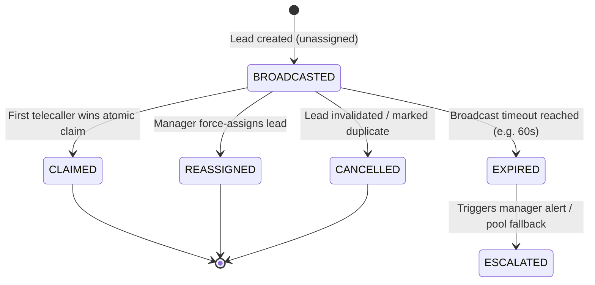
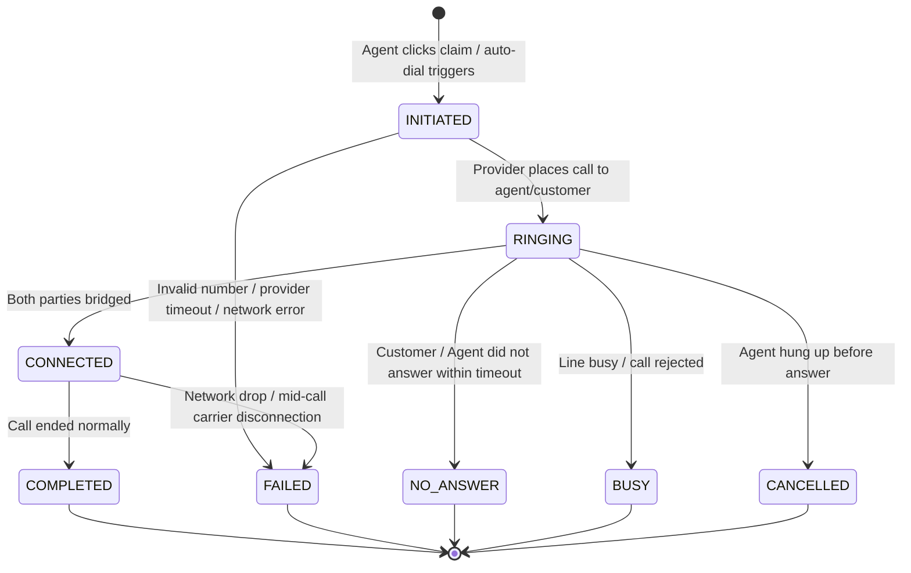
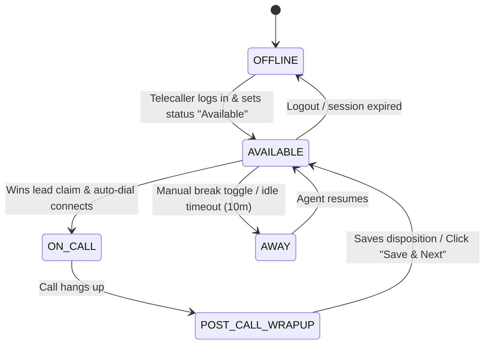

# Ralix CRM — Real-Time Lead Distribution & Calling Module
## Product, UX, Domain, State Machine & Integration Design Specification

> **Document Version**: 1.0.0-SPECIFICATION  
> **Status**: Approved Design Contract (Implementation-Ready)  
> **Authoritative Hierarchy**:  
> 1. `ARCHITECTURE.md` (v5.1.0-HARDENED) — Domain, Security, Tenancy, Concurrency, and Transactions  
> 2. `UI.md` (v2.0.0-PRODUCTION) — User Experience, Design System, Layout, and Workstation Architecture  
> 3. `REAL_TIME_LEAD_CALLING.md` (This Document) — Product & Calling Module Specification  
> **Target Provider**: Knowlarity SuperReceptionist (`sr.knowlarity.com`) via Provider-Neutral Abstraction  
> **Security Baseline**: Zero provider secrets on client; masked customer PII; tenant-scoped atomic concurrency  

---

## Table of Contents

1. [Executive Summary](#1-executive-summary)
2. [Goals](#2-goals)
3. [Non-Goals](#3-non-goals)
4. [Existing Architecture Alignment](#4-existing-architecture-alignment)
5. [Existing UI Alignment](#5-existing-ui-alignment)
6. [User Roles & Authorization](#6-user-roles--authorization)
7. [Telecaller Workflow](#7-telecaller-workflow)
8. [Admin & Manager Workflow](#8-admin--manager-workflow)
9. [New Lead Distribution Flow](#9-new-lead-distribution-flow)
10. [Notification Lifecycle](#10-notification-lifecycle)
11. [First-Accept Claim Model](#11-first-accept-claim-model)
12. [Concurrency & Transaction Model](#12-concurrency--transaction-model)
13. [Lead Assignment Lifecycle](#13-lead-assignment-lifecycle)
14. [Calling Lifecycle & Auto-Dial](#14-calling-lifecycle--auto-dial)
15. [Call State Machine](#15-call-state-machine)
16. [CRM Outcome Model](#16-crm-outcome-model)
17. [Disposition Model](#17-disposition-model)
18. [Follow-Up & Scheduling Model](#18-follow-up--scheduling-model)
19. [Call Brief UX](#19-call-brief-ux)
20. [Active Call UX & Workstation](#20-active-call-ux--workstation)
21. [Post-Call Disposition UX](#21-post-call-disposition-ux)
22. [Call History UX & Detail Drawer](#22-call-history-ux--detail-drawer)
23. [Admin Calling UX & Telephony Monitor](#23-admin-calling-ux--telephony-monitor)
24. [Telecaller Presence & Availability](#24-telecaller-presence--availability)
25. [Real-Time Event Architecture](#25-real-time-event-architecture)
26. [Event Catalogue & Payload Concepts](#26-event-catalogue--payload-concepts)
27. [Provider Adapter Boundary](#27-provider-adapter-boundary)
28. [Knowlarity Integration Boundary (`sr.knowlarity.com`)](#28-knowlarity-integration-boundary-srknowlaritycom)
29. [Agent Mapping Architecture](#29-agent-mapping-architecture)
30. [Webhook & CDR Event Processing Pipeline](#30-webhook--cdr-event-processing-pipeline)
31. [Idempotency & Replay Guarantees](#31-idempotency--replay-guarantees)
32. [Failure & Exception Matrix](#32-failure--exception-matrix)
33. [Concurrency Test Scenarios](#33-concurrency-test-scenarios)
34. [Security & Threat Model](#34-security--threat-model)
35. [PII Masking & Privacy Model](#35-pii-masking--privacy-model)
36. [Tenant Isolation Guarantees](#36-tenant-isolation-guarantees)
37. [Audit Trail Requirements](#37-audit-trail-requirements)
38. [Observability & Metrics Requirements](#38-observability--metrics-requirements)
39. [Future Inbound Calling Compatibility](#39-future-inbound-calling-compatibility)
40. [Future Call Recording & Storage Compatibility](#40-future-call-recording--storage-compatibility)
41. [Implementation Dependencies](#41-implementation-dependencies)
42. [Open Decisions](#42-open-decisions)
43. [Acceptance Criteria](#43-acceptance-criteria)
44. [Recommended Implementation Order](#44-recommended-implementation-order)
45. [Change Control (Architecture Reconciliations)](#45-change-control-architecture-reconciliations)
46. [Design Decisions Requiring Approval](#46-design-decisions-requiring-approval)

---

# 1. Executive Summary

The **Real-Time Lead Distribution & Calling Module** is Ralix CRM's high-velocity conversion engine for inbound real estate demand. When marketing channels (Meta Lead Ads, Google Ads, housing portals, website inquiries) generate a new lead, speed-to-call is the single greatest determinant of sales conversion.

This module delivers a seamless, zero-friction operator workflow:
1. **Instant Broadcast**: A newly ingested, verified lead is broadcast in real time to all eligible, available telecallers within the tenant project scope.
2. **First-Accept-Wins (Atomic Claim)**: Multiple telecallers may click `[ ACCEPT LEAD ]`. The backend executes an atomic row-lock mutation—exactly one telecaller wins; all other telecallers immediately receive a clean, non-disruptive "Lead already taken" notice.
3. **Instant Workstation Launch & Auto-Dial**: The winning telecaller is immediately presented with the **Call Brief** (3-second visual scan of requirement, budget, location, and source notes), while the backend simultaneously triggers a duplex click-to-call via the configured telephony provider (Knowlarity SuperReceptionist). The telecaller never needs to search, copy-paste phone numbers, or click another dial button.
4. **Focused In-Call HUD**: During conversation, customer details, live duration, and lightweight quick notes are accessible without operating a heavy ERP form.
5. **Enforced Post-Call Workflow**: Upon call termination, the telecaller selects an authoritative `CallDisposition` and `LeadDisposition`, schedules the next action (Callback or Site Visit), saves notes, and seamlessly transitions to the next queue item via **[ SAVE & NEXT LEAD ]**.

Architecturally, **Ralix owns the entire business calling lifecycle**. The telephony vendor (Knowlarity SuperReceptionist) is strictly an external transport mechanism managed through an isolated adapter boundary. The domain maintains complete vendor agnosticism, strict tenant isolation, PII phone masking, and database-level concurrency invariants.

---

# 2. Goals

1. **Sub-Second Lead Distribution**: Deliver real-time visual and audio alerts to all eligible, available telecallers within 500ms of lead ingestion.
2. **Guaranteed Single-Winner Concurrency**: Ensure mathematically zero possibility of double-assignment under simultaneous click collisions using PostgreSQL row locking and optimistic concurrency checks.
3. **Zero-Friction Calling Workstation**: Eliminate all manual steps between lead acceptance and telephone conversation. The workstation renders immediately; dialing occurs automatically.
4. **Provider Neutrality**: Insulate Ralix core domain logic from Knowlarity-specific request payloads, headers, and status strings.
5. **Absolute Credential Security**: Ensure telephony API keys and secret tokens never enter browser bundles, client environments, or network payloads.
6. **Strict Separation of Technical vs. Business Dimensions**: Maintain independent tracking for technical call progress (`CallAttempt`), business conversation facts (`CallRecord`), and customer opportunity state (`Lead`).
7. **Complete Auditability**: Guarantee that every distribution broadcast, claim race, assignment, call attempt, and disposition transition produces an immutable audit trail.

---

# 3. Non-Goals

1. **In-Browser WebRTC Softphone Audio Streaming**: Audio media packets are handled over the Public Switched Telephone Network (PSTN) by Knowlarity bridging the telecaller's physical phone/extension and the customer. The browser handles control state, HUD, and data display—not audio RTP packets.
2. **Automated Predictive / Power Dialing**: The module focuses on real-time responsive inbound demand and scheduled follow-ups. Unattended robotic dialers dialing before agent availability are explicitly out of scope.
3. **In-Memory Volatile Claims**: Claims will not be arbitrated solely in browser state or transient memory. All claims are persisted in PostgreSQL.
4. **Arbitrary In-Call ERP Form Editing**: Telecallers will not edit complex multi-tab property inventory matrices or financial ledgers while on a live call.
5. **Client-Side Direct Vendor Integration**: The frontend will never communicate directly with `sr.knowlarity.com`.

---

# 4. Existing Architecture Alignment

The module strictly builds upon the foundation defined in `ARCHITECTURE.md` (v5.1.0-HARDENED):

| Architecture Section | Established Concept | Calling Module Application |
| :--- | :--- | :--- |
| **§2 Principles** | Principle 1 (Tenant Isolation), 6 (State Machines), 8 (Concurrency), 12 (PII) | Mandatory tenant scoping on all queries; explicit call state transitions; database row-level locking for claims; masked customer phone numbers. |
| **§5 Tenancy Model** | Class A Entities (`Lead`, `CallAttempt`, `CallRecord`, `LeadAssignment`, `Notification`) | Every record carries explicit, immutable `organizationId`. Composite foreign keys prevent cross-tenant assignment. |
| **§7 Authorization** | Capabilities: `LEAD_VIEW`, `LEAD_UPDATE`, `LEAD_ASSIGN` | Accepting a lead requires `LEAD_VIEW`; initiating calls requires `LEAD_VIEW`; recording post-call disposition requires `LEAD_UPDATE`. |
| **§10 Lead Domain** | 5-Dimensional State Model (§10.1) | `lifecycleStage`, `status`, `temperature`, `slaState`, and `disposition` are preserved independently. Call outcomes never clobber lifecycle stages. |
| **§11 Assignment Engine** | `LeadAssignment` History & Target Validation | Claims create a `LeadAssignment` record with `reason = FIRST_ACCEPT_CLAIM`, maintaining an unbroken audit chain. |
| **§19 Communication** | `CallAttempt` vs. `CallRecord` (§19.1) | Separates provider transport lifecycle (`CallAttemptStatus`) from the business interaction record (`CallRecord` and `CallDisposition`). |
| **§20 Adapters** | Provider Adapter Pattern | `KnowlarityTelephonyAdapter` translates normalized domain commands into vendor HTTP payloads, and vendor CDRs into normalized events. |
| **§21 Webhooks** | Idempotent Ingestion (`provider, providerEventId`) | Ingests Knowlarity post-call webhooks via `WebhookEvent` with guaranteed deduplication. |
| **§22 & §23 Outbox** | Transactional Outbox & Event Registry | Claims, assignments, and call starts emit domain events within the database transaction, published via Redis/BullMQ. |
| **§31 PII Model** | Customer Phone Masking | Telecallers see `+91 98•••• 4512`. Raw numbers are bridged backend-to-provider only. |

---

# 5. Existing UI Alignment

The calling module strictly aligns with the design tokens, layouts, and UX patterns in `UI.md` (v2.0.0-PRODUCTION):

- **Color Tokens**: Dark mode palette using `--surface-base` (`#0b0f19`), `--surface-card` (`#121827`), `--border-subtle` (`rgba(255, 255, 255, 0.08)`), and semantic accents (Amber `#f59e0b` for dialing, Emerald `#10b981` for connected live call, Indigo `#6366f1` for brand actions).
- **Typography**: Inter/system sans-serif for UI labels; JetBrains Mono/monospace font for call timers, timestamps, and telephone numbers.
- **Section 12 (Telecaller Experience)**: Directly enhances `/my-day`, `/todays-calls`, and `/follow-ups` workspaces with live claim alerts.
- **Section 14 (Communication Center)**: Enhances the Floating Call HUD (`call-hud`) and Post-Call Disposition Modal (`glass-panel`) with real-time Knowlarity integration.
- **Micro-Animations**: Subtle pulse glow for live call indicators (`pulseGlow 1.5s infinite`); smooth transitions for notification slide-in; zero flashing or abrasive consumer-app animations.

---

# 6. User Roles & Authorization

Access to lead distribution, claiming, calling, and reporting is governed by granular capabilities evaluated against the actor's scope:

```
+-------------------------------------------------------------------------------+
| CAPABILITY MATRIX FOR REAL-TIME CALLING                                       |
+------------------------------+-------------+---------------+------------------+
| Capability                   | CSE (Agent) | Sales Manager | Org Admin        |
+------------------------------+-------------+---------------+------------------+
| LEAD_VIEW                    | YES (Scope) | YES (Team)    | YES (Org)        |
| LEAD_UPDATE                  | YES (Scope) | YES (Team)    | YES (Org)        |
| LEAD_ASSIGN (Manual Reassign)| NO          | YES           | YES              |
| TELEPHONY_CALL_INITIATE      | YES         | YES           | YES              |
| TELEPHONY_DISPOSITION_RECORD | YES         | YES           | YES              |
| TELEPHONY_MONITOR_VIEW       | NO          | YES (Team)    | YES (Org)        |
| TELEPHONY_PROVIDER_CONFIG    | NO          | NO            | YES              |
| CUSTOMER_VIEW_UNMASKED       | NO          | NO (Default)  | YES (Audit Logged) |
+------------------------------+-------------+---------------+------------------+
```

### Role Behavioral Rules
1. **Sales Executive (CSE)**: Receives real-time broadcast alerts for unclaimed leads belonging to assigned projects. Can execute atomic claim (`[ ACCEPT LEAD ]`). Automatically dials upon winning. Can submit post-call disposition and schedule callbacks.
2. **Sales Manager**: Has supervisory visibility over unclaimed leads, telecaller presence, call queues, and active calls. Can manually reassign leads if unattended beyond SLA thresholds.
3. **Organization Administrator**: Configures telephony provider credentials (Knowlarity API keys, virtual numbers), monitors provider health and webhooks, and reviews audit logs.

---

# 7. Telecaller Workflow

The operational telecaller journey is optimized for zero wasted motion:

```
[ IDLE / AVAILABLE ]
        │
        ▼ (New Inbound Lead Arrives)
[ 🔔 REAL-TIME BROADCAST ALERT ]  ─── Audio Chime + Slide-in Banner (30s)
        │
        ├── Click [ ACCEPT LEAD ]
        │
   [ ATOMIC CLAIM CHECK ]
   ├── WINS CLAIM ──► [ OPEN CALL WORKSTATION ]
   │                        │
   │                        ├── Render Call Brief (3-5 second scan)
   │                        │   (Requirement, Budget, Location, Source)
   │                        │
   │                        └── Trigger Automatic Call via Backend
   │                                  │
   │                                  ▼
   │                            [ "Dialing Knowlarity..." ]
   │                                  │
   │                                  ▼
   │                            [ "Agent Phone Ringing..." ]
   │                                  │
   │                                  ▼
   │                            [ "Customer Ringing..." ]
   │                                  │
   │                                  ▼
   │                            [ 🔴 LIVE CALL CONNECTED ]
   │                                  │
   │                                  ├── In-Call Context & Quick Notes
   │                                  │
   │                                  ▼
   │                            [ CLICK END CALL / CUSTOMER HANGS UP ]
   │                                  │
   │                                  ▼
   │                            [ POST-CALL DISPOSITION MODAL ]
   │                                  │
   │                                  ├── Select Call Disposition
   │                                  ├── Refine Notes
   │                                  ├── Schedule Next Action (Callback / Visit)
   │                                  │
   │                                  ▼
   │                            [ CLICK SAVE & NEXT LEAD ]
   │                                  │
   │                                  ▼
   │                            [ LOAD NEXT QUEUED LEAD / RETURN TO MY DAY ]
   │
   └── LOSES CLAIM (Another Agent Accepted First)
        │
        ▼
   [ "LEAD ALREADY TAKEN" (Non-Disruptive Toast) ]
        │
        ▼
   [ RETURN TO CURRENT WORKSPACE ]
```

---

# 8. Admin & Manager Workflow

Managers and administrators oversee lead flow, SLA compliance, and system health without disrupting active calls:

```
[ ADMIN / MANAGER WORKSPACE ]
  ├── 1. TELEPHONY HEALTH MONITOR
  │     ├── Provider Connectivity (sr.knowlarity.com API status & latency)
  │     ├── Webhook Delivery Health (Last received, failure rate, DLQ count)
  │     └── Virtual Pilot Number Status (Active / Expired)
  │
  ├── 2. REAL-TIME TELECALLER PRESENCE BOARD
  │     ├── Telecallers Available (Ready for leads)
  │     ├── Telecallers On Call (Active conversation timer & prospect name)
  │     ├── Telecallers in Post-Call Wrap-up (Time since call ended)
  │     └── Telecallers Away / Offline
  │
  ├── 3. UNCLAIMED LEADS QUEUE (ATTENTION REQUIRED)
  │     ├── Broadcast Age Countdown (e.g. "Available for 45s")
  │     ├── Imminent SLA Breach Alert (Due in < 60s)
  │     └── Action: [ Force Assign to Specific Agent ] or [ Re-Broadcast ]
  │
  └── 4. CALL QUALITY & RECONCILIATION
        ├── Daily Call Stats (Total, Connected, No-Answer, Failed)
        └── CDR Discrepancy Reconciliation Tool
```

---

# 9. New Lead Distribution Flow

```
+─────────────────────────────────────────────────────────────────────────────+
| INBOUND LEAD ARRIVAL & BROADCAST PIPELINE                                   |
+─────────────────────────────────────────────────────────────────────────────+

   Meta Ads / Portal / Website Form
                 │
                 ▼ (Inbound Webhook)
      [ Webhook Ingestion Perimeter ]
                 │ (Deduplicate & Verify Signature)
                 ▼
      [ Customer Resolution & Lead Creation ]
                 │ (Lead Created: lifecycle=NEW, status=ACTIVE, assignedToId=NULL)
                 ▼
      [ Organization Setting Check ]
                 │
                 ├── If distributionStrategy === "ROUND_ROBIN" ──► Auto-assign (§11.4)
                 │
                 └── If distributionStrategy === "BROADCAST_FIRST_ACCEPT"
                                │
                                ▼
                   [ Resolve Eligible Telecallers ]
                                │
                                ├── Member of Lead.organizationId
                                ├── Membership status === ACTIVE
                                ├── Presence status === AVAILABLE
                                ├── Assigned to Lead.projectId (UserProject / TeamProject)
                                └── Has capability LEAD_VIEW
                                │
                                ▼
                   [ Publish Real-Time Event ]
                     Event: "lead.broadcast_available"
                     Channel: "tenant:{orgId}:project:{projectId}:leads"
                                │
                 ┌──────────────┴──────────────┐
                 ▼                             ▼
         [ Telecaller A ]              [ Telecaller B ]
      (In-App Alert + Chime)        (In-App Alert + Chime)
```

---

# 10. Notification Lifecycle

The real-time notification represents an invitation to claim, **NOT an assignment**.



### Notification Properties
- **Visual Display**: Top-right floating card with glassmorphism styling, animated amber beacon, prospect name, requirement summary, budget, and prominent `[ ACCEPT LEAD ]` button.
- **Audio Chime**: Crisp, high-frequency, non-jarring audio chime (`chime_lead_arrival.mp3`). Telecallers can toggle audio in profile settings.
- **TTL / Expiry**: Default 60 seconds (configurable via `OrganizationSetting.leadBroadcastTimeoutSeconds`). If unaccepted at TTL, it escalates to the manager's Attention Center.

---

# 11. First-Accept Claim Model

### The Concurrency Rule
When Telecaller A, Telecaller B, and Telecaller C simultaneously click `[ ACCEPT LEAD ]`:
- The frontend **never** decides who won.
- Network arrival order at the browser **never** decides who won.
- The database **atomically** decides who won using PostgreSQL row-level locks.

### Atomic Claim Invariant (INV-CLM-001)
> **Exactly one telecaller can claim an unassigned lead. Under concurrent requests, exactly one request commits with success; all other requests fail with a structured `LEAD_ALREADY_CLAIMED` domain conflict.**

```text
               Telecaller A (T0)         Telecaller B (T0 + 2ms)
                      │                            │
                      ▼                            ▼
              POST /leads/:id/claim        POST /leads/:id/claim
                      │                            │
                      └─────────────┬──────────────┘
                                    │
                       [ PostgreSQL Transaction ]
                                    │
                      SELECT * FROM "Lead"
                      WHERE id = :id AND organizationId = :orgId
                      FOR UPDATE;   <── Row-level exclusive lock
                                    │
                ┌───────────────────┴───────────────────┐
         Telecaller A acquired lock             Telecaller B waits...
                │                                       │
         Check: assignedToId == NULL? (YES)             │
         UPDATE "Lead" SET                              │
           assignedToId = 'user_A',                     │
           version = version + 1                        │
         INSERT INTO "LeadAssignment" ...               │
         INSERT INTO "OutboxEvent" ...                  │
         COMMIT TRANSACTION ──► Returns 200 OK          │
                │                                       │
                │                        Lock released to Telecaller B
                │                                       │
                │                        Check: assignedToId == NULL? (NO, it's user_A)
                │                        ROLLBACK TRANSACTION
                │                        Returns 409 Conflict:
                │                        { code: "LEAD_ALREADY_CLAIMED" }
                │                                       │
                ▼                                       ▼
     [ Telecaller A Wins ]                    [ Telecaller B Notice ]
   Workstation opens & auto-dials          "Rahul Sharma was accepted by another agent"
```

---

# 12. Concurrency & Transaction Model

### Backend Mutation Pipeline (Strict §35.1 Compliance)

Every claim request executes through the following 7-step transactional pipeline:

```typescript
// Conceptual Transaction Implementation Pattern
async function claimLead(actor: ActorContext, leadId: string): Promise<ClaimResult> {
  return prisma.$transaction(async (tx) => {
    // 1. Target Validation & Tenant Boundary Check
    // Explicit row-level lock using raw SQL query with FOR UPDATE
    const leads = await tx.$queryRaw<Lead[]>`
      SELECT * FROM "Lead"
      WHERE "id" = ${leadId}
        AND "organizationId" = ${actor.organizationId}
        AND "deletedAt" IS NULL
      FOR UPDATE
    `;

    const lead = leads[0];
    if (!lead) {
      throw new ResourceNotFoundError('Lead not found or access denied', 'leadId');
    }

    // 2. Concurrency Invariant Check
    if (lead.assignedToId !== null) {
      // Fetch claiming agent's name for informative UX
      const currentOwner = await tx.user.findUnique({
        where: { id: lead.assignedToId },
        select: { name: true }
      });
      throw new ConflictError(
        `This lead was already accepted by ${currentOwner?.name || 'another telecaller'}.`,
        'LEAD_ALREADY_CLAIMED'
      );
    }

    // 3. Verify Claimer Eligibility & Project Scope
    await targetValidator.validateUserProjectAccess(actor.userId, lead.projectId, actor.organizationId, tx);

    // 4. State Mutation
    const updatedLead = await tx.lead.update({
      where: { id: lead.id },
      data: {
        assignedToId: actor.userId,
        version: { increment: 1 },
      },
      include: { customer: true, project: true }
    });

    // 5. Append-Only Ownership Chain Record (§11.1)
    await tx.leadAssignment.create({
      data: {
        organizationId: actor.organizationId,
        leadId: lead.id,
        fromUserId: null,
        toUserId: actor.userId,
        assignedById: actor.userId,
        reason: 'FIRST_ACCEPT_CLAIM', // Reconciled AssignmentReason
        assignedAt: new Date(),
      }
    });

    // 6. Security Audit Log (§32)
    await tx.auditLog.create({
      data: {
        organizationId: actor.organizationId,
        actorId: actor.userId,
        actorType: 'USER',
        action: 'lead.claimed',
        entityType: 'Lead',
        entityId: lead.id,
        correlationId: actor.correlationId,
        oldValue: { assignedToId: null },
        newValue: { assignedToId: actor.userId },
        reason: 'First-Accept Claim Won',
      }
    });

    // 7. Transactional Outbox Event (§23)
    await tx.outboxEvent.create({
      data: {
        organizationId: actor.organizationId,
        eventType: 'LeadAssigned',
        aggregateType: 'Lead',
        aggregateId: lead.id,
        correlationId: actor.correlationId,
        payload: {
          leadId: lead.id,
          assignedToId: actor.userId,
          claimedAt: new Date().toISOString(),
          reason: 'FIRST_ACCEPT_CLAIM'
        }
      }
    });

    return { lead: updatedLead };
  });
}
```

---

# 13. Lead Assignment Lifecycle

`LeadAssignment` records the immutable ownership chain of a lead:

```
[ INGESTION ] ────────► assignedToId: null (Claim Pool)
                             │
                             ▼ (First-Accept Claim)
                      [ OPEN ASSIGNMENT ]
                      toUserId: usr_telecaller_1
                      reason: FIRST_ACCEPT_CLAIM
                      releasedAt: null
                             │
        ┌────────────────────┴────────────────────┐
        ▼ (SLA Breach Failover)                   ▼ (Manager Reassignment)
[ REASSIGNMENT ]                          [ REASSIGNMENT ]
fromUserId: usr_telecaller_1              fromUserId: usr_telecaller_1
toUserId: usr_backup_2                    toUserId: usr_senior_3
reason: SLA_FAILOVER                      reason: MANAGER_REASSIGN
releasedAt: 2026-09-29T11:45:00Z          releasedAt: 2026-09-29T11:50:00Z
```

---

# 14. Calling Lifecycle & Auto-Dial

Following successful lead claim, the calling sequence executes automatically:

```text
T0:  Backend commits claim transaction. Returns Lead payload to winner.
T+1: Frontend immediately transitions route to Active Calling Workstation.
     Call Brief displays instantly.
T+2: Backend enqueues call dispatch or dispatches via Knowlarity adapter.
T+3: Knowlarity SuperReceptionist API invoked:
     POST https://sr.knowlarity.com/vr/call/makecall
     { k_number, agent_number, customer_number, caller_id, additional_params }
T+4: Knowlarity dials Agent's extension/mobile.
     Workstation HUD: "Calling your phone..." (Amber)
T+5: Agent answers.
     Knowlarity bridges customer line.
     Workstation HUD: "Ringing customer..." (Blue)
T+6: Customer answers.
     CallAttempt.status = CONNECTED.
     Workstation HUD: "🔴 LIVE CALL CONNECTED" (Green) + Active Timer (00:01).
T+7: Conversation takes place. Agent takes Quick Notes.
T+8: Call terminates (Agent clicks End Call or Customer hangs up).
     Knowlarity disconnects PSTN session.
T+9: Workstation HUD transitions immediately to Post-Call Disposition Modal.
```

---

# 15. Call State Machine

The technical lifecycle of a physical call attempt is strictly modeled by `CallAttemptStatus` (§19.1):



### State Machine Transition Rules

| From State | Allowed To States | Trigger | Invariant Enforced |
| :--- | :--- | :--- | :--- |
| `INITIATED` | `RINGING`, `FAILED` | Provider HTTP response | `providerCallId` must be populated on success. |
| `RINGING` | `CONNECTED`, `NO_ANSWER`, `BUSY`, `CANCELLED`, `FAILED` | Provider webhook / CDR | Set `connectedAt` on `CONNECTED`. |
| `CONNECTED` | `COMPLETED`, `FAILED` | Provider webhook / CDR | `durationSeconds` must be recorded; `endedAt` set. |
| Terminal (`COMPLETED`, `FAILED`, `NO_ANSWER`, `BUSY`, `CANCELLED`) | *None* | Webhook duplicate | Terminal states are immutable. Late webhooks cannot revert a completed call. |

---

# 16. CRM Outcome Model

Technical transport outcomes (`CallAttemptStatus`) must **never** be conflated with the human conversation outcome (`CallDisposition`) or the sales opportunity status (`LeadStatus`).

```
+─────────────────────────────────────────────────────────────────────────────+
| THREE-TIER CALL STATUS ARCHITECTURE                                         |
+─────────────────────────────────────────────────────────────────────────────+

1. Technical Transport Fact       CallAttempt.status
   (Provider-driven transport)    e.g. CONNECTED, NO_ANSWER, BUSY, FAILED

2. Business Conversation Fact     CallRecord.disposition
   (Agent recorded outcome)       e.g. INTERESTED, CALLBACK_REQUESTED, NOT_INTERESTED

3. Opportunity Dimension          Lead.lifecycleStage & Lead.status
   (Commercial deal state)        e.g. CONTACTED, CALLBACK_PENDING, NO_RESPONSE
```

---

# 17. Disposition Model

`CallDisposition` captures the business outcome of **one interaction**. It maps to side effects on the `Lead` according to `ARCHITECTURE.md` §10.2:

| `CallDisposition` Enum | Meaning | Permitted Lead Side Effect |
| :--- | :--- | :--- |
| `INTERESTED` | Prospect engaged; open to purchase/visit | Advances `Lead.lifecycleStage = CONTACTED`; updates `temperature = HOT`. |
| `CALLBACK_REQUESTED` | Prospect busy; requested call at later slot | Sets `Lead.status = CALLBACK_PENDING`; creates `FollowUp`. |
| `NO_ANSWER` | Phone rang without answer | Sets `Lead.status = NO_RESPONSE`; updates `Lead.nextFollowUpAt` (+4 hours). |
| `BUSY` | Line busy / rejected | Sets `Lead.status = NO_RESPONSE`; schedules retry callback. |
| `NOT_INTERESTED` | Explicit refusal of project/offer | Sets `Lead.status = CLOSED`; sets `Lead.lifecycleStage = LOST`. |
| `WRONG_NUMBER` | Contact identity does not match | Sets `Lead.status = INVALID`; flags customer for verification. |
| `INVALID` | Junk lead / spam inquiry | Sets `Lead.status = INVALID`. |

> **Architectural Guard**: A single call can never delete a lead or overwrite historical call records.

---

# 18. Follow-Up & Scheduling Model

When `CALLBACK_REQUESTED` or `Site Visit` is selected in post-call disposition:
1. An authoritative [`FollowUp`](file:///d:/Freelance/CRMS/server/prisma/schema.prisma#L1093) record is created in the database.
2. `Lead.nextFollowUpAt` is updated as a derived index field.
3. If Site Visit is scheduled, a [`SiteVisit`](file:///d:/Freelance/CRMS/server/prisma/schema.prisma#L1067) entity is created with status `SCHEDULED`.
4. Follow-up jobs are scheduled in BullMQ to alert the agent 15 minutes before the due time.

---

# 19. Call Brief UX

The **Call Brief** appears the moment the workstation opens, designed for a **3-second cognitive scan**:

```
+-----------------------------------------------------------------------------+
| CALL BRIEF                                                                  |
+-----------------------------------------------------------------------------+
| PROSPECT: Rahul Sharma              SOURCE: Meta Lead Ads (Pune 2BHK Blast) |
| PROJECT:  Park Avenue (Baner)       SLA STATUS: [ WITHIN SLA (18m left) ]  |
+-----------------------------------------------------------------------------+
| CONFIGURATION:  2 BHK Luxury Apartment                                     |
| BUDGET:         ₹80,00,000 – ₹90,00,000 (80L - 90L)                         |
| LOCATION:       Baner / Balewadi Preferred                                  |
| PURPOSE:        Self-Use                                                    |
| TIMELINE:       Immediate / Ready to Move (Within 3 Months)                 |
| NOTES:          "Possession required before Diwali. Needs SBI Home Loan."   |
+-----------------------------------------------------------------------------+
```

---

# 20. Active Call UX & Workstation

During the live call, the workstation presents a high-density, focused operational canvas without administrative clutter:

```
+-----------------------------------------------------------------------------+
| 🔴 LIVE CALL CONNECTED                          03:24  |  Provider: Knowlarity |
+--------------------------------------------------------+--------------------+
| Customer: Rahul Sharma   ·   Phone: +91 98•••• 4512    | [ MUTE ] [ END CALL]|
+--------------------------------------------------------+--------------------+
|                                                                             |
| [ CALL BRIEF ]                                 [ TIMELINE SNAPSHOT ]        |
| Requirement: 2 BHK / 1200 Sq Ft                Yesterday: Form submitted    |
| Budget:      ₹80L – ₹90L                       Today:     Claimed by you    |
| Location:    Baner, Pune                                                    |
| Possession:  < 6 Months                                                     |
|                                                                             |
|-----------------------------------------------------------------------------|
| QUICK NOTES (DURING CALL)                                                   |
| [ Customer is interested in 4th floor garden-facing unit. Asked if SBI     ]|
| [ pre-approval is eligible. Prefers Saturday morning site visit.         ]|
+-----------------------------------------------------------------------------+
```

---

# 21. Post-Call Disposition UX

When the call terminates, the HUD immediately presents the modal dialog:

```
+-----------------------------------------------------------------------------+
| CALL COMPLETED  ·  Duration: 03m 42s  ·  Rahul Sharma                       |
+-----------------------------------------------------------------------------+
| 1. SELECT CALL DISPOSITION                                                  |
|    (*) Interested            ( ) Callback Requested    ( ) Site Visit Req.  |
|    ( ) No Answer / Busy      ( ) Not Interested        ( ) Wrong Number     |
|                                                                             |
| 2. OPPORTUNITY DISPOSITION                                                  |
|    [ INTERESTED — Buyer shows positive engagement                       v ] |
|                                                                             |
| 3. CONVERSATION SUMMARY & PROSPECT NOTES                                    |
|    [ Customer confirmed budget of 85L. Liked Tower B floor plans. Wants   ] |
|    [ site visit on Saturday at 11:00 AM with spouse.                      ] |
|                                                                             |
| 4. SCHEDULE NEXT ACTION                                                     |
|    [X] Site Visit          [ ] Follow-up Call          [ ] None             |
|    Date: [ 2026-10-03 ]   Time: [ 11:00 AM ]   Project: [ Park Avenue     ] |
|                                                                             |
|                                     [ CANCEL ]   [ SAVE & NEXT LEAD (Enter) ]|
+-----------------------------------------------------------------------------+
```

---

# 22. Call History UX & Detail Drawer

Every past call is recorded in the Lead's chronological timeline. Clicking an item opens the **Call Detail Drawer**:

```
+-------------------------------------------------------+
| CALL DETAIL RECORD                                    |
+-------------------------------------------------------+
| Customer:          Rahul Sharma                       |
| Lead ID:           RAL-10482                          |
| Telecaller:        Amit Kumar (CSE)                   |
| Provider:          Knowlarity SuperReceptionist       |
| Provider Call ID:  knowlarity_sr_994821a              |
| Call Started:      29 Sep 2026, 11:32:14 AM           |
| Call Ended:        29 Sep 2026, 11:35:56 AM           |
| Duration:          03m 42s                            |
| Technical Status:  COMPLETED                          |
| Call Disposition:  INTERESTED                         |
| Lead Disposition:  INTERESTED                         |
| Audio Recording:   [ ▶ Play Recording (03:42) ]       |
|                    (Signed private streaming URL)     |
| Notes:             "Customer confirmed budget..."     |
+-------------------------------------------------------+
```

---

# 23. Admin Calling UX & Telephony Monitor

The Operational Exception Monitor displays real-time calling throughput and telephony telemetry:

```
+-----------------------------------------------------------------------------+
| TELEPHONY OPERATIONS & HEALTH (sr.knowlarity.com)                           |
+-----------------------------------------------------------------------------+
| PROVIDER STATUS: [ ● OPERATIONAL ]     WEBHOOKS: [ 100% HEALTHY (0 DLQ) ]   |
| API RESPONSE:    182ms Avg             CALLS TODAY: 428 (314 Connected)     |
+-----------------------------------------------------------------------------+
| AGENT PRESENCE (16 Total)                                                   |
| [ 8 Available ]   [ 4 On Call ]   [ 2 Wrap-up ]   [ 2 Away ]                |
+-----------------------------------------------------------------------------+
| UNCLAIMED LEADS (CALL POOL)                                                 |
| Lead Name       Project      Source     Available For    Action             |
| Sunil Verma     Green Hills  Meta Ads   42s              [ Force Assign v ] |
| Sneha Rao       Sunrise Pk   Website    18s              [ Force Assign v ] |
+-----------------------------------------------------------------------------+
```

---

# 24. Telecaller Presence & Availability

Telecaller eligibility is dynamically tracked in Redis with a fallback to `OrganizationMembership.isAvailable`:



### Eligibility Rules
A user receives broadcast alerts **only if**:
1. Membership in organization is `ACTIVE`.
2. Presence is `AVAILABLE`.
3. User is assigned to the lead's project via `UserProject` or `TeamProject`.
4. User is within their daily lead quota (`OrganizationSetting.maxLeadsPerUserPerDay`).
5. User is not currently engaged on an active call attempt.

---

# 25. Real-Time Event Architecture

Ralix uses a dual-layer real-time architecture:
- **Persistence & Outbox**: PostgreSQL `OutboxEvent` table committed in-transaction.
- **Message Broker**: Redis Pub/Sub for sub-millisecond local fan-out.
- **Client Transport**: Server-Sent Events (SSE) or WebSockets multiplexed over `/api/v1/realtime/stream`.

```text
[ Transaction Commits OutboxEvent ]
                │
                ▼
      [ BullMQ / Redis Pub/Sub ]
                │
    Channel: org:{orgId}:leads
                │
   ┌────────────┴────────────┐
   ▼                         ▼
Telecaller A (SSE)        Telecaller B (SSE)
```

---

# 26. Event Catalogue & Payload Concepts

### 1. `lead.broadcast_available`
- **Producer**: Lead Ingestion Worker
- **Consumer**: Eligible Telecaller Workstations
- **Payload**:
  ```json
  {
    "eventId": "evt_bc_101",
    "organizationId": "org_ralix_demo",
    "leadId": "lead_9841",
    "leadName": "Rahul Sharma",
    "maskedPhone": "+91 98•••• 4512",
    "projectName": "Park Avenue",
    "configuration": "2 BHK",
    "budget": "₹80L – ₹90L",
    "source": "Meta Ads",
    "broadcastAt": "2026-09-29T11:30:00.000Z",
    "expiresAt": "2026-09-29T11:31:00.000Z"
  }
  ```

### 2. `lead.claimed`
- **Producer**: Claim Mutation Service
- **Consumer**: All Telecallers (to cancel alert), Admin Monitor
- **Payload**:
  ```json
  {
    "eventId": "evt_cl_202",
    "organizationId": "org_ralix_demo",
    "leadId": "lead_9841",
    "claimedById": "usr_sales_1",
    "claimedByName": "Amit Kumar",
    "claimedAt": "2026-09-29T11:30:12.450Z"
  }
  ```

### 3. `telephony.call_status_updated`
- **Producer**: Knowlarity Adapter Webhook Processor
- **Consumer**: Telecaller Workstation HUD
- **Payload**:
  ```json
  {
    "eventId": "evt_call_303",
    "organizationId": "org_ralix_demo",
    "callAttemptId": "att_7841",
    "providerCallId": "knowlarity_sr_994821a",
    "status": "CONNECTED",
    "connectedAt": "2026-09-29T11:30:18.000Z"
  }
  ```

---

# 27. Provider Adapter Boundary

Following `ARCHITECTURE.md` §20, the calling domain defines a strict provider interface:

```typescript
export interface ITelephonyAdapter {
  makeCall(request: MakeCallCommand): Promise<MakeCallResult>;
  parseCdrWebhook(rawBody: any): NormalizedCdrEvent | null;
  getProviderName(): string;
}

export interface MakeCallCommand {
  agentNumber: string;
  customerNumber: string;
  virtualPilotNumber?: string;
  callerId?: string;
  additionalParams: {
    leadId: string;
    callAttemptId: string;
    organizationId: string;
  };
}

export interface MakeCallResult {
  success: boolean;
  providerCallId: string;
  message: string;
  isSimulated?: boolean;
}

export interface NormalizedCdrEvent {
  providerCallId: string;
  status: CallAttemptStatus;
  durationSeconds: number;
  recordingUrl?: string;
  agentNumber: string;
  customerNumber: string;
  callAttemptId?: string;
  leadId?: string;
}
```

---

# 28. Knowlarity Integration Boundary (`sr.knowlarity.com`)

The Knowlarity SuperReceptionist adapter implements the interface specifically for the `sr.knowlarity.com` host:

- **MakeCall Endpoint**: `POST https://sr.knowlarity.com/vr/call/makecall`
- **Headers**:
  - `x-api-key`: string (Account API Key)
  - `Authorization`: string (Authorization Token)
  - `Content-Type`: `application/json`
- **Payload Construction**:
  ```json
  {
    "k_number": "+91804710XXXX",
    "agent_number": "+919876543210",
    "customer_number": "+919123456789",
    "caller_id": "+91804710XXXX",
    "additional_params": {
      "leadId": "lead_9841",
      "callAttemptId": "att_7841",
      "organizationId": "org_ralix_demo"
    }
  }
  ```
- **Webhook Ingestion**: `POST /api/webhooks/knowlarity`
  - Normalized from Knowlarity CDR fields (`call_id`, `call_status`, `duration`, `recording_url`).

---

# 29. Agent Mapping Architecture

Ralix `User` accounts are mapped to telephony phone numbers/extensions:

```
+─────────────────────────────────────────────────────────────+
| TELEPHONY AGENT MAPPING                                     |
+─────────────────────────────────────────────────────────────+
| Ralix User:            Amit Kumar (usr_sales_1)             |
| Organization:          org_ralix_demo                       |
| Virtual Pilot (K-Num): +91 80 4710 0000                     |
| Telephony Extension:   +91 98765 43210 (Physical Mobile)    |
| Provider Agent ID:     KN_AGT_492 (Optional SIP ID)         |
| Status:                ACTIVE                               |
+─────────────────────────────────────────────────────────────+
```

- Mappings are stored in `User.phone` or an explicit `TelephonyAgentMapping` table.
- If a telecaller lacks a mapped phone number, the claim succeeds but the auto-dial alerts: *"Agent telephone number not configured. Please update profile."*

---

# 30. Webhook & CDR Event Processing Pipeline

Following `ARCHITECTURE.md` §21:

```text
Knowlarity CDR Webhook (POST /api/webhooks/knowlarity)
       │
       ▼
1. Extract providerEventId (payload.call_id)
       │
       ▼
2. Idempotency Guard via WebhookEvent table:
   INSERT INTO "WebhookEvent" (provider='KNOWLARITY', providerEventId=call_id)
   ON CONFLICT DO NOTHING
       │
       ├── Duplicate detected? ──► Return 200 OK immediately (Exit)
       │
       ▼ New Event
3. Normalize Payload via KnowlarityTelephonyAdapter.parseCdrWebhook
       │
       ▼
4. Update CallAttempt:
   - status = mappedStatus
   - endedAt = now()
   - durationSeconds = parsedDuration
       │
       ▼
5. Upsert CallRecord:
   - recordingRef = payload.recording_url
       │
       ▼
6. Emit SSE Event to telecaller HUD to close timer
       │
       ▼
7. Return 200 OK fast (< 500ms)
```

---

# 31. Idempotency & Replay Guarantees

1. **Webhook Deduplication**: Enforced by composite unique constraint `@@unique([provider, providerEventId])` on `WebhookEvent`. Duplicate deliveries produce zero duplicate database records.
2. **MakeCall Idempotency**: `callAttemptId` is passed in `additional_params`. Provider retries correlation key ensures one physical call attempt maps to exactly one `CallAttempt`.
3. **Disposition Submission**: Submitting a disposition twice for the same `callAttemptId` updates the existing `CallRecord` rather than creating duplicates.

---

# 32. Failure & Exception Matrix

| # | Scenario | Expected Backend Behavior | Expected UI Behavior | Retry Allowed? | Audit Logged? | Lead Status |
| :--- | :--- | :--- | :--- | :---: | :---: | :--- |
| **1** | Two telecallers accept at exact same ms | Winner commits; loser gets 409 Conflict with `LEAD_ALREADY_CLAIMED` | Winner opens workspace; loser gets toast "Lead already taken by [Agent Name]" | No | Yes | Assigned to Winner |
| **2** | Lead deleted/closed before claim | Claim rejects with 404/410 | Toast "Lead no longer available" | No | Yes | Unchanged |
| **3** | Telecaller loses internet upon clicking claim | If committed: lead assigned to agent. If dropped before server: unassigned | On reconnect, agent sees lead in "Today's Calls" | Yes | Yes | Assigned or Pool |
| **4** | Claim succeeds, but Knowlarity API times out | `CallAttempt` created with status `FAILED`. Lead remains assigned to winner | Alert "Calling service temporarily unavailable. Click to retry call" | Yes | Yes | Remains with Agent |
| **5** | Customer phone number invalid / disconnected | Knowlarity returns error; `CallAttempt.status = FAILED` | HUD displays "Invalid phone number". Prompt to mark invalid | Yes (if edit) | Yes | Agent retains |
| **6** | Customer does not answer (No Answer) | Call completes with `CallAttempt.status = NO_ANSWER` | Disposition modal pre-selects `NO_ANSWER`. Schedules retry in 4 hrs | Yes | Yes | `NO_RESPONSE` |
| **7** | Customer line busy | Call completes with `CallAttempt.status = BUSY` | Disposition modal pre-selects `BUSY` | Yes | Yes | `NO_RESPONSE` |
| **8** | Agent phone rings but agent does not answer | Knowlarity times out; `CallAttempt.status = NO_ANSWER` | HUD: "You did not answer the bridged call". Prompt to retry dial | Yes | Yes | Remains with Agent |
| **9** | Webhook arrives out of order (Ended before Ringing) | State machine ignores regression; updates terminal duration | HUD sets final timer state | No | Yes | Terminal |
| **10** | Telecaller closes browser during active call | Knowlarity PSTN call continues until hangup. CDR updates DB | On next login, prompt opens to complete pending disposition | No | Yes | Remains with Agent |
| **11** | Manager force-reassigns lead during claim race | Winner transaction conflicts if manager commits first | Agent receives "Lead reassigned by manager" | No | Yes | Reassigned |
| **12** | Real-time SSE/WebSocket disconnects | Polling fallback activates every 15s; auto-reconnects with backoff | Subtle offline banner; reconnection spinner | Auto | Yes | Unchanged |

---

# 33. Concurrency Test Scenarios

The test suite must validate these specific concurrency invariants:

1. **`INV-CLM-CONC-001` (Simultaneous Two-Way Claim Race)**:
   - Telecaller A claims Lead 1 at $T_0$.
   - Telecaller B claims Lead 1 at $T_0 + 1\text{ms}$.
   - **Verification**: Exactly one 200 OK; exactly one 409 Conflict; `Lead.assignedToId` has exactly one owner; exactly one `LeadAssignment` record created.
2. **`INV-CLM-CONC-002` (Five-Way Multi-Agent Collision)**:
   - 5 concurrent promises issue `claimLead` for the same lead.
   - **Verification**: 1 success, 4 conflicts; database row version increments by exactly 1.
3. **`INV-CLM-CONC-003` (Double-Click Replay Prevention)**:
   - Same browser session dispatches two identical claims with the same `idempotencyKey`.
   - **Verification**: Second request returns existing assignment; no double history rows.
4. **`INV-CLM-CONC-004` (Claim vs. Manager Reassign Race)**:
   - Manager reassigns lead while telecaller clicks claim.
   - **Verification**: Strict serializability; whoever commits first wins; loser receives clear conflict.

---

# 34. Security & Threat Model

1. **No Client-Side Secrets**: Knowlarity `x-api-key`, `Authorization` tokens, and virtual account credentials reside exclusively in server `.env` and `OrganizationSetting.telephonyCredentialRef`. Client bundles never receive these credentials.
2. **Tenant Parameter Tampering Protection**: All claim, call, and disposition routes validate that `lead.organizationId === req.actor.organizationId`. A telecaller cannot claim or dial a lead belonging to another tenant.
3. **Rate Limiting**:
   - Claim endpoint: 60 claims/minute per user.
   - Dial endpoint: 10 outbound calls/minute per user (prevents telephony flooding).
   - Knowlarity webhook endpoint: Protected by `webhookRateLimiter` (60 req/min).

---

# 35. PII Masking & Privacy Model

In accordance with `ARCHITECTURE.md` §31:
- In all real-time events, workstation screens, and HUD banners, the customer's phone number is masked: `+91 98•••• 4512`.
- Telecallers have **zero capability** to view or copy unmasked customer phone numbers, eliminating phone list exfiltration.
- Only the backend Knowlarity adapter receives unmasked phone numbers to pass to Knowlarity over TLS.

---

# 36. Tenant Isolation Guarantees

- **Class A Isolation**: `CallAttempt`, `CallRecord`, and `LeadAssignment` carry explicit `organizationId`.
- **Composite Unique Keys**: `@@unique([organizationId, providerCallId])` prevents cross-tenant provider ID collisions.
- **PubSub Room Isolation**: Real-time broadcast channels are prefixed with tenant ID: `org:{organizationId}:project:{projectId}:leads`. Agents only receive messages for their authorized tenant.

---

# 37. Audit Trail Requirements

Every state mutation generates an immutable [`AuditLog`](file:///d:/Freelance/CRMS/server/prisma/schema.prisma#L407) entry in the same database transaction:
- `lead.broadcast`: When lead enters the claim pool.
- `lead.claimed`: Identity of claimer, previous state (`null`), timestamp, and correlation ID.
- `telephony.call_initiated`: Call attempt start, telecaller ID, lead ID.
- `telephony.call_completed`: Duration, technical status, recording reference.
- `telephony.disposition_saved`: Selected disposition, notes, follow-up scheduled.

---

# 38. Observability & Metrics Requirements

- **Trace Correlation**: Request `X-Correlation-ID` passes from frontend → backend API → Knowlarity `additional_params` → Knowlarity CDR Webhook → logging.
- **Key Metrics (Pino / Prometheus)**:
  - `lead_broadcast_to_claim_latency_seconds` (Target: < 30s)
  - `lead_claim_to_call_connected_latency_seconds` (Target: < 15s)
  - `telephony_provider_failure_count`
  - `concurrent_claim_conflicts_total`

---

# 39. Future Inbound Calling Compatibility

While V1 focuses on outbound auto-dialing:
- The `CallAttempt` model supports `direction: INBOUND | OUTBOUND`.
- Inbound webhooks can resolve existing customers by phone, trigger an incoming call HUD pop-up, and attach the resulting `CallRecord` to the same timeline without altering schema fundamentals.

---

# 40. Future Call Recording & Storage Compatibility

- Knowlarity provides encrypted recording URLs in its CDR webhook.
- `CallRecord.recordingRef` stores this reference.
- Telecallers access recordings via an authenticated endpoint (`GET /api/v1/telephony/calls/:id/recording`) which generates a short-lived presigned URL or streams the audio with access control.

---

# 41. Implementation Dependencies

- **Backend**: Node.js, Express, Prisma ORM, Redis (ioredis), BullMQ, Zod.
- **Frontend**: Next.js 15, React 19, Lucide Icons, Vanilla CSS design tokens.
- **External Network**: TLS egress to `https://sr.knowlarity.com/vr/call/makecall`.

---

# 42. Open Decisions

1. **Broadcast Expiry Fallback**: If no telecaller accepts an incoming lead within 60 seconds:
   - *Option A*: Fallback automatically to Round-Robin assignment to the least-busy telecaller.
   - *Option B (Recommended)*: Remain in Unclaimed Pool and trigger an immediate notification in the Manager's "Attention Required" dashboard.
2. **Audio Chime Asset**: Use local static audio asset (`/sounds/lead_alert.mp3`) with browser user-interaction audio consent handling.

---

# 43. Acceptance Criteria

- [ ] New lead ingestion broadcasts visual & audio notification to eligible telecallers in < 500ms.
- [ ] Concurrent claims by multiple agents result in exactly 1 winner and 0 errors for losers (loser sees polite "Lead already taken" feedback).
- [ ] Winning telecaller is redirected to Call Workstation immediately without manual search.
- [ ] Call Brief renders requirement, budget, location, and source notes within 100ms.
- [ ] Backend dispatches MakeCall to Knowlarity SuperReceptionist (`sr.knowlarity.com`) automatically without requiring a second click.
- [ ] HUD displays accurate live call duration and provider state transitions.
- [ ] Post-call disposition modal triggers on call end, capturing call disposition, lead disposition, notes, and next follow-up.
- [ ] Knowlarity CDR webhook updates call duration and recording URL idempotently.
- [ ] Customer phone numbers remain masked for telecallers throughout the entire flow.
- [ ] All vitest test suites pass with 100% precision.

---

# 44. Recommended Implementation Order

### Phase 1: Concurrency & Claim Domain Engine
- Implement atomic `claimLead` service method with `SELECT FOR UPDATE` and `FIRST_ACCEPT_CLAIM` assignment reason.
- Unit test concurrent claim races with simulated parallel promises.

### Phase 2: Real-Time Event Fan-Out (SSE / Redis)
- Implement SSE event stream endpoint `/api/v1/realtime/stream`.
- Connect lead ingestion outbox worker to publish `lead.broadcast_available` and `lead.claimed`.

### Phase 3: Telecaller Workstation & Call Brief UI
- Create `/calling/workstation` route with dedicated Call Brief, Active Call HUD, and Quick Notes.
- Add audio chime and slide-in notification card in root client layout.

### Phase 4: Telephony Provider Adapter & Auto-Dial
- Connect claim success to `POST /api/v1/telephony/call` auto-dial trigger.
- Implement Knowlarity SuperReceptionist duplex bridge with fallback simulation.

### Phase 5: Post-Call Disposition & Save-and-Next
- Build post-call disposition submission modal with cross-dimensional lead state updates.
- Connect **[ Save & Next Lead ]** pipeline to pull next prioritized follow-up or lead.

### Phase 6: Admin Calling Health & Telemetry
- Expose `/admin/calling-health` monitoring dashboard displaying active calls, available telecallers, and webhook status.

---

# 45. Change Control (Architecture Reconciliations)

| File | Section | Current Behavior | Proposed Revision | Reason & Architectural Impact |
| :--- | :--- | :--- | :--- | :--- |
| `schema.prisma` | Line 106 (`AssignmentReason`) | Contains `AUTO_ROUND_ROBIN`, `MANUAL`, `SLA_FAILOVER`, etc. | Add enum value `FIRST_ACCEPT_CLAIM` | Enables clean distinguishability between round-robin push assignment and real-time pull claim in audit history. |
| `schema.prisma` | Line 421 (`OrganizationSetting`) | `distributionStrategy` defaults to `"ROUND_ROBIN"` | Support `"BROADCAST_FIRST_ACCEPT"` strategy value | Enables per-tenant configuration of lead distribution strategy without schema restructuring. |

---

# 46. Design Decisions Requiring Approval

1. **Broadcast Scope for Multi-Project Tenants**: When an organization has multiple projects, should leads be broadcast to:
   - *Option A (Recommended)*: Only telecallers explicitly mapped to `Lead.projectId` via `UserProject` / `TeamProject`.
   - *Option B*: All active telecallers in the organization regardless of project mapping.
2. **Audio Autoplay Policy**: Modern browsers restrict audio chimes until the user has interacted with the document (click/keypress). The client UI will prompt agents upon daily login with a *"Enable Audio Notifications"* toggle to ensure full browser compliance.
